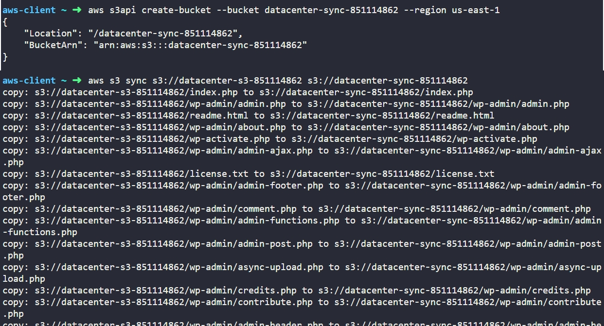
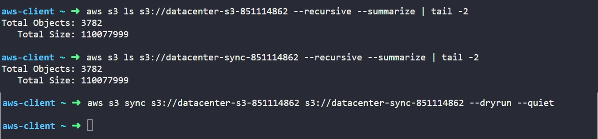

# Day 23: Data Migration Between S3 Buckets Using AWS CLI


## Objective
The objective is to create a new private Amazon S3 bucket named `datacenter-sync-851114862` in the `us-east-1` region and migrate all objects from an existing bucket named `datacenter-s3-851114862`. I used the AWS CLI to create the destination bucket, copy all data, and verify object count and total file size for 100% data consistency.


## 1. S3 Data Migration & Synchronization

Amazon S3 provides high-level commands to transfer large amounts of data directly between buckets:
- **`aws s3 cp --recursive`**: Copies every file, even if an identical file already exists at the destination.
- **`aws s3 sync`**: Compares files using their size and last-modified time. It transfers only new or updated objects, making large migrations faster and easier to resume if interrupted.

### Default Privacy
New S3 buckets have **Block Public Access enabled by default**, helping prevent public access. The bucket and its objects remain accessible to authorized identities according to their permissions.

### Verification Principles
To verify a migration, we need to check these three things:

1. **Total object count:** to confirm that both buckets contain the same number of objects.
2. **Total byte size:** to confirm that both buckets contain the same total amount of data. However, matching counts and sizes alone do not guarantee that every object's content is identical.
3. **Dry-run validation:** Run `aws s3 sync` with `--dryrun` to preview changes without copying anything. If there is no output, no copies or updates are needed.


## 2. Command Execution

### Step 1: Create the Target S3 Bucket
I created the new private destination bucket in `us-east-1`:

```bash
aws s3api create-bucket --bucket datacenter-sync-851114862 --region us-east-1
```

### Argument Breakdown:
* `aws s3api`: Calls low-level Amazon S3 management operations.
* `create-bucket`: The API action that creates a new S3 bucket.
* `--bucket datacenter-sync-851114862`: Sets the globally unique bucket name.
* `--region us-east-1`: Specifies the AWS region.

### Step 2: Migrate Data Between Buckets
I synced all files directly from the source bucket to the new target bucket:

```bash
aws s3 sync s3://datacenter-s3-851114862 s3://datacenter-sync-851114862
```

### Argument Breakdown:
* `aws s3 sync`: Synchronizes objects between two storage locations.
* `s3://datacenter-s3-851114862`: The source bucket containing the data.
* `s3://datacenter-sync-851114862`: The destination bucket receiving the data.

AWS performed the transfer directly inside the cloud infrastructure.

## 3. Verification

### CLI Verification
I ran summary counts on both buckets to verify object numbers and total storage volume matched:

```bash
# Check source bucket totals
aws s3 ls s3://datacenter-s3-851114862 --recursive --summarize | tail -2

# Check destination bucket totals
aws s3 ls s3://datacenter-sync-851114862 --recursive --summarize | tail -2
```

Output for both commands:
```text
Total Objects: 3782
   Total Size: 110077999
```

Both buckets contain 3,782 objects totaling 110,077,999 bytes.

Next, I executed a dry run synchronization check:

```bash
aws s3 sync s3://datacenter-s3-851114862 s3://datacenter-sync-851114862 --dryrun --quiet
```

* `--dryrun`: Simulates the command without copying files.
* `--quiet`: Hides informational messages and only prints file transfer actions.

Because the command returned no output, there are zero missing, modified, or desynchronized files between the two buckets.


## Result
I verified that the `datacenter-sync-851114862` S3 bucket was created and all 3,782 objects were successfully migrated from `datacenter-s3-851114862`.

## Screenshots

