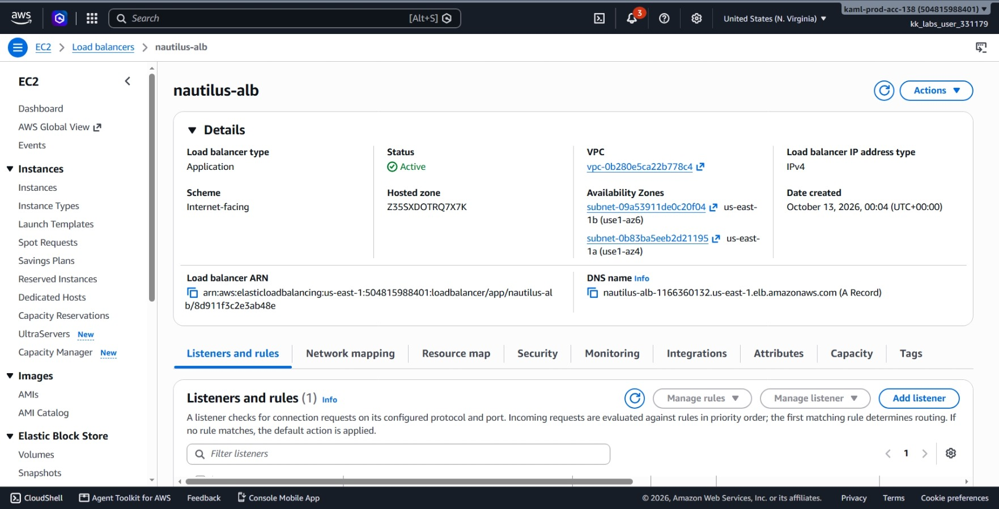
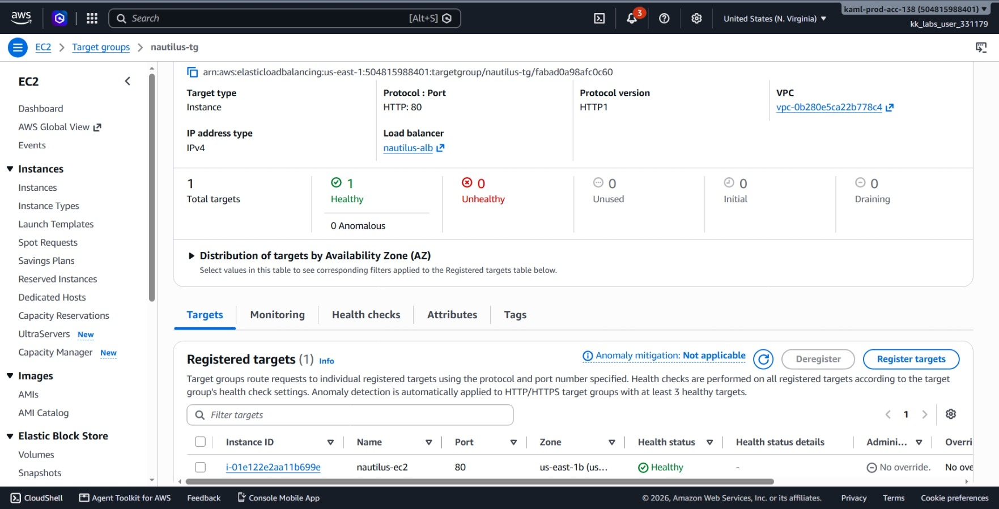
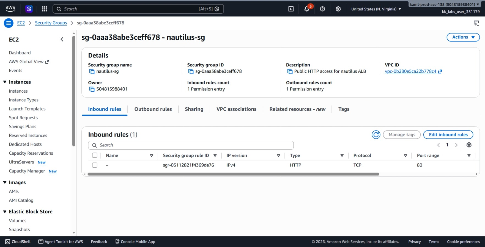
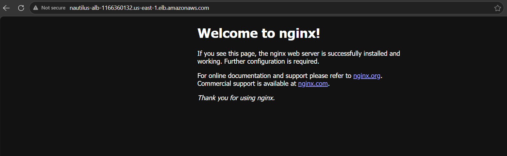
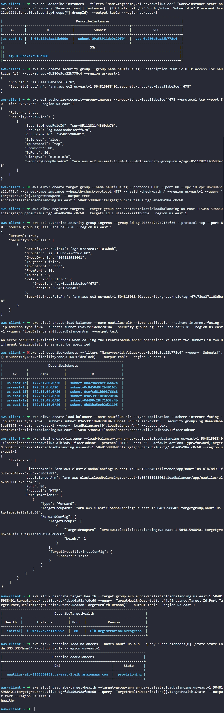

# Day 24: Setting Up an Application Load Balancer for an EC2 Instance


## Objective
The objective is to deploy an Application Load Balancer (ALB) named `nautilus-alb` in the `us-east-1` region to route public HTTP traffic on port 80 to an existing EC2 instance named `nautilus-ec2`. I created a dedicated security group for the load balancer, created and configured a target group, chained security group permissions between the ALB and the EC2 instance, and registered the instance as a healthy target.

## 1. Application Load Balancer (ALB) Architecture

An **Application Load Balancer (ALB)** operates at the application layer (Layer 7) of the OSI model to inspect incoming HTTP/HTTPS traffic and route it to backend targets.

## Core Components

1. **Load Balancer:** Receives incoming requests through a public DNS name and distributes traffic across Availability Zones.
2. **Listener:** Listens for incoming requests on a specific protocol and port (HTTP on port 80).
3. **Rules:** Define how the listener routes incoming traffic.
4. **Target Group:** Contains the targets (EC2 instances, IP addresses, or containers) that receive the traffic.
5. **Health Checks:** The ALB periodically sends HTTP requests to registered targets (e.g. path `/`). A target is marked `healthy` when it passes the configured health checks.

## High Availability

An internet-facing ALB requires at least two subnets in different Availability Zones (AZs). This helps keep the load balancer available if one AZ experiences an outage.

## Security Group Chaining

Instead of exposing the EC2 instance directly to the internet, I used **security group referencing**:

- **ALB security group:** Allows public inbound HTTP traffic on port 80 from `0.0.0.0/0`.
- **EC2 security group:** Allows inbound traffic on port 80 only from the ALB's security group.


## 2. Command Execution

### Step 1: Inspect the Target EC2 Instance
I retrieved the VPC, Subnet, Availability Zone, and Security Group details of `nautilus-ec2`:

```bash
aws ec2 describe-instances --filters "Name=tag:Name,Values=nautilus-ec2" "Name=instance-state-name,Values=running" --query 'Reservations[].Instances[].{ID:InstanceId,VPC:VpcId,Subnet:SubnetId,AZ:Placement.AvailabilityZone,SGs:SecurityGroups[*].GroupId}' --output table --region us-east-1
```

Found details:
* **Instance ID:** `i-01e122e2aa11b699e`
* **VPC ID:** `vpc-0b280e5ca22b778c4`
* **Subnet ID:** `subnet-09a53911de0c20f04` (in `us-east-1b`)
* **EC2 Security Group:** `sg-0158bd7a7c916cf80`


### Step 2: Create ALB Security Group
I created `nautilus-sg` and opened port 80 to the public:

```bash
# Create the security group
aws ec2 create-security-group --group-name nautilus-sg --description "Public HTTP access for nautilus ALB" --vpc-id vpc-0b280e5ca22b778c4 --region us-east-1

# Authorize public HTTP inbound
aws ec2 authorize-security-group-ingress --group-id sg-0aaa38abe3ceff678 --protocol tcp --port 80 --cidr 0.0.0.0/0 --region us-east-1
```

Created ALB Security Group ID: `sg-0aaa38abe3ceff678`


### Step 3: Create Target Group and Register Instance
I created the target group `nautilus-tg` on port 80 with health checks pointing to `/`, then registered the EC2 instance:

```bash
# Create target group
aws elbv2 create-target-group --name nautilus-tg --protocol HTTP --port 80 --vpc-id vpc-0b280e5ca22b778c4 --target-type instance --health-check-protocol HTTP --health-check-path / --region us-east-1 --query 'TargetGroups[0].TargetGroupArn' --output text

# Register the EC2 instance
aws elbv2 register-targets --target-group-arn arn:aws:elasticloadbalancing:us-east-1:504815988401:targetgroup/nautilus-tg/fabad0a98afc0c60 --targets Id=i-01e122e2aa11b699e --region us-east-1
```

Target Group ARN: `arn:aws:elasticloadbalancing:us-east-1:504815988401:targetgroup/nautilus-tg/fabad0a98afc0c60`


### Step 4: Allow ALB Ingress on the EC2 Instance
I updated the EC2 instance's security group so it accepts HTTP traffic sent from the ALB security group:

```bash
aws ec2 authorize-security-group-ingress --group-id sg-0158bd7a7c916cf80 --protocol tcp --port 80 --source-group sg-0aaa38abe3ceff678 --region us-east-1
```

* `--source-group`: Restricts inbound traffic on port 80 strictly to requests coming from `sg-0aaa38abe3ceff678`.


### Step 5: Create the Application Load Balancer
Because an ALB requires subnets in at least two different Availability Zones, I listed the subnets in the VPC:

```bash
aws ec2 describe-subnets --filters "Name=vpc-id,Values=vpc-0b280e5ca22b778c4" --query 'Subnets[].{ID:SubnetId,AZ:AvailabilityZone,CIDR:CidrBlock}' --output table --region us-east-1
```

I selected `subnet-09a53911de0c20f04` (`us-east-1b`) and `subnet-0b83ba5eeb2d21195` (`us-east-1a`) to create the load balancer:

```bash
aws elbv2 create-load-balancer --name nautilus-alb --type application --scheme internet-facing --ip-address-type ipv4 --subnets subnet-09a53911de0c20f04 subnet-0b83ba5eeb2d21195 --security-groups sg-0aaa38abe3ceff678 --region us-east-1 --query 'LoadBalancers[0].LoadBalancerArn' --output text
```

ALB ARN: `arn:aws:elasticloadbalancing:us-east-1:504815988401:loadbalancer/app/nautilus-alb/8d911f3c2e3ab48e`


### Step 6: Create the Listener
I configured a listener on port 80 to forward requests to the target group:

```bash
aws elbv2 create-listener --load-balancer-arn arn:aws:elasticloadbalancing:us-east-1:504815988401:loadbalancer/app/nautilus-alb/8d911f3c2e3ab48e --protocol HTTP --port 80 --default-actions Type=forward,TargetGroupArn=arn:aws:elasticloadbalancing:us-east-1:504815988401:targetgroup/nautilus-tg/fabad0a98afc0c60 --region us-east-1
```


## 3. Verification

### CLI Verification
I monitored the target health status and confirmed the ALB finished provisioning:

```bash
# Check target health state
aws elbv2 describe-target-health --target-group-arn arn:aws:elasticloadbalancing:us-east-1:504815988401:targetgroup/nautilus-tg/fabad0a98afc0c60 --query 'TargetHealthDescriptions[].TargetHealth.State' --output text --region us-east-1
```

Output:
```text
healthy
```

I also checked the load balancer status and DNS name:

```bash
aws elbv2 describe-load-balancers --names nautilus-alb --query 'LoadBalancers[0].{State:State.Code,DNS:DNSName}' --output table --region us-east-1
```

DNS Name assigned: `nautilus-alb-1166360132.us-east-1.elb.amazonaws.com`


### Console UI Verification
I confirmed the resources in the AWS Management Console:


1. **EC2 > Load Balancers:** Located `nautilus-alb`, confirmed **State** is **Active**, and verified the attached security group is `nautilus-sg`.




2. **EC2 > Target Groups:** Opened `nautilus-tg`, clicked the **Targets** tab, and verified `nautilus-ec2` (`i-01e122e2aa11b699e`) is listed with a **Health status** of **Healthy**.




3. **EC2 > Security Groups:** Selected `nautilus-sg` and confirmed the inbound rule shows **HTTP**, port **80**, and source **0.0.0.0/0**.




4. **Browser Verification:** Opened the ALB DNS name in a browser and confirmed the Nginx sample page loads successfully.




## Result
I verified that the `nautilus-alb` Application Load Balancer was successfully created and configured with the `nautilus-sg` security group. Traffic hitting the ALB on port 80 is forwarded to the `nautilus-tg` target group, where the backend `nautilus-ec2` instance is registered and healthy.

## Screenshots

