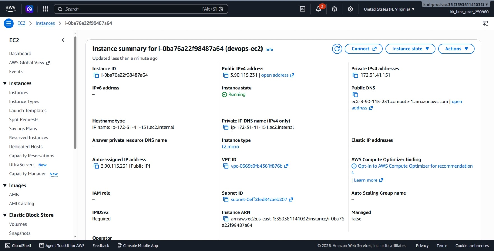
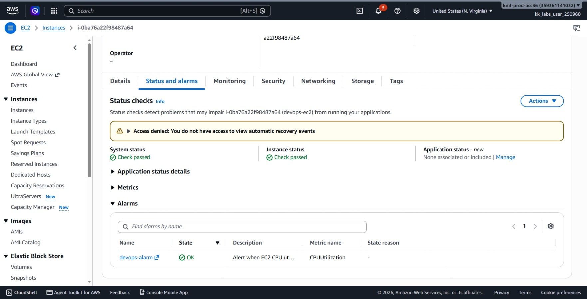
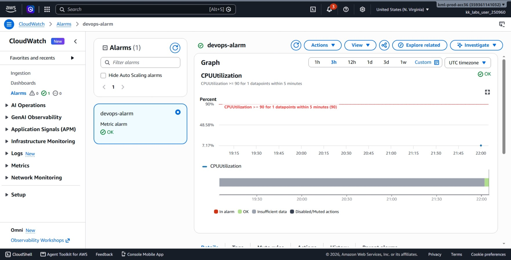
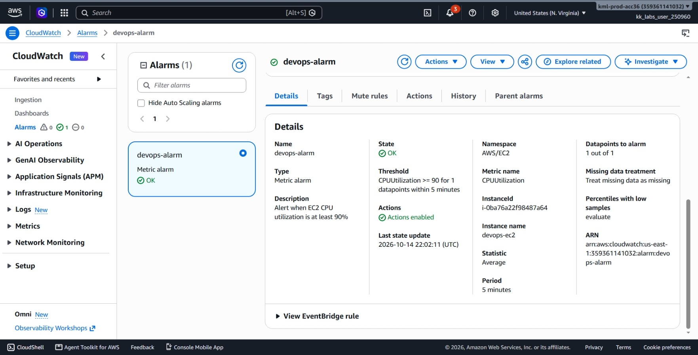
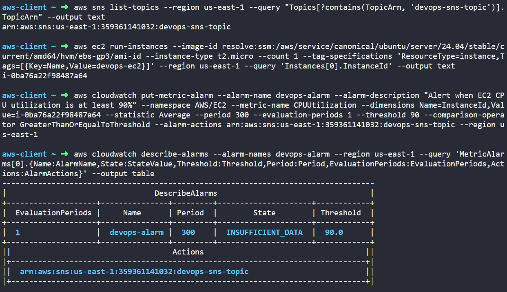

# Day 25: Setting Up an EC2 Instance and CloudWatch Alarm


## Objective

The objective is to launch an Ubuntu-based Amazon EC2 instance named `devops-ec2` (type `t2.micro`) and configure an automated CloudWatch alarm named `devops-alarm` in the `us-east-1` region using the AWS CLI. The alarm monitors the server's CPU utilization and publishes an alert to an existing SNS topic (`devops-sns-topic`) whenever average CPU usage reaches or exceeds 90% for a 5-minute period.


## 1. CloudWatch Metric Alarms

Amazon CloudWatch monitors AWS resources and applications in real time by collecting metrics and triggering automated actions.

### Core Concepts

1. **Metrics:** Data points emitted over time. For EC2, AWS automatically sends standard metrics to the `AWS/EC2` namespace, including `CPUUtilization`.
2. **Dimensions:** A dimension tells CloudWatch **which specific resource** a metric belongs to. For example, `InstanceId=i-123abc` means monitor CPU usage for this particular EC2 instance
3. **Period and Evaluation Periods:**
   * **Period (300 seconds):** The time window used to group metric data (5 minutes). Every 5 minutes, CloudWatch calculates one average CPU usage percentage from the measurements collected during those 5 minutes.
   * **Evaluation Periods (1):** How many consecutive 5-minute blocks must breach the threshold before changing the alarm state. Only one 5-minute block needs to breach the threshold to trigger the alarm.
    * **Example:** 
        * If the average CPU usage over one 5-minute block is 95%, the alarm triggers because 95% ≥ 90%.
        * If Evaluation Periods were `2`, CloudWatch would require **two consecutive 5-minute blocks** to breach the threshold (10 minutes total).
4. **Alarm States:**
   * `OK`: The metric is within acceptable limits.
   * `ALARM`: The metric has breached the defined threshold.
   * `INSUFFICIENT_DATA`: The alarm just started and is collecting its first data points.
5. **Alarm Actions:** Automated operations triggered when the state switches to `ALARM`. Linking an Amazon SNS topic ARN sends an email or notification immediately.


## 2. Command Execution

### Step 1: Find the Existing SNS Topic ARN
I queried AWS to find the Amazon Resource Name (ARN) of the pre-created SNS topic:

```bash
aws sns list-topics \
  --region us-east-1 \
  --query "Topics[?contains(TopicArn, 'devops-sns-topic')].TopicArn" \
  --output text
```

* `list-topics`: Lists notification topics in the region.
* `--query`: Filters the list to find the topic containing `devops-sns-topic` and outputs its ARN string.

Target Topic ARN: `arn:aws:sns:us-east-1:359361141032:devops-sns-topic`

### Step 2: Launch the Ubuntu EC2 Instance
I launched the instance using an SSM path to dynamically resolve the latest official Ubuntu 24.04 LTS AMI:

```bash
aws ec2 run-instances \
  --image-id resolve:ssm:/aws/service/canonical/ubuntu/server/24.04/stable/current/amd64/hvm/ebs-gp3/ami-id \
  --instance-type t2.micro \
  --count 1 \
  --tag-specifications 'ResourceType=instance,Tags=[{Key=Name,Value=devops-ec2}]' \
  --region us-east-1 \
  --query 'Instances[0].InstanceId' \
  --output text
```

### Argument Breakdown:
* `run-instances`: Launches a new EC2 virtual server.
* `--image-id resolve:ssm:...`: Automatically points to the newest stable Ubuntu 24.04 AMI.
* `--instance-type t2.micro`: Sets the hardware size to 1 vCPU and 1 GiB RAM.
* `--tag-specifications`: Assigns the name tag `devops-ec2` to the instance.

Created Instance ID: `i-0ba76a22f98487a64`

### Step 3: Create the CloudWatch Metric Alarm
I created the alarm and linked it to the instance ID and the SNS topic:

```bash
aws cloudwatch put-metric-alarm \
  --alarm-name devops-alarm \
  --alarm-description "Alert when EC2 CPU utilization is at least 90%" \
  --namespace AWS/EC2 \
  --metric-name CPUUtilization \
  --dimensions Name=InstanceId,Value=i-0ba76a22f98487a64 \
  --statistic Average \
  --period 300 \
  --evaluation-periods 1 \
  --threshold 90 \
  --comparison-operator GreaterThanOrEqualToThreshold \
  --alarm-actions arn:aws:sns:us-east-1:359361141032:devops-sns-topic \
  --region us-east-1
```

### Argument Breakdown:
* `put-metric-alarm`: Creates or updates a CloudWatch alarm.
* `--alarm-name devops-alarm`: Sets the alarm name.
* `--namespace AWS/EC2`: The AWS service reporting the data.
* `--metric-name CPUUtilization`: The specific performance counter to track.
* `--dimensions Name=InstanceId,Value=i-0ba76a22f98487a64`: Attaches the alarm directly to the instance.
* `--statistic Average`: Calculates the average value across each time slice.
* `--period 300`: Gathers data in 5-minute increments (300 seconds).
* `--evaluation-periods 1`: Triggers the alarm after 1 consecutive breaching period.
* `--threshold 90`: The trigger limit (90% CPU usage).
* `--comparison-operator GreaterThanOrEqualToThreshold`: Triggers if CPU is greater than or equal to 90%.
* `--alarm-actions`: The SNS topic that receives the alert.

## 3. Verification

### CLI Verification
I queried CloudWatch to confirm the alarm was created with all required parameters:

```bash
aws cloudwatch describe-alarms \
  --alarm-names devops-alarm \
  --region us-east-1 \
  --query 'MetricAlarms[0].{Name:AlarmName,State:StateValue,Threshold:Threshold,Period:Period,EvaluationPeriods:EvaluationPeriods Actions:AlarmActions}' \
  --output table
```

Output:
```text
-----------------------------------------------------------------------------------
|                                 DescribeAlarms                                  |
+--------------------+---------------+---------+---------------------+------------+
|  EvaluationPeriods |     Name      | Period  |        State        | Threshold  |
+--------------------+---------------+---------+---------------------+------------+
|  1                 |  devops-alarm |  300    |  INSUFFICIENT_DATA  |  90.0      |
+--------------------+---------------+---------+---------------------+------------+
||                                    Actions                                    ||
|+-------------------------------------------------------------------------------+|
||  arn:aws:sns:us-east-1:359361141032:devops-sns-topic                          ||
|+-------------------------------------------------------------------------------+|
```

The alarm is active and initialized in `INSUFFICIENT_DATA` while waiting for the first 5-minute metric cycle from the new instance.

### Console UI Verification

I confirmed the resources in the AWS Management Console:
1. **EC2 > Instances:**
   * Located `devops-ec2` (`i-0ba76a22f98487a64`).
   * Verified **Instance state** is **Running**.
   * Checked the **Alarm status** column to confirm `devops-alarm` is attached.





2. **CloudWatch > Alarms > All alarms:**
   * Opened `devops-alarm` and verified configuration:
     * **Metric:** `CPUUtilization`
     * **Statistic:** `Average`
     * **Period:** `5 minutes`
     * **Threshold:** `>= 90%`
     * **Datapoints to alarm:** `1 out of 1`
     * **Action:** Notifies `devops-sns-topic`





## Result
I verified that the `devops-ec2` Ubuntu instance is running in `us-east-1` and is actively monitored by the `devops-alarm` CloudWatch alarm. Both the AWS CLI and the AWS Management Console confirm the alarm monitors CPU utilization over 5-minute intervals and is connected to the `devops-sns-topic` SNS topic.

## Screenshots

