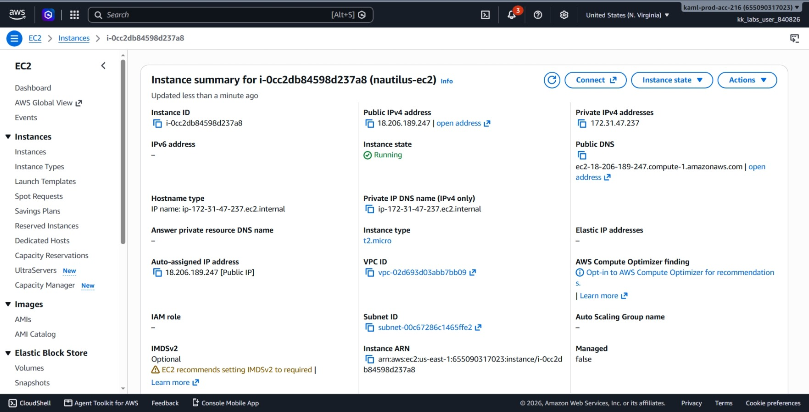
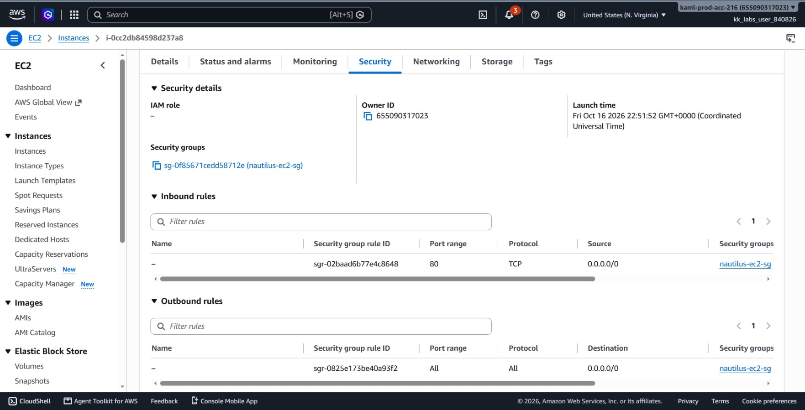
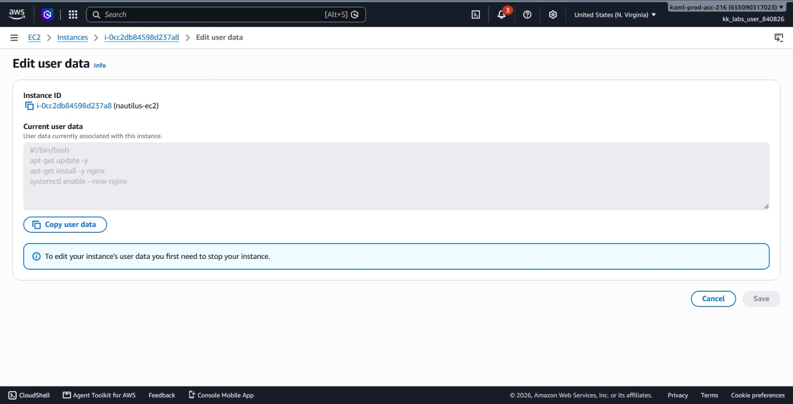
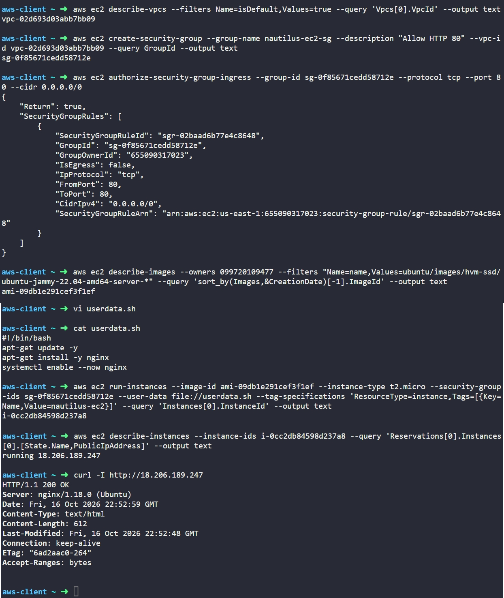

# Day 26: Configuring an EC2 Instance as a Web Server with Nginx

## Objective
The objective is to deploy an Ubuntu-based Amazon EC2 instance named `nautilus-ec2` (type `t2.micro`) and configure it automatically as an Nginx web server using EC2 User Data. I created a dedicated security group allowing inbound HTTP traffic on port 80 from the internet, passed an automated script during launch, and verified web accessibility using both the CLI and web browser.

## 1. EC2 User Data

EC2 User Data allows us to automate software installation and configuration when an instance starts up for the first time.

### Steps
1. **Execution on First Boot:** When an instance launches, the `cloud-init` service checks for user data. If a shell script starting with `#!/bin/bash` is provided, it executes automatically with `root` privileges.
2. **One-Time Run:** User data runs only during the initial launch cycle. It does not run on subsequent reboots unless specifically configured to do so.
3. **Hands-Off Setup:** Using user data eliminates the need to SSH into the instance to install basic dependencies like web servers or agents.

### Inbound Web Access
For clients on the internet to reach Nginx:
* The EC2 instance must reside in a public subnet with an assigned public IPv4 address.
* The attached security group must have an inbound rule allowing TCP traffic on port 80 from `0.0.0.0/0`.

## 2. Command Execution

### Step 1: Find the Default VPC ID
I retrieved the default VPC ID in the region to host the security group:

```bash
aws ec2 describe-vpcs \
  --filters Name=isDefault,Values=true \
  --query 'Vpcs[0].VpcId' \
  --output text
```

* `describe-vpcs`: Lists VPCs in the account.
* `--filters Name=isDefault,Values=true`: Targets the pre-configured default VPC.
* `--query 'Vpcs[0].VpcId'`: Extracts only the VPC ID string.

Target VPC ID: `vpc-02d693d03abb7bb09`

### Step 2: Create Security Group and Allow HTTP Port 80
I created a security group named `nautilus-ec2-sg` and opened inbound port 80 to the world:

```bash
# Create security group
aws ec2 create-security-group \
  --group-name nautilus-ec2-sg \
  --description "Allow HTTP 80" \
  --vpc-id vpc-02d693d03abb7bb09 \
  --query GroupId \
  --output text

# Add inbound rule for port 80
aws ec2 authorize-security-group-ingress \
  --group-id sg-0f85671cedd58712e \
  --protocol tcp \
  --port 80 \
  --cidr 0.0.0.0/0
```

* `create-security-group`: Creates the firewall container.
* `authorize-security-group-ingress`: Adds the rule allowing inbound TCP on port 80 from `0.0.0.0/0`.

Created Security Group ID: `sg-0f85671cedd58712e`

### Step 3: Find the Latest Ubuntu 22.04 AMI
I retrieved the newest official Ubuntu 22.04 LTS AMI ID owned by Canonical (`099720109477`):

```bash
aws ec2 describe-images \
  --owners 099720109477 \
  --filters "Name=name,Values=ubuntu/images/hvm-ssd/ubuntu-jammy-22.04-amd64-server-*" \
  --query 'sort_by(Images,&CreationDate)[-1].ImageId' \
  --output text
```

Found AMI ID: `ami-09db1e291cef3f1ef`

### Step 4: Create the User Data Script
I created a local script file named `userdata.sh` to update packages, install Nginx, and enable the service:

```bash
#!/bin/bash
apt-get update -y
apt-get install -y nginx
systemctl enable --now nginx
EOF
```

### Step 5: Launch the Instance with User Data
I launched the instance with the user data script attached:

```bash
aws ec2 run-instances \
  --image-id ami-09db1e291cef3f1ef \
  --instance-type t2.micro \
  --security-group-ids sg-0f85671cedd58712e \
  --user-data file://userdata.sh \
  --tag-specifications 'ResourceType=instance,Tags=[{Key=Name,Value=nautilus-ec2}]' \
  --query 'Instances[0].InstanceId' \
  --output text
```

### Argument Breakdown:
* `run-instances`: Launches the virtual machine.
* `--image-id ami-09db1e291cef3f1ef`: The Ubuntu 22.04 AMI.
* `--instance-type t2.micro`: Hardware size (1 vCPU, 1 GiB RAM).
* `--security-group-ids sg-0f85671cedd58712e`: Attaches the HTTP port 80 firewall rule.
* `--user-data file://userdata.sh`: Supplies the bootstrap script to run on launch.
* `--tag-specifications`: Names the instance `nautilus-ec2`.

Created Instance ID: `i-0cc2db84598d237a8`

## 3. Verification

### Console UI Verification
I confirmed the deployment in the AWS Management Console:
1. **EC2 > Instances:** Selected `nautilus-ec2` (`i-0cc2db84598d237a8`) and verified the **Instance state** is **Running**.




2. **Security Tab:** Verified `nautilus-ec2-sg` is attached with an inbound rule allowing **HTTP** on port **80** from source **0.0.0.0/0**.




3. **Actions > Instance settings > Edit user data:** Inspected the stored user data script and verified it contains the Nginx install commands.



4. **Browser Test:** Opened `http://18.206.189.247` in a web browser and verified the default "Welcome to nginx!" landing page loaded.


### CLI Verification
I queried the instance to ensure it entered the `running` state and retrieved its public IP address:

```bash
aws ec2 describe-instances \
  --instance-ids i-0cc2db84598d237a8 \
  --query 'Reservations[0].Instances[0].[State.Name,PublicIpAddress]' \
  --output text
```

Output:
```text
running 18.206.189.247
```

Next, I sent an HTTP request to the instance's public IP to verify Nginx was installed, started, and serving traffic:

```bash
curl -I http://18.206.189.247
```

Output:
```text
HTTP/1.1 200 OK
Server: nginx/1.18.0 (Ubuntu)
Date: Fri, 16 Oct 2026 22:52:59 GMT
Content-Type: text/html
Content-Length: 612
```

The `HTTP/1.1 200 OK` response proves that `cloud-init` executed the script successfully and Nginx is running.

## Result
I verified that the `nautilus-ec2` instance was launched in the default VPC with `nautilus-ec2-sg` attached. The user data script automatically installed and started Nginx during first boot, and the web server responded with `HTTP 200 OK` on public IP `18.206.189.247`.

## Screenshots
