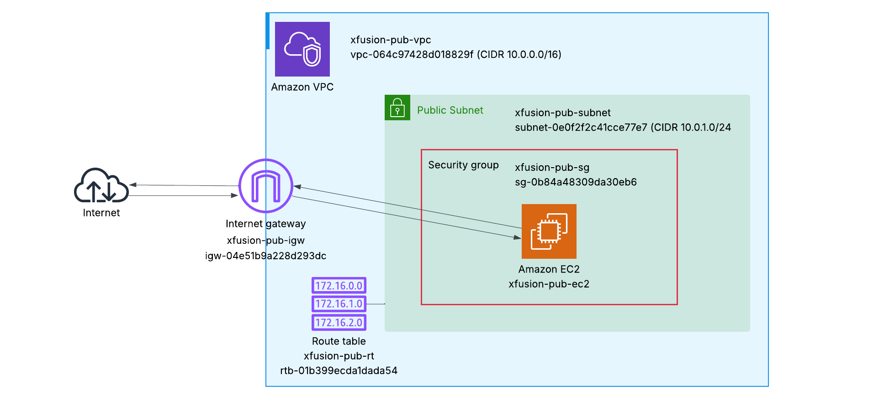
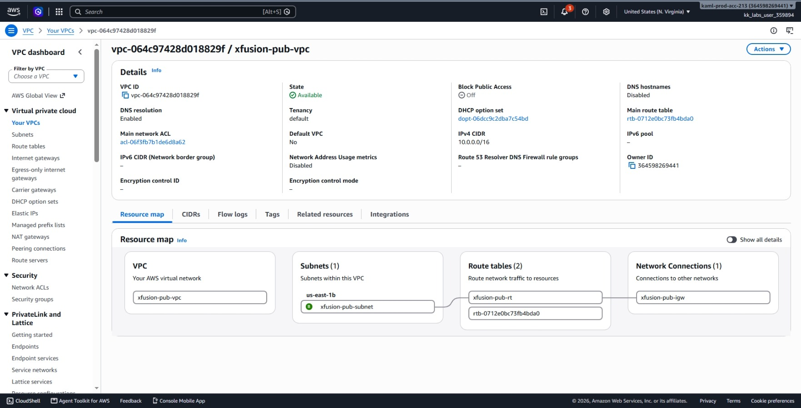
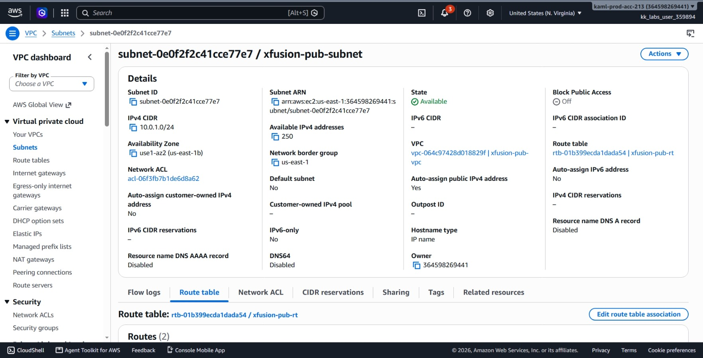
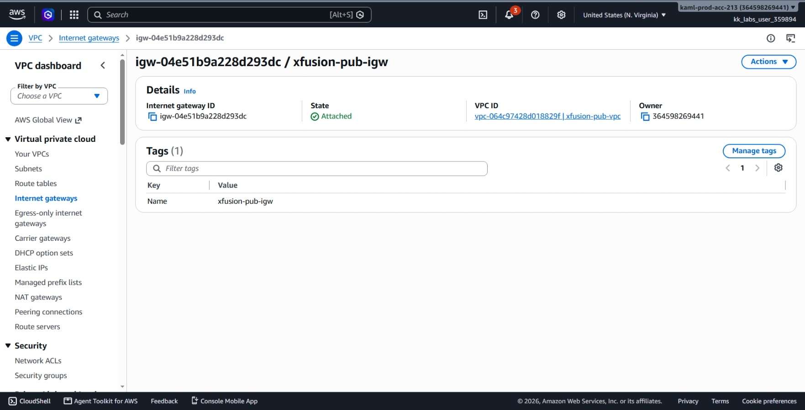
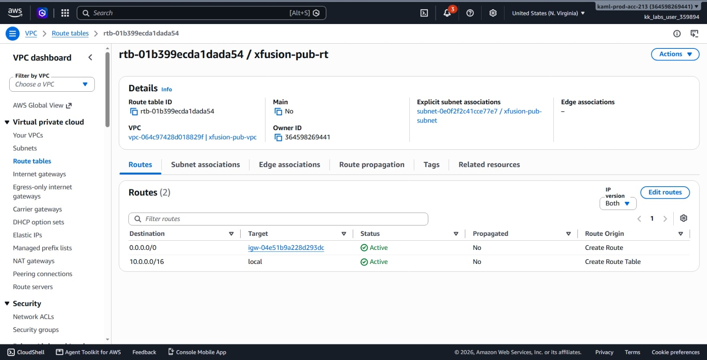
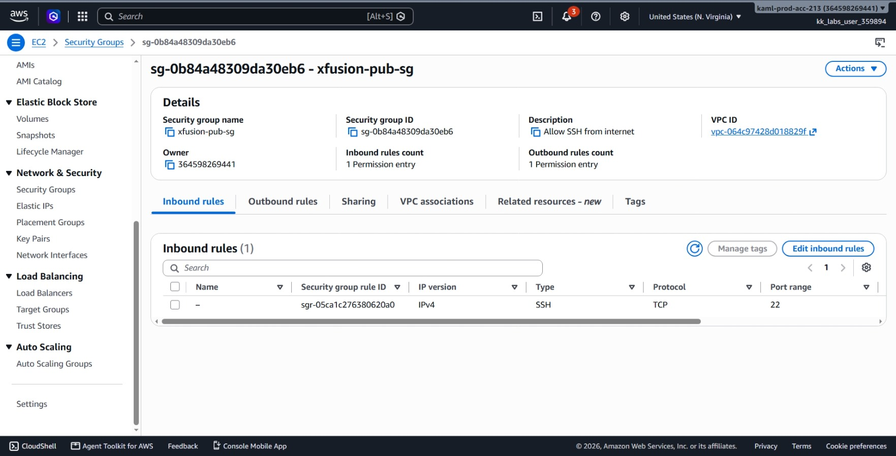
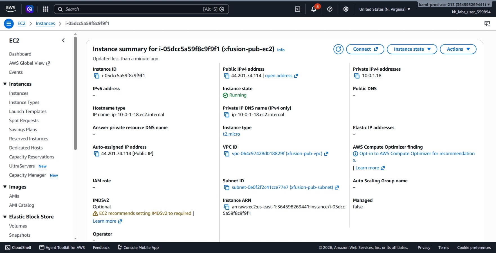
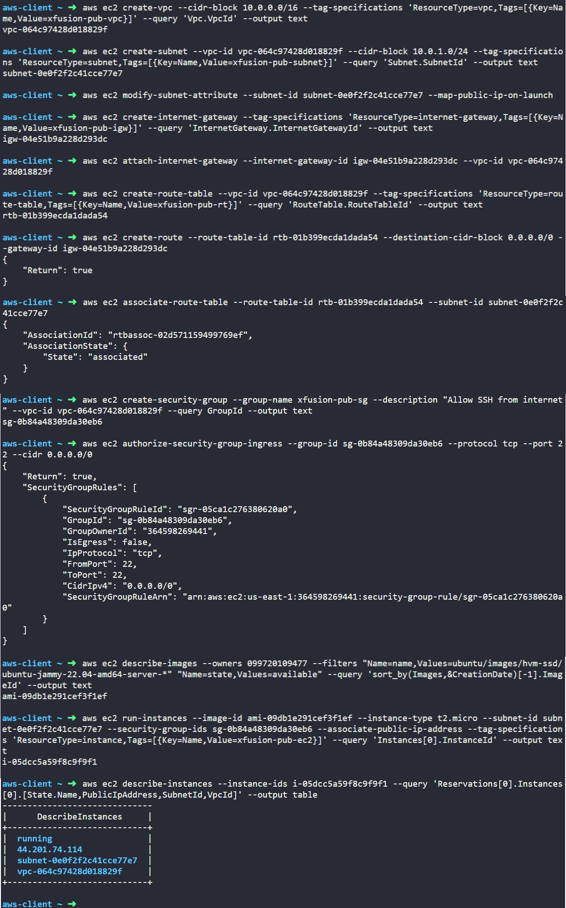

# Day 27: Configuring a Public VPC with an EC2 Instance for Internet Access

## Objective

The objective is to build a complete custom public cloud network from scratch in the `us-east-1` region. I created a custom VPC (`xfusion-pub-vpc`), a public subnet (`xfusion-pub-subnet`) with auto-assign public IP enabled, an Internet Gateway (`xfusion-pub-igw`), a custom route table (`xfusion-pub-rt`) routing internet traffic, a security group (`xfusion-pub-sg`) opening SSH port 22 to the world, and launched an Ubuntu EC2 instance (`xfusion-pub-ec2`) accessible over the internet.



## 1. Public VPC Architecture & Network Flow

In AWS, a custom VPC has no connection to the outside world by default. To make a subnet and an instance public, we must build the entire routing path ourselves.

### The Network Chain: VPC → Subnet → Internet Gateway → Route Table → Security Group → EC2

Each component has a specific role:
1. **VPC (`xfusion-pub-vpc`):** The isolated virtual network envelope with an internal private CIDR block (`10.0.0.0/16`).
2. **Subnet (`xfusion-pub-subnet`):** A smaller segment of that IP space (`10.0.1.0/24`) where the instance lives.
3. **Auto-Assign Public IP:** By default, custom subnets do not give instances public IPs. Enabling this setting ensures every instance launched here automatically gets a public IPv4 address.
4. **Internet Gateway (`xfusion-pub-igw`):** The physical link that connects the VPC to the public internet and performs network address translation (NAT).
5. **Route Table (`xfusion-pub-rt`):** The routing rules for the subnet. Adding a default route (`0.0.0.0/0`) pointing to the Internet Gateway turns a private subnet into a public subnet.
6. **Security Group (`xfusion-pub-sg`):** The virtual firewall attached to the instance that allows incoming traffic on port 22 (SSH).
7. **EC2 Instance (`xfusion-pub-ec2`):** The virtual server running inside the public subnet.

## 2. Build Strategy & Order of Operations

To build this public environment correctly, I executed the tasks in this exact order:
1. **Create the VPC:** Establish the primary `10.0.0.0/16` network.
2. **Create the Subnet:** Carve out the `10.0.1.0/24` range.
3. **Enable Public IP Assignment:** Configure the subnet attribute so instances receive public IPs automatically.
4. **Create & Attach the Internet Gateway:** Provide the gateway to the internet and attach it to the VPC.
5. **Create the Route Table, Add Route & Associate:** Direct internet-bound traffic (`0.0.0.0/0`) to the Internet Gateway, and attach this table to the subnet.
6. **Create the Security Group & Open SSH:** Authorize inbound TCP port 22 from `0.0.0.0/0`.
7. **Find AMI & Launch EC2:** Deploy the Ubuntu `t2.micro` instance into the configured public subnet.

## 3. Command Execution

### Step 1: Create the VPC
I created the custom VPC with a `10.0.0.0/16` CIDR block:

```bash
aws ec2 create-vpc \
  --cidr-block 10.0.0.0/16 \
  --tag-specifications 'ResourceType=vpc,Tags=[{Key=Name,Value=xfusion-pub-vpc}]' \
  --query 'Vpc.VpcId' \
  --output text
```

Created VPC ID: `vpc-064c97428d018829f`

### Step 2: Create the Subnet
I carved out the `10.0.1.0/24` subnet inside the newly created VPC:

```bash
aws ec2 create-subnet \
  --vpc-id vpc-064c97428d018829f \
  --cidr-block 10.0.1.0/24 \
  --tag-specifications 'ResourceType=subnet,Tags=[{Key=Name,Value=xfusion-pub-subnet}]' \
  --query 'Subnet.SubnetId' \
  --output text
```

Created Subnet ID: `subnet-0e0f2f2c41cce77e7`

### Step 3: Enable Automatic Public IP Assignment
I configured the subnet so all instances launched inside it automatically receive a public IPv4 address:

```bash
aws ec2 modify-subnet-attribute \
  --subnet-id subnet-0e0f2f2c41cce77e7 \
  --map-public-ip-on-launch
```

* `modify-subnet-attribute`: Updates subnet-level settings.
* `--map-public-ip-on-launch`: Turns on automatic public IP allocation.

### Step 4: Create and Attach the Internet Gateway
I created an Internet Gateway and attached it directly to `xfusion-pub-vpc`:

```bash
# Create the Internet Gateway
aws ec2 create-internet-gateway \
  --tag-specifications 'ResourceType=internet-gateway,Tags=[{Key=Name,Value=xfusion-pub-igw}]' \
  --query 'InternetGateway.InternetGatewayId' \
  --output text

# Attach it to the VPC
aws ec2 attach-internet-gateway \
  --internet-gateway-id igw-04e51b9a228d293dc \
  --vpc-id vpc-064c97428d018829f
```

Created IGW ID: `igw-04e51b9a228d293dc`

### Step 5: Create Route Table, Add Internet Route, and Associate Subnet
I created a custom route table, added a route sending all external traffic (`0.0.0.0/0`) through the Internet Gateway, and linked it to the subnet:

```bash
# Create the route table
aws ec2 create-route-table \
  --vpc-id vpc-064c97428d018829f \
  --tag-specifications 'ResourceType=route-table,Tags=[{Key=Name,Value=xfusion-pub-rt}]' \
  --query 'RouteTable.RouteTableId' \
  --output text

# Add the default route pointing to the Internet Gateway
aws ec2 create-route \
  --route-table-id rtb-01b399ecda1dada54 \
  --destination-cidr-block 0.0.0.0/0 \
  --gateway-id igw-04e51b9a228d293dc

# Associate the route table with the subnet
aws ec2 associate-route-table \
  --route-table-id rtb-01b399ecda1dada54 \
  --subnet-id subnet-0e0f2f2c41cce77e7
```

Created Route Table ID: `rtb-01b399ecda1dada54`

### Step 6: Create Security Group and Allow SSH
I created a security group in the custom VPC and opened port 22 to the public internet:

```bash
# Create security group
aws ec2 create-security-group \
  --group-name xfusion-pub-sg \
  --description "Allow SSH from internet" \
  --vpc-id vpc-064c97428d018829f \
  --query GroupId \
  --output text

# Authorize inbound SSH on port 22 from 0.0.0.0/0
aws ec2 authorize-security-group-ingress \
  --group-id sg-0b84a48309da30eb6 \
  --protocol tcp \
  --port 22 \
  --cidr 0.0.0.0/0
```

Created Security Group ID: `sg-0b84a48309da30eb6`

### Step 7: Find Latest Ubuntu 22.04 AMI
I looked up the newest official Ubuntu 22.04 LTS AMI ID:

```bash
aws ec2 describe-images \
  --owners 099720109477 \
  --filters "Name=name,Values=ubuntu/images/hvm-ssd/ubuntu-jammy-22.04-amd64-server-*" "Name=state,Values=available" \
  --query 'sort_by(Images,&CreationDate)[-1].ImageId' \
  --output text
```

Found AMI ID: `ami-09db1e291cef3f1ef`

### Step 8: Launch the EC2 Instance
I launched the instance inside the public subnet, attached the SSH security group, and enabled public IP association:

```bash
aws ec2 run-instances \
  --image-id ami-09db1e291cef3f1ef \
  --instance-type t2.micro \
  --subnet-id subnet-0e0f2f2c41cce77e7 \
  --security-group-ids sg-0b84a48309da30eb6 \
  --associate-public-ip-address \
  --tag-specifications 'ResourceType=instance,Tags=[{Key=Name,Value=xfusion-pub-ec2}]' \
  --query 'Instances[0].InstanceId' \
  --output text
```

Created Instance ID: `i-05dcc5a59f8c9f9f1`

## 4. Verification


### Console UI Verification

I confirmed each component in the AWS Management Console:

1. **VPC > Your VPCs:** Verified `xfusion-pub-vpc` exists with CIDR `10.0.0.0/16`.



2. **VPC > Subnets:** Verified `xfusion-pub-subnet` belongs to `xfusion-pub-vpc` and **Auto-assign public IPv4 address** is set to **Yes**.




3. **VPC > Internet gateways:** Verified `xfusion-pub-igw` shows **State** as **Attached** to `xfusion-pub-vpc`.



4. **VPC > Route tables:** Verified `xfusion-pub-rt` has a route for `0.0.0.0/0` targeting `igw-04e51b9a228d293dc`, and the subnet association lists `xfusion-pub-subnet`.




5. **EC2 > Security Groups:** Verified `xfusion-pub-sg` allows inbound **SSH (TCP port 22)** from `0.0.0.0/0`.




6. **EC2 > Instances:** Verified `xfusion-pub-ec2` is **Running**, uses type **t2.micro**, and has public IPv4 address `44.201.74.114`.




### CLI Verification
I queried the instance to ensure it entered the `running` state and received an auto-assigned public IPv4 address:

```bash
aws ec2 describe-instances \
  --instance-ids i-05dcc5a59f8c9f9f1 \
  --query 'Reservations[0].Instances[0].[State.Name,PublicIpAddress,SubnetId,VpcId]' \
  --output table
```

Output:
```text
------------------------------
|      DescribeInstances     |
+----------------------------+
|  running                   |
|  44.201.74.114             |
|  subnet-0e0f2f2c41cce77e7  |
|  vpc-064c97428d018829f     |
+----------------------------+
```

The output confirms:
* **State:** `running`
* **Public IP:** `44.201.74.114`
* **Subnet:** `subnet-0e0f2f2c41cce77e7` (`xfusion-pub-subnet`)
* **VPC:** `vpc-064c97428d018829f` (`xfusion-pub-vpc`)


## Result
I verified that the full public network stack (`VPC → Subnet → IGW → Route Table → Security Group → EC2`) was successfully built and tested. The `xfusion-pub-ec2` instance is running in `xfusion-pub-subnet` with an auto-assigned public IP address and port 22 open to the internet.

## Screenshots
