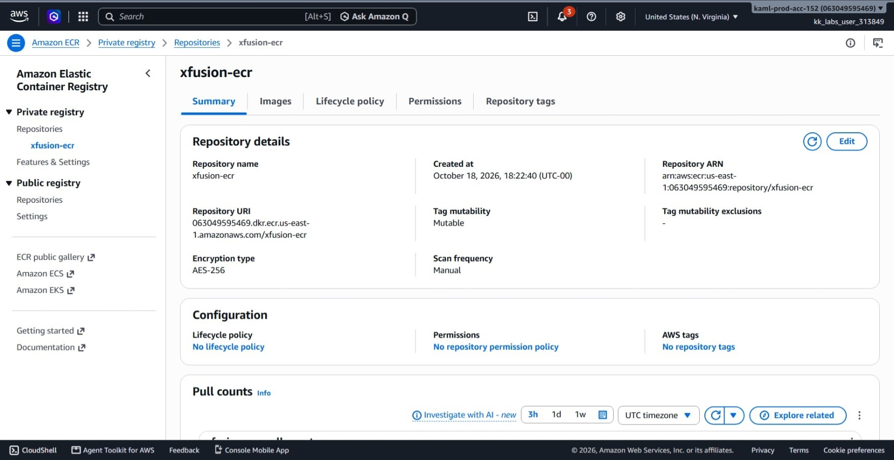
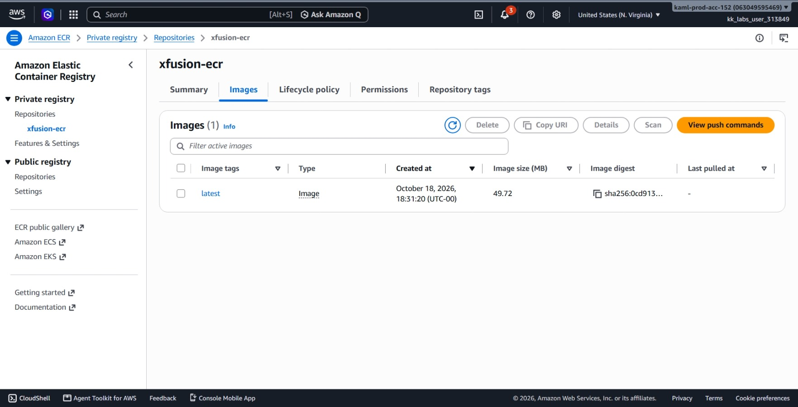
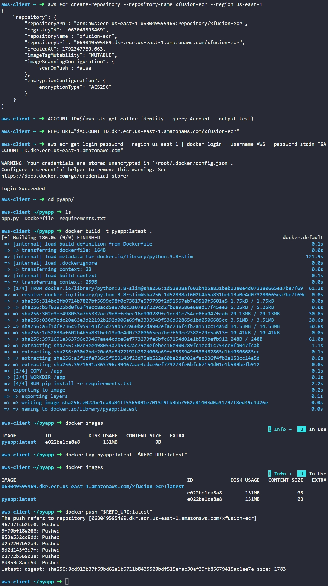

# Day 28: Creating a Private ECR Repository

## Objective
The objective is to create a private Amazon Elastic Container Registry (ECR) repository named `xfusion-ecr` in the `us-east-1` region using the AWS CLI. I then built a Docker image from a local Python application directory (`/root/pyapp`), authenticated Docker with AWS ECR, and pushed the image with the `latest` tag.

## 1. Amazon ECR: Registry vs. Repository

Amazon **Elastic Container Registry (ECR)** is an AWS-managed container image registry service.

### ECR Registry vs. ECR Repository
* **Private ECR Registry:** Our account's private container image registry, similar to a private **Docker Hub** account. It is tied to our AWS Account ID and a specific AWS Region.
    * Private by Default: Unlike public Docker Hub, a private ECR repository only allows pushes and pulls from authorized AWS IAM identities.
* **Public ECR Registry:** AWS's public container image registry, where images can be shared publicly and pulled by anyone.
* **ECR Repository:** A repository is a specific folder inside that registry created for one single application. We create one repository per application (for example, `xfusion-ecr` stores all version tags for this Python app).


### Docker Authentication to ECR
Docker does not natively know our AWS credentials. To connect:
1. I ran `aws ecr get-login-password` to retrieve a temporary authentication token from AWS.
2. I piped that token directly into `docker login`.
3. Once logged in, Docker has permission to push images directly to the ECR registry URI for 12 hours.

### Image Tagging for ECR
Docker needs to know the exact destination server when pushing. To push to ECR, the local image must be tagged with the full repository URI:
`<account_id>.dkr.ecr.<region>.amazonaws.com/<repository_name>:<tag>`


## 2. Command Execution

### Step 1: Create the Private ECR Repository
I created the `xfusion-ecr` repository in `us-east-1`:

```bash
aws ecr create-repository \
  --repository-name xfusion-ecr \
  --region us-east-1
```

* `create-repository`: Creates a new image repository inside your account's ECR registry.
* `--repository-name xfusion-ecr`: Names the application repository.

Created Repository URI: `063049595469.dkr.ecr.us-east-1.amazonaws.com/xfusion-ecr`

### Step 2: Authenticate Docker with Amazon ECR
I retrieved my AWS Account ID, stored the full repository URI, and authenticated the local Docker daemon:

```bash
# Get current AWS account ID
ACCOUNT_ID=$(aws sts get-caller-identity --query Account --output text)

# Store repository URI
REPO_URI="$ACCOUNT_ID.dkr.ecr.us-east-1.amazonaws.com/xfusion-ecr"

# Authenticate Docker against the ECR registry endpoint
aws ecr get-login-password --region us-east-1 | docker login --username AWS --password-stdin "$ACCOUNT_ID.dkr.ecr.us-east-1.amazonaws.com"
```

* `get-login-password`: Generates a temporary auth token.
* `docker login --password-stdin`: Passes the password securely without showing it in command history.

Result: `Login Succeeded`

### Step 3: Build the Docker Image Locally
I navigated to the application directory and built the image using the local `Dockerfile`:

```bash
cd pyapp/
docker build -t pyapp:latest .
```

* `docker build`: Packages the files in the directory into a container image.
* `-t pyapp:latest`: Tags the local image with the name `pyapp` and tag `latest`.
* `.`: Uses the current directory (`/root/pyapp`) as the build context.

### Step 4: Tag Image with the Remote ECR URI
I created a tag pointing from the local image to the remote ECR repository URI:

```bash
docker tag pyapp:latest "$REPO_URI:latest"
```

* `docker tag`: Creates an alias pointing to the existing image ID.
* `$REPO_URI:latest`: Sets the target destination to `063049595469.dkr.ecr.us-east-1.amazonaws.com/xfusion-ecr:latest`.

### Step 5: Push the Image to Amazon ECR
I pushed the tagged image layers to ECR:

```bash
docker push "$REPO_URI:latest"
```

* `docker push`: Uploads the container image layers to the remote registry.

All image layers were uploaded successfully with digest `sha256:0cd913b37f69bd62a1b5711b8435500bdf515efac30af39fb85679415ac1ee7e`.


## 3. Verification


### Console UI Verification
I confirmed the repository in the AWS Management Console:
1. Navigated to **Amazon ECR** > **Repositories**.
2. Located and clicked on `xfusion-ecr`.
3. Verified that an image with the tag **latest** exists in the repository list with status **Active**.






## Result
I verified that the private ECR repository `xfusion-ecr` was created in `us-east-1`. I built the application image from `/root/pyapp`, authenticated Docker to ECR, and pushed the image with the `latest` tag. Both the AWS CLI and AWS Management Console confirm the image is stored in ECR and ready for deployment.

## Screenshots

