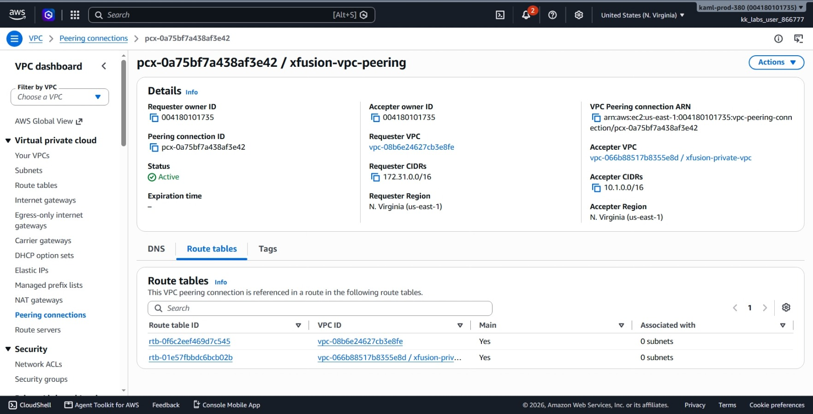
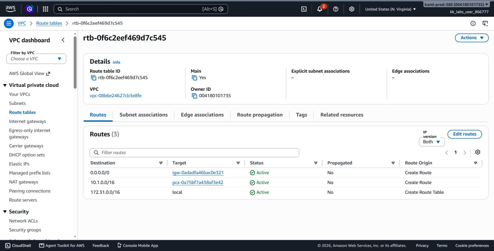
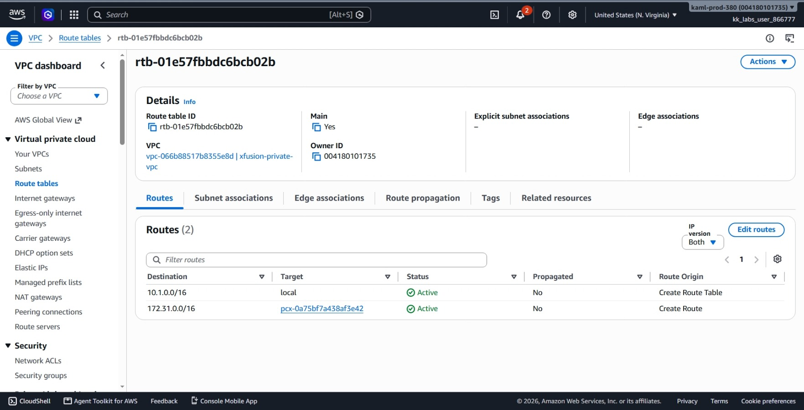
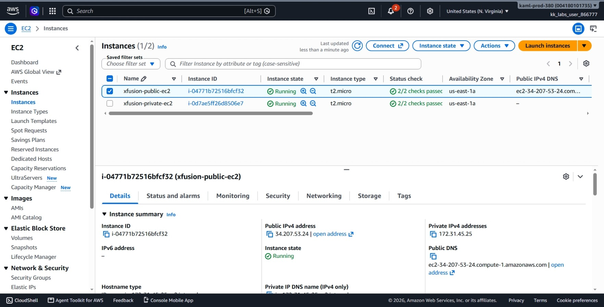
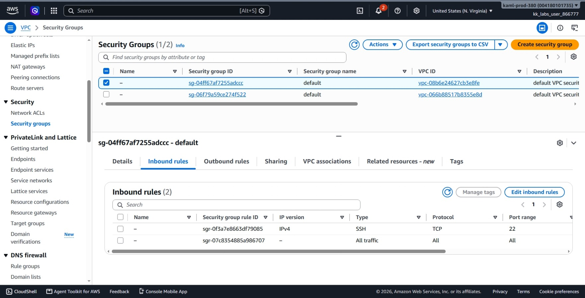
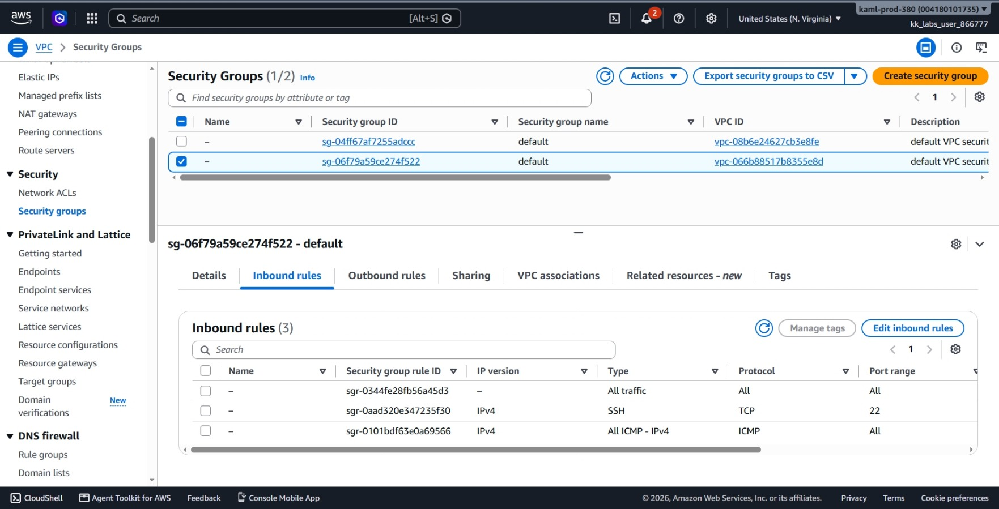

# Day 29: Establishing Secure Communication Between Public and Private VPCs via VPC Peering


## Objective
The objective is to establish private network communication between two isolated Virtual Private Clouds (VPCs) in the `us-east-1` region using an AWS VPC Peering Connection named `xfusion-vpc-peering`. I connected the default public VPC (`172.31.0.0/16`) to a private VPC named `xfusion-private-vpc` (`10.1.0.0/16`), configured route tables in both directions, adjusted security groups to permit ICMP and SSH traffic, authorized SSH keys on the public instance (`xfusion-public-ec2`), and verified connectivity by pinging the private instance (`xfusion-private-ec2`) from inside the public instance.

## 1. VPC Peering

**VPC Peering** is a direct network connection between two VPCs in AWS. It allows EC2 instances in different VPCs to talk to each other directly using private IP addresses.

### How It Works

1. **Private Traffic:** Traffic stays inside the AWS network. It does not travel over the public internet.
2. **Different IP Ranges:** The two VPCs must use different IP blocks (here, `172.31.0.0/16` and `10.1.0.0/16`). If the IP ranges match or overlap, AWS will not connect them.
3. **Two-Way Routes Needed:** Making the connection is not enough. We must add a route in the public route table pointing to the VPC peering connections, and a route in the private route table pointing also to the VPC peering connection. If either route is missing, traffic cannot travel both ways.
4. **Security Groups:** Security groups block incoming traffic by default. The private EC2 instance must have rules added to allow SSH and ping (ICMP) from the public VPC IP range (`172.31.0.0/16`).

## 2. Order of Steps

To connect the two VPCs and test the setup, I followed these steps in order:

1. **Get default VPC ID and CIDR:** Find the ID and network range (`172.31.0.0/16`) of the public VPC.
2. **Get private VPC ID and CIDR:** Find the ID and network range (`10.1.0.0/16`) of `xfusion-private-vpc`.
3. **Get route table ID for default VPC**
4. **Get route table ID for private VPC**
5. **Get security group ID of public EC2:** Find the security group protecting `xfusion-public-ec2`.
6. **Get security group ID of private EC2:** Find the security group protecting `xfusion-private-ec2`.
7. **Create VPC peering connection:** Request a peering connection between the two VPCs named `xfusion-vpc-peering`.
8. **Accept peering connection** so the connection status becomes active.
9. **Add route in default VPC route table:** Tell the public VPC to send `10.1.0.0/16` traffic through the peering connection.
10. **Add route in private VPC route table:** Tell the private VPC to send `172.31.0.0/16` traffic through the peering connection.
11. **Update private EC2 security group:** Allow SSH and ping (ICMP) traffic coming from the public VPC range (`172.31.0.0/16`).
12. **Update public EC2 security group:** Allow SSH access from the `aws-client` public IP.
13. **Get instance IP addresses:** Note the public IP of the public instance and the private IP of the private instance.
14. **Send SSH key via EC2 Instance Connect:** Push `/root/.ssh/id_rsa.pub` to the public instance for quick access.
15. **SSH into public EC2:** Connect from `aws-client` to `xfusion-public-ec2`.
16. **Save SSH key permanently:** Add the public key to `~/.ssh/authorized_keys` on the public EC2 instance.
17. **Set correct SSH file permissions:** Set `chmod 700` on `.ssh` and `chmod 600` on `authorized_keys`.
18. **Ping private EC2 from public EC2:** Run `ping 10.1.1.224` to confirm traffic travels across the peering link.
19. **Test SSH reconnect:** Disconnect and SSH back into the public instance to confirm the key login works permanently.

## 3. Command Execution

### Step 1 & 2: Identify VPC IDs and CIDR Blocks
I retrieved the network configurations for both the default public VPC and the private VPC:

```bash
# Get default VPC details
aws ec2 describe-vpcs \
  --filters Name=is-default,Values=true \
  --query 'Vpcs[*].[VpcId,CidrBlock]' \
  --output table

# Get private VPC details
aws ec2 describe-vpcs \
  --filters Name=tag:Name,Values=xfusion-private-vpc \
  --query 'Vpcs[*].[VpcId,CidrBlock]' \
  --output table
```

Found:
* **Default Public VPC:** `vpc-08b6e24627cb3e8fe` (`172.31.0.0/16`)
* **Private VPC (`xfusion-private-vpc`):** `vpc-066b88517b8355e8d` (`10.1.0.0/16`)

### Step 3 & 4: Retrieve Route Table IDs
I found the associated route table IDs for both VPCs:

```bash
# Default VPC route table
aws ec2 describe-route-tables \
  --filters Name=vpc-id,Values=vpc-08b6e24627cb3e8fe \
  --query 'RouteTables[*].RouteTableId' \
  --output table

# Private VPC route table
aws ec2 describe-route-tables \
  --filters Name=vpc-id,Values=vpc-066b88517b8355e8d \
  --query 'RouteTables[*].RouteTableId' \
  --output table
```

Found:
* **Public Route Table ID:** `rtb-0f6c2eef469d7c545`
* **Private Route Table ID:** `rtb-01e57fbbdc6bcb02b`

### Step 5 & 6: Inspect Instance IPs and Security Groups
I collected the network parameters and security group IDs for both servers:

```bash
# Public EC2 instance details
aws ec2 describe-instances \
  --filters Name=tag:Name,Values=xfusion-public-ec2 \
  --query 'Reservations[].Instances[].[InstanceId,PublicIpAddress,SecurityGroups[].GroupId]' \
  --output table

# Private EC2 instance details
aws ec2 describe-instances \
  --filters Name=tag:Name,Values=xfusion-private-ec2 \
  --query 'Reservations[].Instances[].[InstanceId,PrivateIpAddress,SecurityGroups[].GroupId]' \
  --output table
```

Found:
* **Public EC2:** `i-04771b72516bfcf32` | IP: `34.207.53.24` | SG: `sg-04ff67af7255adccc`
* **Private EC2:** `i-0d7ae5ff26d8506e7` | Private IP: `10.1.1.224` | SG: `sg-06f79a59ce274f522`

### Step 7 & 8: Create and Accept VPC Peering Connection
I created the peering request and accepted it immediately within the same AWS account:

```bash
# Create peering connection
aws ec2 create-vpc-peering-connection \
  --vpc-id vpc-08b6e24627cb3e8fe \
  --peer-vpc-id vpc-066b88517b8355e8d \
  --tag-specifications 'ResourceType=vpc-peering-connection,Tags=[{Key=Name,Value=xfusion-vpc-peering}]' \
  --query 'VpcPeeringConnection.VpcPeeringConnectionId' \
  --output text

# Accept peering connection
aws ec2 accept-vpc-peering-connection \
  --vpc-peering-connection-id pcx-0a75bf7a438af3e42
```

Created Peering ID: `pcx-0a75bf7a438af3e42`

### Step 9 & 10: Configure Two-Way Routing
I added routes in both route tables pointing to the peering connection:

```bash
# Add route to Private VPC (10.1.0.0/16) in Public Route Table
aws ec2 create-route \
  --route-table-id rtb-0f6c2eef469d7c545 \
  --destination-cidr-block 10.1.0.0/16 \
  --vpc-peering-connection-id pcx-0a75bf7a438af3e42

# Add route to Public VPC (172.31.0.0/16) in Private Route Table
aws ec2 create-route \
  --route-table-id rtb-01e57fbbdc6bcb02b \
  --destination-cidr-block 172.31.0.0/16 \
  --vpc-peering-connection-id pcx-0a75bf7a438af3e42
```

I checked the connection state to confirm it transitioned to active:

```bash
aws ec2 describe-vpc-peering-connections \
  --vpc-peering-connection-ids pcx-0a75bf7a438af3e42 \
  --query 'VpcPeeringConnections[0].Status.Code' \
  --output text
```

Output: `active`

### Step 11: Configure Ingress Rules on Private Instance
I authorized SSH and ICMP traffic coming from the public VPC CIDR (`172.31.0.0/16`) on `sg-06f79a59ce274f522`:

```bash
# Allow SSH from public VPC
aws ec2 authorize-security-group-ingress \
  --group-id sg-06f79a59ce274f522 \
  --protocol tcp \
  --port 22 \
  --cidr 172.31.0.0/16

# Allow ICMP (ping) from public VPC
aws ec2 authorize-security-group-ingress \
  --group-id sg-06f79a59ce274f522 \
  --protocol icmp \
  --port -1 \
  --cidr 172.31.0.0/16
```

### Step 12: Configure Ingress Rules on Public Instance
I retrieved the external IP of `aws-client` and allowed inbound SSH access to `sg-04ff67af7255adccc`: This authorizes aws-client to SSH into the public EC2 instance

```bash
# Check client external IP
curl -s https://checkip.amazonaws.com
# Result: 65.108.255.62

# Authorize SSH access from client IP
aws ec2 authorize-security-group-ingress \
  --group-id sg-04ff67af7255adccc \
  --protocol tcp \
  --port 22 \
  --cidr 65.108.255.62/32
```

### Step 13, 14, 15, 16 & 17: Authorize SSH Key on Public EC2
I pushed the public key temporarily via EC2 Instance Connect, connected into the server, and permanently appended the public key to `authorized_keys`:

```bash
# Send temporary public key
aws ec2-instance-connect send-ssh-public-key \
  --instance-id i-04771b72516bfcf32 \
  --availability-zone us-east-1a \
  --instance-os-user ec2-user \
  --ssh-public-key file:///root/.ssh/id_rsa.pub

# Permanently inject public key and set permissions
cat /root/.ssh/id_rsa.pub | ssh -i /root/.ssh/id_rsa ec2-user@34.207.53.24 \
  'mkdir -p ~/.ssh && chmod 700 ~/.ssh && cat >> ~/.ssh/authorized_keys && chmod 600 ~/.ssh/authorized_keys'
```

### Step 18 & 19: Test Peering Connection (Ping Private Instance)
I logged into the public EC2 instance and sent 4 ICMP ping packets across the peering connection to the private IP `10.1.1.224`:

```bash
# SSH into public instance
ssh -i /root/.ssh/id_rsa ec2-user@34.207.53.24

# Ping private EC2
ping -c 4 10.1.1.224
```

## 4. Verification


### Console UI Verification
I confirmed the infrastructure components in the AWS Management Console:
1. **VPC > Peering connections:** Located `xfusion-vpc-peering` (`pcx-0a75bf7a438af3e42`) and verified the status is **Active**.



2. **VPC > Route tables (Public):** Checked `rtb-0f6c2eef469d7c545` and verified a route exists for `10.1.0.0/16` targeting `pcx-0a75bf7a438af3e42`.




3. **VPC > Route tables (Private):** Checked `rtb-01e57fbbdc6bcb02b` and verified a route exists for `172.31.0.0/16` targeting `pcx-0a75bf7a438af3e42`.




4. **EC2 > Instances:** Confirmed both `xfusion-public-ec2` and `xfusion-private-ec2` show an instance state of **Running**.



5. **EC2 > Security Groups (Public):** Confirmed `sg-04ff67af7255adccc` has an inbound rule for **SSH (TCP 22)** from `65.108.255.62/32`.



6. **EC2 > Security Groups (Private):** Confirmed `sg-06f79a59ce274f522` has inbound rules for **SSH (TCP 22)** and **All ICMP - IPv4** from `172.31.0.0/16`.




### CLI Verification
The ping command from `xfusion-public-ec2` to `xfusion-private-ec2` confirmed full connectivity across the peering connection:

```text
PING 10.1.1.224 (10.1.1.224) 56(84) bytes of data.
64 bytes from 10.1.1.224: icmp_seq=1 ttl=127 time=4.48 ms
64 bytes from 10.1.1.224: icmp_seq=2 ttl=127 time=0.704 ms
64 bytes from 10.1.1.224: icmp_seq=3 ttl=127 time=0.832 ms
64 bytes from 10.1.1.224: icmp_seq=4 ttl=127 time=0.343 ms

--- 10.1.1.224 ping statistics ---
4 packets transmitted, 4 received, 0% packet loss, time 3084ms
rtt min/avg/max/mdev = 0.343/1.588/4.476/1.676 ms
```

All 4 packets were transmitted and received with 0% packet loss.


## Result
I verified that the `xfusion-vpc-peering` connection is active and both route tables allow bidirectional traffic between the public VPC (`172.31.0.0/16`) and private VPC (`10.1.0.0/16`). The security groups allow authorized access, and the public instance can successfully reach and ping the private instance at `10.1.1.224`.


```bash
aws-client ~ ➜  aws ec2 describe-vpcs --filters Name=is-default,Values=true --query 'Vpcs[*].[VpcId,CidrBlock]' --output table
|               DescribeVpcs               |
+------------------------+-----------------+
|  vpc-08b6e24627cb3e8fe |  172.31.0.0/16  |
+------------------------+-----------------+

aws-client ~ ➜  aws ec2 describe-vpcs --filters Name=tag:Name,Values=xfusion-private-vpc --query 'Vpcs[*].[VpcId,CidrBlock]' --output table
|              DescribeVpcs              |
+------------------------+---------------+
|  vpc-066b88517b8355e8d |  10.1.0.0/16  |
+------------------------+---------------+

aws-client ~ ➜  aws ec2 describe-route-tables --filters Name=vpc-id,Values=vpc-08b6e24627cb3e8fe --query 'RouteTables[*].RouteTableId' --output table
|   DescribeRouteTables   |
+-------------------------+
|  rtb-0f6c2eef469d7c545  |
+-------------------------+

aws-client ~ ➜  aws ec2 describe-route-tables --filters Name=vpc-id,Values=vpc-066b88517b8355e8d --query 'RouteTables[*].RouteTableId' --output table
|   DescribeRouteTables   |
+-------------------------+
|  rtb-01e57fbbdc6bcb02b  |
+-------------------------+

aws-client ~ ➜  aws ec2 describe-instances --filters Name=tag:Name,Values=xfusion-public-ec2 --query 'Reservations[].Instances[].[InstanceId,PublicIpAddress,SecurityGroups[].GroupId]' --output table
|    DescribeInstances   |
+------------------------+
|  i-04771b72516bfcf32   |
|  34.207.53.24          |
|  sg-04ff67af7255adccc  |
+------------------------+

aws-client ~ ➜  aws ec2 describe-instances --filters Name=tag:Name,Values=xfusion-private-ec2 --query 'Reservations[].Instances[].[InstanceId,PrivateIpAddress,SecurityGroups[].GroupId]' --output table
|    DescribeInstances   |
+------------------------+
|  i-0d7ae5ff26d8506e7   |
|  10.1.1.224            |
|  sg-06f79a59ce274f522  |
+------------------------+

aws-client ~ ➜  aws ec2 create-vpc-peering-connection --vpc-id vpc-08b6e24627cb3e8fe --peer-vpc-id vpc-066b88517b8355e8d --tag-specifications 'ResourceType=vpc-peering-connection,Tags=[{Key=Name,Value=xfusion-vpc-peering}]' --query 'VpcPeeringConnection.VpcPeeringConnectionId' --output text
pcx-0a75bf7a438af3e42

aws-client ~ ➜  aws ec2 accept-vpc-peering-connection --vpc-peering-connection-id pcx-0a75bf7a438af3e42
{
  "VpcPeeringConnection": {
    "AccepterVpcInfo": {
      "CidrBlock": "10.1.0.0/16",
      "CidrBlockSet": [
        {
          "CidrBlock": "10.1.0.0/16"
        }
      ],
      "OwnerId": "004180101735",
      "PeeringOptions": {
        "AllowDnsResolutionFromRemoteVpc": false,
        "AllowEgressFromLocalClassicLinkToRemoteVpc": false,
        "AllowEgressFromLocalVpcToRemoteClassicLink": false
      },
      "VpcId": "vpc-066b88517b8355e8d",
      "Region": "us-east-1"
    },
    "RequesterVpcInfo": {
      "CidrBlock": "172.31.0.0/16",
      "CidrBlockSet": [
        {
          "CidrBlock": "172.31.0.0/16"
        }
      ],
      "OwnerId": "004180101735",
      "PeeringOptions": {
        "AllowDnsResolutionFromRemoteVpc": false,
        "AllowEgressFromLocalClassicLinkToRemoteVpc": false,
        "AllowEgressFromLocalVpcToRemoteClassicLink": false
      },
      "VpcId": "vpc-08b6e24627cb3e8fe",
      "Region": "us-east-1"
    },
    "Status": {
      "Code": "provisioning",
      "Message": "Provisioning"
    },
    "Tags": [],
    "VpcPeeringConnectionId": "pcx-0a75bf7a438af3e42"
  }
}

aws-client ~ ➜  aws ec2 create-route --route-table-id rtb-0f6c2eef469d7c545 --destination-cidr-block 10.1.0.0/16 --vpc-peering-connection-id pcx-0a75bf7a438af3e42
{
    "Return": true
}

aws-client ~ ➜  aws ec2 create-route --route-table-id rtb-01e57fbbdc6bcb02b --destination-cidr-block 172.31.0.0/16 --vpc-peering-connection-id pcx-0a75bf7a438af3e42
{
    "Return": true
}

aws-client ~ ➜  aws ec2 describe-vpc-peering-connections --vpc-peering-connection-ids pcx-0a75bf7a438af3e42 --query 'VpcPeeringConnections[0].Status.Code' --output text
active

aws-client ~ ➜  aws ec2 authorize-security-group-ingress --group-id sg-06f79a59ce274f522 --protocol tcp --port 22 --cidr 172.31.0.0/16
{
  "Return": true,
  "SecurityGroupRules": [
    {
      "SecurityGroupRuleId": "sgr-0aad320e347235f30",
      "GroupId": "sg-06f79a59ce274f522",
      "GroupOwnerId": "004180101735",
      "IsEgress": false,
      "IpProtocol": "tcp",
      "FromPort": 22,
      "ToPort": 22,
      "CidrIpv4": "172.31.0.0/16",
      "SecurityGroupRuleArn": "arn:aws:ec2:us-east-1:004180101735:security-group-rule/sgr-0aad320e347235f30"
    }
  ]
}

aws-client ~ ➜  aws ec2 authorize-security-group-ingress --group-id sg-06f79a59ce274f522 --protocol icmp --port -1 --cidr 172.31.0.0/16
{
  "Return": true,
  "SecurityGroupRules": [
    {
      "SecurityGroupRuleId": "sgr-0101bdf63e0a69566",
      "GroupId": "sg-06f79a59ce274f522",
      "GroupOwnerId": "004180101735",
      "IsEgress": false,
      "IpProtocol": "icmp",
      "FromPort": -1,
      "ToPort": -1,
      "CidrIpv4": "172.31.0.0/16",
      "SecurityGroupRuleArn": "arn:aws:ec2:us-east-1:004180101735:security-group-rule/sgr-0101bdf63e0a69566"
    }
  ]
}

aws-client ~ ➜  curl -s https://checkip.amazonaws.com
65.108.255.62

aws-client ~ ➜  aws ec2 authorize-security-group-ingress --group-id sg-04ff67af7255adccc --protocol tcp --port 22 --cidr 65.108.255.62/32
{
  "Return": true,
  "SecurityGroupRules": [
    {
      "SecurityGroupRuleId": "sgr-0f3a7e8663df79085",
      "GroupId": "sg-04ff67af7255adccc",
      "GroupOwnerId": "004180101735",
      "IsEgress": false,
      "IpProtocol": "tcp",
      "FromPort": 22,
      "ToPort": 22,
      "CidrIpv4": "65.108.255.62/32",
      "SecurityGroupRuleArn": "arn:aws:ec2:us-east-1:004180101735:security-group-rule/sgr-0f3a7e8663df79085"
    }
  ]
}

aws-client ~ ➜  aws ec2-instance-connect send-ssh-public-key --instance-id i-04771b72516bfcf32 --availability-zone us-east-1a --instance-os-user ec2-user --ssh-public-key file:///root/.ssh/id_rsa.pub
{
    "RequestId": "4e28f87f-310e-4b20-9030-4752e6083a68",
    "Success": true
}

aws-client ~ ➜  cat /root/.ssh/id_rsa.pub | ssh -i /root/.ssh/id_rsa ec2-user@34.207.53.24 'mkdir -p ~/.ssh && chmod 700 ~/.ssh && cat >> ~/.ssh/authorized_keys && chmod 600 ~/.ssh/authorized_keys'
The authenticity of host '34.207.53.24 (34.207.53.24)' can't be established.
ECDSA key fingerprint is SHA256:wqMc89GCKc5SruZatjH4GTB4gqSvfpTJC+Tzl8886oI.
Are you sure you want to continue connecting (yes/no/[fingerprint])? yes
Warning: Permanently added '34.207.53.24' (ECDSA) to the list of known hosts.

aws-client ~ ➜  ssh -i /root/.ssh/id_rsa ec2-user@34.207.53.24
A newer release of "Amazon Linux" is available.
Version 2023.10.20260105:
Version 2023.10.20260120:
Version 2023.10.20260202:
Version 2023.10.20260216:
Version 2023.10.20260302:
Version 2023.10.20260325:
Version 2023.10.20260330:
Version 2023.11.20260406:
Version 2023.11.20260413:
Version 2023.11.20260427:
Version 2023.11.20260505:
Version 2023.11.20260509:
Version 2023.11.20260511:
Version 2023.11.20260514:
Version 2023.11.20260526:
Version 2023.12.20260608:
Version 2023.12.20260611:
Version 2023.12.20260622:
Version 2023.12.20260629:
Version 2023.12.20260706:
Version 2023.12.20260710:
Version 2023.12.20260720:
Version 2023.12.20260724:
Version 2023.12.20260727:
Version 2023.12.20260803:
Version 2023.12.20260817:
Version 2023.12.20260831:
Version 2023.12.20260909:
Version 2023.12.20260914:
Version 2023.12.20260917:
Version 2023.12.20260918:
Version 2023.12.20260928:
Version 2023.12.20260930:
Version 2023.12.20261012:
Version 2023.12.20261013:
Version 2023.12.20261014:
Version 2023.12.20261016:
Version 2023.5.20241001:
Version 2023.6.20241010:
Version 2023.6.20241028:
Version 2023.6.20241031:
Version 2023.6.20241111:
Version 2023.6.20241121:
Version 2023.6.20241212:
Version 2023.6.20250107:
Version 2023.6.20250115:
Version 2023.6.20250123:
Version 2023.6.20250128:
Version 2023.6.20250203:
Version 2023.6.20250211:
Version 2023.6.20250218:
Version 2023.6.20250303:
Version 2023.6.20250317:
Version 2023.7.20250331:
Version 2023.7.20250414:
Version 2023.7.20250428:
Version 2023.7.20250512:
Version 2023.7.20250527:
Version 2023.7.20250609:
Version 2023.7.20250623:
Version 2023.8.20250707:
Version 2023.8.20250715:
Version 2023.8.20250721:
Version 2023.8.20250808:
Version 2023.8.20250818:
Version 2023.8.20250908:
Version 2023.8.20250915:
Version 2023.9.20250929:
Version 2023.9.20251014:
Version 2023.9.20251020:
Version 2023.9.20251027:
Version 2023.9.20251105:
Version 2023.9.20251110:
Version 2023.9.20251117:
Version 2023.9.20251208:
Run "/usr/bin/dnf check-release-update" for full release and version update info
,     #_
_  ####_        Amazon Linux 2023
~~  _#####
~~     ###|
~~       #/ ___   https://aws.amazon.com/linux/amazon-linux-2023
~~       V' '->
~~~         /
~~._.   _/
_/ _/
_/m/'
[ec2-user@ip-172-31-45-25 ~]$ ping -c 4 10.1.1.224
PING 10.1.1.224 (10.1.1.224) 56(84) bytes of data.
64 bytes from 10.1.1.224: icmp_seq=1 ttl=127 time=4.48 ms
64 bytes from 10.1.1.224: icmp_seq=2 ttl=127 time=0.704 ms
64 bytes from 10.1.1.224: icmp_seq=3 ttl=127 time=0.832 ms
64 bytes from 10.1.1.224: icmp_seq=4 ttl=127 time=0.343 ms
--- 10.1.1.224 ping statistics ---
4 packets transmitted, 4 received, 0% packet loss, time 3084ms
rtt min/avg/max/mdev = 0.343/1.588/4.476/1.676 ms
[ec2-user@ip-172-31-45-25 ~]$
```