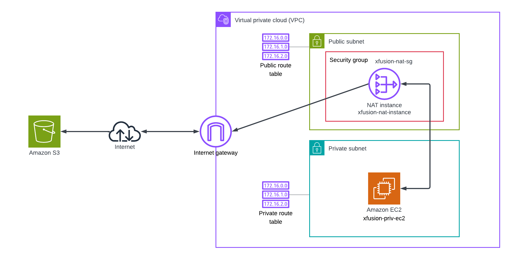
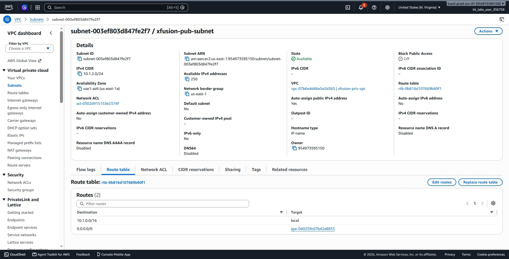
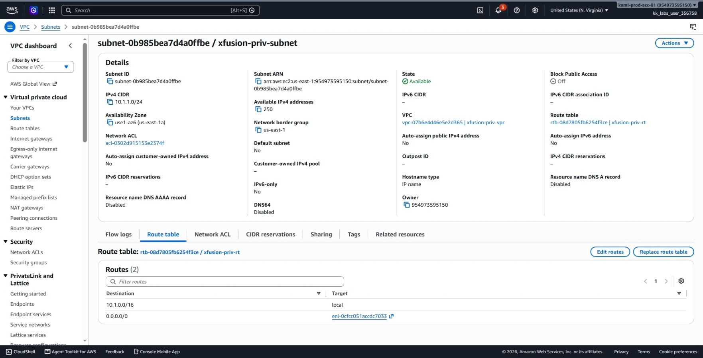
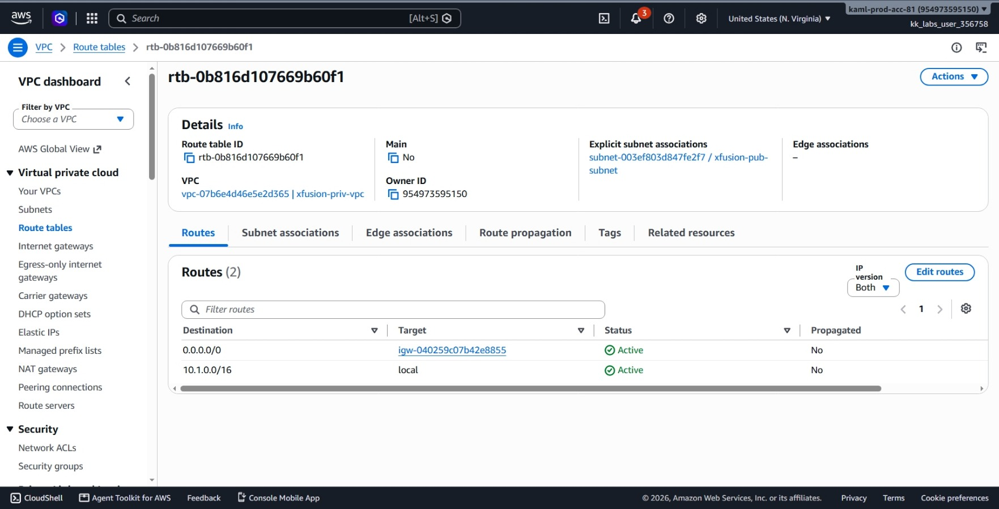
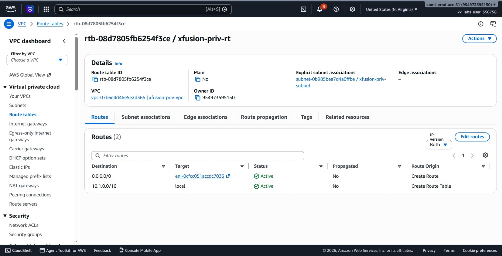
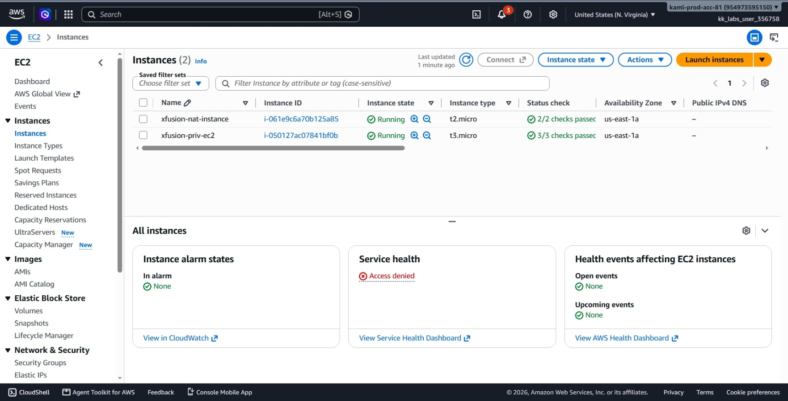
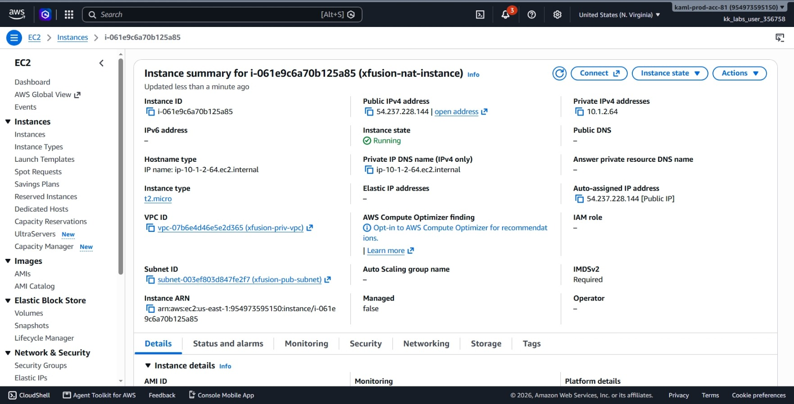
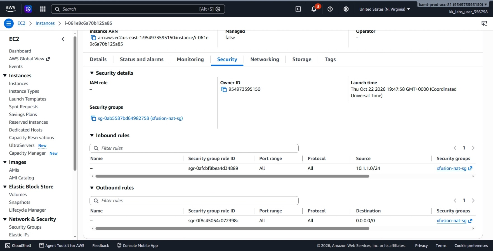
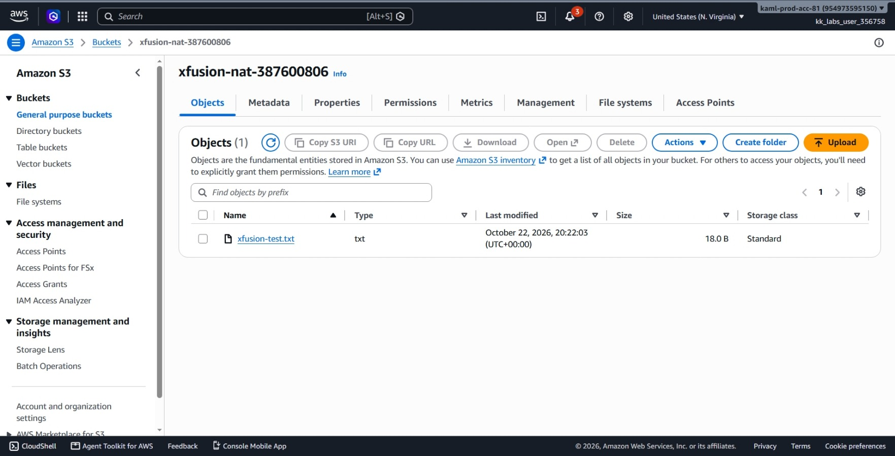
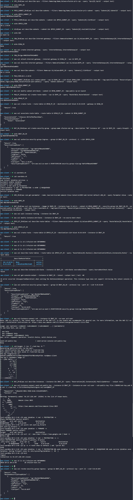

# Day 30: Enable Internet Access for Private EC2 using NAT Instance

## Objective
The objective is to provide outbound internet access to a private EC2 instance (`xfusion-priv-ec2`) existing in a private subnet without exposing it directly to the public internet. To keep costs low, I had to use a custom NAT Instance (`xfusion-nat-instance`) in a newly created public subnet instead of a managed NAT Gateway. I configured the network routing, adjusted AWS and Linux forwarding settings, troubleshot network interface naming issues, and verified success when the private instance through a cron job that runs every minute uploaded its test file to the target S3 bucket.




## 1. NAT Gateway vs. NAT Instance

Network Address Translation (NAT) allows servers inside a private subnet to make outbound requests to the internet (such as downloading updates or uploading data to an S3 bucket) while blocking anyone on the internet from connecting directly into those private servers.

### NAT Gateway vs. NAT Instance
* **NAT Gateway:** An AWS-managed service. It automatically scales, offers built-in high availability, and requires no operating system management. However, it comes with an hourly charge plus data processing costs.
* **NAT Instance:** A standard EC2 instance running Linux configured to forward traffic. It is much cheaper for small workloads, development labs, or low-traffic environments. However, we must configure the operating system, manage firewall rules, and maintain the instance ourselves.

### How Traffic Flows Through a NAT Instance
1. The private EC2 instance sends an outbound request destined for the internet (`0.0.0.0/0`).
2. The private subnet route table directs all internet-bound traffic to the NAT instance.
3. The NAT instance lives in a public subnet that has a route table directing traffic to the Internet Gateway (`igw`).
4. The NAT instance forwards the request out to the internet through the Internet Gateway, receives the response, and hands it back to the private EC2 instance.

### The 3 Required Settings for a NAT Instance
For an EC2 instance to forward traffic for other servers, three separate blockers must be resolved across two different layers:

1. **Source/Destination Check (AWS Layer):**
   * **Problem:** By default, AWS drops any network traffic reaching an instance if the instance is not the final destination address.
   * **Fix:** I disabled the Source/Destination check (`--no-source-dest-check`) on the NAT instance in AWS. This permits the instance to receive and handle packets meant for other servers.

2. **IP Forwarding (Linux Kernel Layer):**
   * **Problem:** By default, Linux drops any packet that is addressed to a different machine.
   * **Fix:** I set `net.ipv4.ip_forward = 1` inside the Linux kernel. This tells the operating system to act as a router and pass through incoming packets instead of discarding them.

3. **IP Masquerading (Linux Firewall Layer):**
   * **Problem:** The private EC2 instance has a private IP address (`10.1.1.x`). Servers on the public internet cannot send replies to private IPs.
   * **Fix:** I added an `iptables` rule using `MASQUERADE`. When traffic leaves the NAT instance toward the internet, this rule swaps the private sender IP with the NAT instance's own public IP address. When the reply comes back, the NAT instance remembers who asked and delivers the response back to the private EC2 instance.


## 2. Order of Steps

To build the NAT network and enable outbound internet for the private server, I followed these steps in order:

1. **Find Existing VPC & Private Subnet:** Get the IDs and network range for `xfusion-priv-vpc` and `xfusion-priv-subnet`.
2. **Check for an Internet Gateway:** Verify if the VPC has an attached Internet Gateway; create and attach one if missing.
3. **Create Public Subnet:** Create a new subnet (`xfusion-pub-subnet`) using an available IP block in the same Availability Zone.
4. **Enable Auto-Assign Public IP:** Configure the public subnet so instances launched inside (NAT) get public IPv4 addresses automatically.
5. **Create Public Route Table:** Add a default route (`0.0.0.0/0`) pointing to the Internet Gateway, and attach this table to the public subnet.
6. **Create NAT Security Group:** Create `xfusion-nat-sg` allowing all traffic coming from the private subnet CIDR.
7. **Write Bootstrap Script (User Data):** Prepare commands to install `iptables`, enable IP forwarding, and add the masquerade rule.
8. **Launch NAT Instance:** Deploy `xfusion-nat-instance` running Amazon Linux 2023 in the public subnet with a public IP.
9. **Turn Off Source/Destination Check:** Disable the AWS-level traffic check on the NAT instance.
10. **Update Private Route Table:** Add a route directing all internet traffic (`0.0.0.0/0`) from the private subnet to the NAT instance.
11. **Verify S3 Upload:** Confirm the private instance's automated cron job successfully uploads `xfusion-test.txt` to the S3 bucket.


## 3. Command Execution

### Step 1: Collect Existing VPC and Subnet Details
I gathered the IDs, CIDR block, and Availability Zone of the existing private infrastructure:

```bash
# Retrieve VPC ID
VPC_ID=$(aws ec2 describe-vpcs \
  --filters Name=tag:Name,Values=xfusion-priv-vpc \
  --query 'Vpcs[0].VpcId' \
  --output text)

# Retrieve Private Subnet ID
PRIV_SUBNET_ID=$(aws ec2 describe-subnets \
  --filters Name=tag:Name,Values=xfusion-priv-subnet \
  --query 'Subnets[0].SubnetId' \
  --output text)

# Retrieve Private CIDR and Availability Zone
PRIV_CIDR=$(aws ec2 describe-subnets \
  --subnet-ids $PRIV_SUBNET_ID \
  --query 'Subnets[0].CidrBlock' \
  --output text)

AZ=$(aws ec2 describe-subnets \
  --subnet-ids $PRIV_SUBNET_ID \
  --query 'Subnets[0].AvailabilityZone' \
  --output text)
```

Values found:
* **VPC ID:** `vpc-07b6e4d46e5e2d365`
* **Private Subnet ID:** `subnet-0b985bea7d4a0ffbe`
* **Private Subnet CIDR:** `10.1.1.0/24`
* **Availability Zone:** `us-east-1a`


### Step 2: Check, Create, and Attach Internet Gateway
I verified whether the VPC already had an Internet Gateway attached:

```bash
IGW_ID=$(aws ec2 describe-internet-gateways \
  --filters Name=attachment.vpc-id,Values=$VPC_ID \
  --query 'InternetGateways[0].InternetGatewayId' \
  --output text)
```

The output returned `None`. I created a new Internet Gateway and attached it to the VPC:

```bash
# Create Internet Gateway
IGW_ID=$(aws ec2 create-internet-gateway \
  --query 'InternetGateway.InternetGatewayId' \
  --output text)

# Attach Internet Gateway to VPC
aws ec2 attach-internet-gateway \
  --internet-gateway-id $IGW_ID \
  --vpc-id $VPC_ID
```

Created IGW ID: `igw-040259c07b42e8855`


### Step 3 & 4: Create Public Subnet and Enable Auto-Assign Public IP
I checked existing subnets in the VPC and chose `10.1.2.0/24` as a non-overlapping block in the same Availability Zone (`us-east-1a`):

```bash
# Create the public subnet
PUB_SUBNET_ID=$(aws ec2 create-subnet \
  --vpc-id $VPC_ID \
  --cidr-block 10.1.2.0/24 \
  --availability-zone $AZ \
  --tag-specifications 'ResourceType=subnet,Tags=[{Key=Name,Value=xfusion-pub-subnet}]' \
  --query 'Subnet.SubnetId' \
  --output text)

# Enable automatic public IP assignment
aws ec2 modify-subnet-attribute \
  --subnet-id $PUB_SUBNET_ID \
  --map-public-ip-on-launch
```

Created Public Subnet ID: `subnet-003ef803d847fe2f7`


### Step 5: Create Public Route Table and Associate Subnet
I created a route table for the public subnet that directs internet-bound traffic (`0.0.0.0/0`) to the Internet Gateway:

```bash
# Create route table
PUB_RT_ID=$(aws ec2 create-route-table \
  --vpc-id $VPC_ID \
  --query 'RouteTable.RouteTableId' \
  --output text)

# Add route to Internet Gateway
aws ec2 create-route \
  --route-table-id $PUB_RT_ID \
  --destination-cidr-block 0.0.0.0/0 \
  --gateway-id $IGW_ID

# Associate route table with public subnet
aws ec2 associate-route-table \
  --route-table-id $PUB_RT_ID \
  --subnet-id $PUB_SUBNET_ID
```

Created Public Route Table ID: `rtb-0b816d107669b60f1`


### Step 6: Create Security Group for NAT Instance
I created a security group named `xfusion-nat-sg` that allows all incoming traffic from the private subnet (`10.1.1.0/24`):

```bash
# Create security group
NAT_SG_ID=$(aws ec2 create-security-group \
  --group-name xfusion-nat-sg \
  --description "NAT instance SG" \
  --vpc-id $VPC_ID \
  --query GroupId \
  --output text)

# Authorize all protocols and ports from private subnet CIDR
aws ec2 authorize-security-group-ingress \
  --group-id $NAT_SG_ID \
  --protocol -1 \
  --cidr $PRIV_CIDR
```

Created Security Group ID: `sg-0ab5587bd64982758`


### Step 7: Create User Data Bootstrap Script
Amazon Linux 2023 does not come with `iptables` pre-installed. I prepared a startup script to install `iptables-services`, turn on IP forwarding, and add the masquerade rule:

```bash
cat << 'EOF' > userdata.sh
#!/bin/bash
yum install iptables-services -y
systemctl enable iptables
systemctl start iptables
sysctl -w net.ipv4.ip_forward=1
/sbin/iptables -t nat -A POSTROUTING -o eth0 -j MASQUERADE
/sbin/iptables -F FORWARD
service iptables save
EOF
```


### Step 8: Launch the NAT Instance
I retrieved the latest Amazon Linux 2023 AMI and launched the instance into the public subnet:

```bash
# Find AMI ID
AMI_ID=$(aws ssm get-parameter \
  --name /aws/service/ami-amazon-linux-latest/al2023-ami-kernel-default-x86_64 \
  --query Parameter.Value \
  --output text)

# Launch instance
NAT_ID=$(aws ec2 run-instances \
  --image-id $AMI_ID \
  --instance-type t2.micro \
  --subnet-id $PUB_SUBNET_ID \
  --security-group-ids $NAT_SG_ID \
  --associate-public-ip-address \
  --user-data file://userdata.sh \
  --tag-specifications 'ResourceType=instance,Tags=[{Key=Name,Value=xfusion-nat-instance}]' \
  --query 'Instances[0].InstanceId' \
  --output text)

# Wait for running state
aws ec2 wait instance-running --instance-ids $NAT_ID
```

Created Instance ID: `i-061e9c6a70b125a85`


### Step 9: Disable Source/Destination Check
I turned off the AWS-level source/destination check on the NAT instance so it can forward packets:

```bash
aws ec2 modify-instance-attribute \
  --instance-id $NAT_ID \
  --no-source-dest-check
```


### Step 10: Route Private Subnet Traffic to the NAT Instance
I located the route table associated with the private subnet and added a default route pointing all outbound internet traffic (`0.0.0.0/0`) to the NAT instance:

```bash
# Find private route table
PRIV_RT_ID=$(aws ec2 describe-route-tables \
  --filters Name=association.subnet-id,Values=$PRIV_SUBNET_ID \
  --query 'RouteTables[0].RouteTableId' \
  --output text)

# Add route pointing 0.0.0.0/0 to the NAT instance ID
aws ec2 create-route \
  --route-table-id $PRIV_RT_ID \
  --destination-cidr-block 0.0.0.0/0 \
  --instance-id $NAT_ID
```


## 4. Troubleshooting (The enX0 Interface Bug & Fix)

After completing the initial setup, I waited for the private EC2 instance's 1-minute cron job to upload `xfusion-test.txt` to the S3 bucket:

```bash
aws s3 ls s3://xfusion-nat-387600806/
```

The bucket remained completely empty across multiple checks. The private instance was still unable to access the internet. I started a step-by-step diagnosis.

### Checking AWS Layer Configuration
I confirmed that the AWS network path was properly configured:
1. Checked private route table: `0.0.0.0/0` pointed to the NAT instance ID and was marked `active`.
2. Checked instance attribute: `sourceDestCheck` was confirmed as `false`.

```bash
aws ec2 describe-route-tables \
  --route-table-ids $PRIV_RT_ID \
  --query 'RouteTables[0].Routes[].[DestinationCidrBlock,InstanceId,State]' \
  --output table

aws ec2 describe-instance-attribute \
  --instance-id $NAT_ID \
  --attribute sourceDestCheck \
  --query SourceDestCheck.Value
```

Both AWS settings were correct. This meant the failure was happening inside the Linux operating system on the NAT instance.

### Gaining SSH Access to the NAT Instance
To investigate inside the instance, I needed SSH access:
1. I added an inbound rule to `xfusion-nat-sg` allowing TCP port 22:
   ```bash
   aws ec2 authorize-security-group-ingress \
     --group-id $NAT_SG_ID \
     --protocol tcp \
     --port 22 \
     --cidr 0.0.0.0/0
   ```
2. I attempted to use `aws ec2-instance-connect ssh`, but this subcommand was not available in the installed CLI version.
3. To bypass this, I generated a local SSH key pair, pushed the public key using `send-ssh-public-key`, retrieved the instance public IP, and connected directly:
   ```bash
   # Generate key
   ssh-keygen -t rsa -f ~/nat-key -N ""

   # Get NAT instance public IP
   NAT_IP=$(aws ec2 describe-instances \
     --instance-ids $NAT_ID \
     --query 'Reservations[0].Instances[0].PublicIpAddress' \
     --output text)

   # Send public key and SSH in
   aws ec2-instance-connect send-ssh-public-key \
     --instance-id $NAT_ID \
     --instance-os-user ec2-user \
     --ssh-public-key file://$HOME/nat-key.pub

   ssh -i ~/nat-key -o StrictHostKeyChecking=no ec2-user@$NAT_IP
   ```

### Finding the Root Cause
Once inside the NAT instance, I inspected the active `iptables` NAT rules with packet counters:

```bash
sudo iptables -t nat -L POSTROUTING -n -v
```

Output:
```text
Chain POSTROUTING (policy ACCEPT 0 packets, 0 bytes)
 pkts bytes target     prot opt in     out     source               destination         
    0     0 MASQUERADE  all  --  *      eth0    0.0.0.0/0            0.0.0.0/0           
```

**Discovery:** The packet counter showed `0 packets, 0 bytes`. The rule was looking for an interface named `eth0`.

Next, I checked the actual default network interface used by the system:

```bash
ip -o -4 route show to default | awk '{print $5}'
```

Output:
```text
enX0
```

**The Bug:** On Amazon Linux 2023 under this virtual hardware type, the primary network interface is named **`enX0`**, not **`eth0`**. The standard script from AWS documentation hardcoded `eth0`. Because the outbound interface name did not match, the masquerade rule never triggered, and all forwarded traffic was dropped.


### Applying the Fix
I flushed the incorrect rule, added the masquerade rule targeting the real interface (`enX0`), and saved the firewall state:

```bash
sudo iptables -t nat -F POSTROUTING && \
sudo iptables -t nat -A POSTROUTING -o enX0 -j MASQUERADE && \
sudo service iptables save
```

Output:
`iptables: Saving firewall rules to /etc/sysconfig/iptables: [  OK  ]`

I exited the SSH session back to `aws-client`.

## 5. Verification

### CLI Verification
Within 60 seconds of applying the fix, the private instance's cron job ran again and successfully uploaded the file through the NAT instance:

```bash
aws s3 ls s3://xfusion-nat-387600806/
```

Output:
```text
2026-10-22 20:13:03         18 xfusion-test.txt
```

The presence of `xfusion-test.txt` confirms that `xfusion-priv-ec2` now has outbound internet access via the NAT instance.


### Console UI Verification

I confirmed each component in the AWS Management Console:
1. **VPC > Subnets:** Verified both `xfusion-priv-subnet` and `xfusion-pub-subnet` exist in the VPC and checked their route table associations.




2. **VPC > Route tables:**
   * Inspected the public route table: verified `0.0.0.0/0` points to `igw-040259c07b42e8855`.



   * Inspected the private route table: verified `0.0.0.0/0` points to the instance ID `i-061e9c6a70b125a85`.




3. **EC2 > Instances:** Confirmed both `xfusion-priv-ec2` and `xfusion-nat-instance` display an **Instance state** of **Running**.




4. **EC2 > Instances (NAT Details):** Selected `xfusion-nat-instance` and verified:
   * **Source/dest. check:** Displays as **Disabled**.
   * **Public IPv4 address:** Assigned and active.




5. **EC2 > NAT > Security > security group:**:
   * **Inbound rules:** Displays all traffic (`-1`) from `10.1.1.0/24` and SSH (port 22).
   * **Outbound rules:** Displays all traffic allowed to `0.0.0.0/0`.




6. **Amazon S3 > Buckets:** Opened `xfusion-nat-387600806` and confirmed that `xfusion-test.txt` is stored with status **Active**.




## Result
I verified that the NAT instance was deployed, configured, and troubleshot to resolve the `enX0` interface mismatch. The private EC2 instance successfully established outbound internet connectivity through the NAT instance and uploaded `xfusion-test.txt` to the S3 bucket.

## Screenshots
