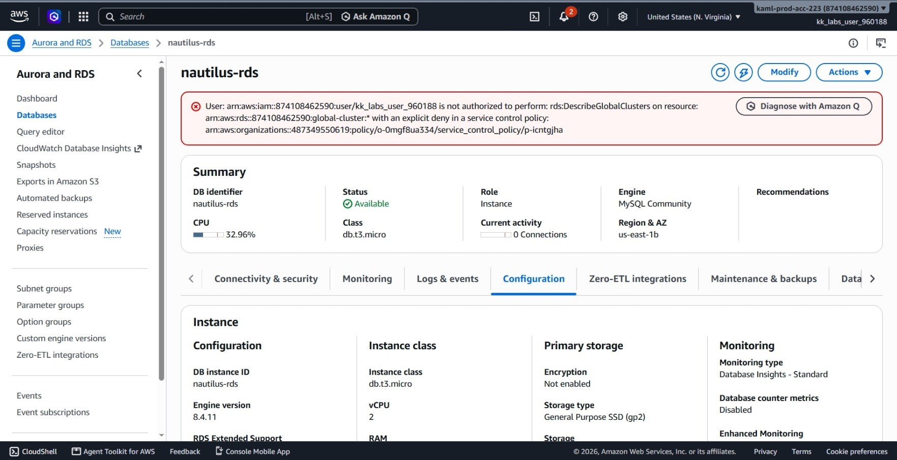
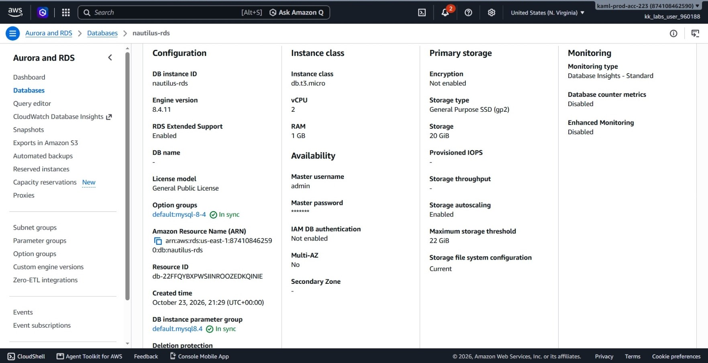
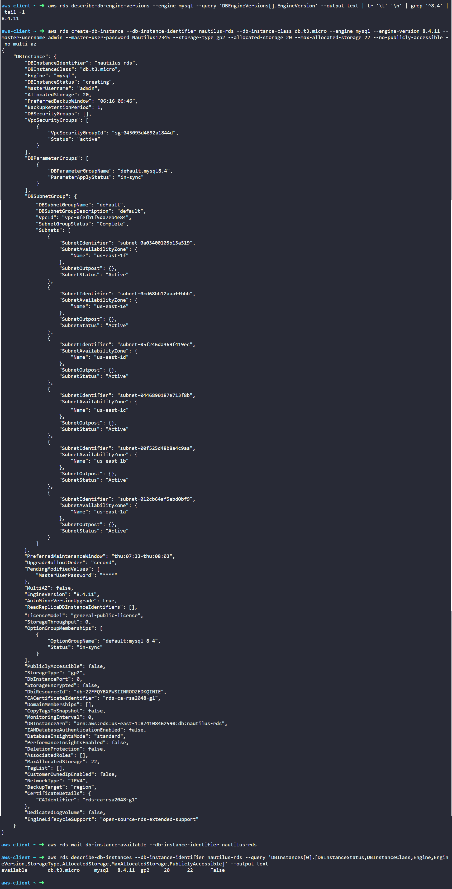

# Day 31: Configuring a Private RDS Instance for Application Development


## Objective
The objective is to provision a private MySQL Amazon Relational Database Service (RDS) instance named `nautilus-rds` using the AWS CLI. The database must use the Free Tier instance type `db.t3.micro`, run MySQL engine version 8.4.x, allocate 20 GiB of General Purpose SSD (gp2) storage, enable storage autoscaling up to 22 GiB, remain private with no public IP address, and reach the `available` state.


## 1. Amazon RDS, Subnet Groups, and Storage Autoscaling

Amazon **Relational Database Service (RDS)** is a managed service that sets up, operates, and scales relational databases in the cloud.

### What is a DB Subnet Group?
A **DB Subnet Group** is a collection of subnets that we define in our VPC. When we launch an RDS instance, we assign it to a subnet group. AWS then picks one of the subnets in that group to place the database's private network interface.

### Why RDS Requires Subnets in at Least Two Availability Zones
Even when we create a single, non-replicated database (`--no-multi-az`), AWS requires the DB subnet group to cover subnets in at least two different Availability Zones (AZs). 

AWS requires this so it has an alternate location available if it needs to move or restore the database during a hardware failure or maintenance window. Without subnets in multiple zones, AWS would be locked to a single physical datacenter.

### Relocation vs. Replication
Not to confuse a subnet group with database replication:
* **Replication:** Multiple copies of the database run at the same time in different zones (such as a Multi-AZ standby or read replicas).
* **Relocation:** AWS having an alternative network location ready in case it needs to restart or restore a single database elsewhere. A subnet group does not create multiple database copies; it only defines valid places where the database is allowed to run.

### Private Database Access (`--no-publicly-accessible`)
Setting public accessibility to `false` ensures the database does not receive a public IP address. It can only be reached by resources inside the same VPC (such as application EC2 instances or container workloads).

### Storage Autoscaling (`--max-allocated-storage`)
Storage autoscaling monitors disk capacity. If the database starts running low on disk space, AWS automatically adds storage without downtime up to the maximum limit I set (22 GiB).


## 2. Order of Steps

To provision and verify the private database, I followed these steps in order:

1. **Find Supported Engine Version:** Query AWS to find the exact available MySQL 8.4.x minor release.
2. **Create the DB Instance:** Run `create-db-instance` with `db.t3.micro`, `gp2` storage, autoscaling parameters, and public access disabled.
3. **Wait for Availability:** Monitor the database state until it transitions from `creating` to `available`.
4. **Verify Configuration:** Inspect the instance attributes using both the AWS CLI and the AWS Management Console.


## 3. Command Execution

### Step 1: Query the Latest MySQL 8.4 Engine Version
I checked which MySQL 8.4 version was supported in the region:

```bash
aws rds describe-db-engine-versions \
  --engine mysql \
  --query 'DBEngineVersions[].EngineVersion' \
  --output text | tr '\t' '\n' | grep '^8.4' | tail -1
```

* `describe-db-engine-versions`: Lists supported database engine builds.
* `--engine mysql`: Filters for the MySQL engine.
* `grep '^8.4'`: Finds releases starting with version 8.4.

Found Version: `8.4.11`

### Step 2: Create the Private RDS Instance
I launched the database with the required storage, credentials, and network isolation settings:

```bash
aws rds create-db-instance \
  --db-instance-identifier nautilus-rds \
  --db-instance-class db.t3.micro \
  --engine mysql \
  --engine-version 8.4.11 \
  --master-username admin \
  --master-user-password Nautilus12345 \
  --storage-type gp2 \
  --allocated-storage 20 \
  --max-allocated-storage 22 \
  --no-publicly-accessible \
  --no-multi-az
```

### Argument Breakdown:
* `create-db-instance`: Provisions a new RDS database instance.
* `--db-instance-identifier nautilus-rds`: The unique name of the database.
* `--db-instance-class db.t3.micro`: The compute size (2 vCPUs, 1 GiB RAM).
* `--engine mysql --engine-version 8.4.11`: The database engine type and release.
* `--master-username admin`: The master administrator login account.
* `--master-user-password Nautilus12345`: The master password.
* `--storage-type gp2`: General Purpose SSD storage.
* `--allocated-storage 20`: Sets initial storage capacity to 20 GiB.
* `--max-allocated-storage 22`: Enables storage autoscaling with a ceiling of 22 GiB.
* `--no-publicly-accessible`: Prevents assigning a public IP address to the database.
* `--no-multi-az`: Creates a single-instance database without standby replicas.

### Step 3: Wait for Creation to Finish
RDS instance provisioning takes several minutes while AWS sets up the underlying virtual machine, network interfaces, and disk storage. I waited for it to finish:

```bash
aws rds wait db-instance-available \
  --db-instance-identifier nautilus-rds
```

* `wait db-instance-available`: Pauses the terminal until the database status changes to `available`.

## 4. Verification


### Console UI Verification
I confirmed the database settings in the AWS Management Console:
1. Navigated to **RDS** > **Databases**.
2. Selected `nautilus-rds` and verified:
   * **Status:** Displays as **Available** (green indicator).
   * **Engine:** Displays as **MySQL Community 8.4.11**.
   * **Size:** Displays as **db.t3.micro**.
3. Checked the **Connectivity & security** tab:
   * **Publicly accessible:** Set to **No**.
   * **VPC:** Associated with default VPC and default DB Subnet Group.
4. Checked the **Configuration** tab:
   * **Storage type:** `General Purpose SSD (gp2)`.
   * **Allocated storage:** `20 GiB`.
   * **Storage autoscaling:** Enabled with maximum threshold set to `22 GiB`.





### CLI Verification
I queried the database configuration to verify the status, engine version, storage parameters, and access rules:

```bash
aws rds describe-db-instances \
  --db-instance-identifier nautilus-rds \
  --query 'DBInstances[0].[DBInstanceStatus,DBInstanceClass,Engine,EngineVersion,StorageType,AllocatedStorage,MaxAllocatedStorage,PubliclyAccessible]' \
  --output text
```

Output:
```text
available       db.t3.micro     mysql   8.4.11  gp2     20      22      False
```

The output confirms:
* **Status:** `available`
* **Class:** `db.t3.micro`
* **Engine:** `mysql` version `8.4.11`
* **Storage:** `gp2` with `20` GiB allocated and `22` GiB autoscaling maximum
* **Public Access:** `False` (private only)


## Result
I verified that the private RDS instance `nautilus-rds` was successfully created and reached the `available` state. Both the AWS CLI and the AWS Management Console confirm the instance uses MySQL 8.4.11 on a `db.t3.micro` class, has storage autoscaling configured from 20 GiB to 22 GiB, and is completely private with no public internet access.

## Screenshot
