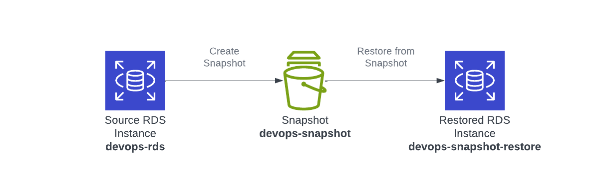
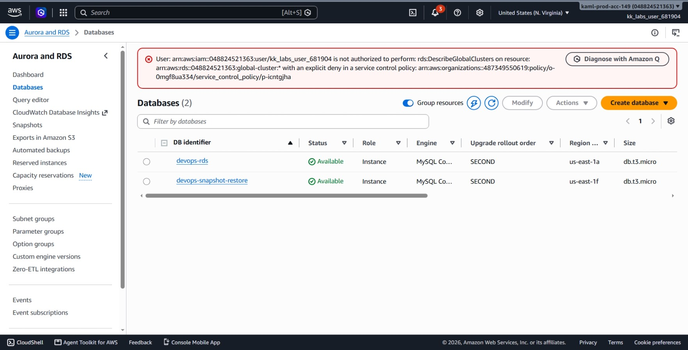
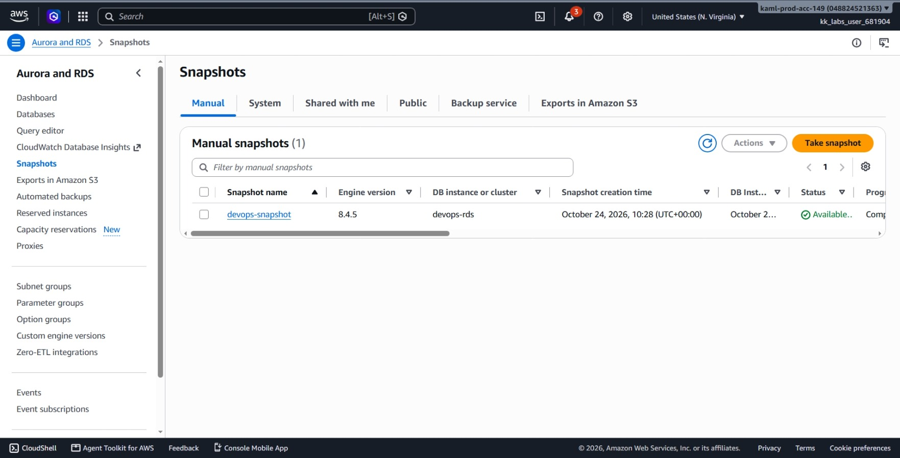
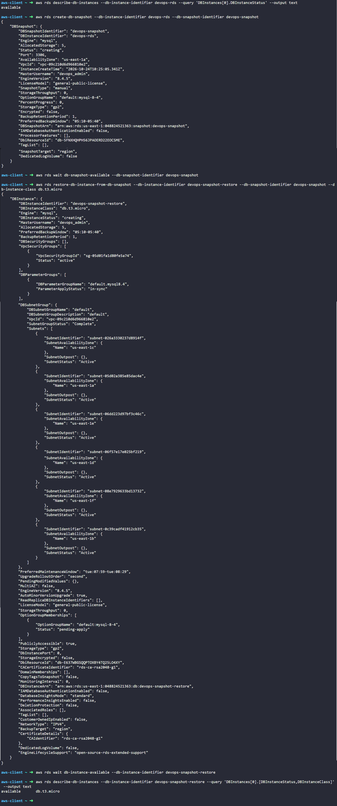

# Day 32: Snapshot and Restoration of an RDS Instance


## Objective
The objective is to back up an existing Amazon RDS MySQL instance named `devops-rds` by taking a manual snapshot named `devops-snapshot`, and then restore that snapshot into a new standalone database instance named `devops-snapshot-restore` with the instance class `db.t3.micro`. I used the AWS CLI to create the snapshot, launch the restored instance, and verify that both databases and the snapshot reached the `available` state.




## 1. RDS Snapshots and Restoration

A **snapshot** is a stored backup of the database data, not a running database server.

### Snapshot vs. Restored Instance
* **Snapshot:** Saved data sitting in storage. There is no active database server running, and it cannot take connections or queries.
* **Restored Instance:** A brand-new running database server created from that saved snapshot data.

### Storage-Level Copy
An RDS snapshot is a storage-level copy of our database. It is not an export into SQL commands or text files (unlike a `.sql` dump). The disk blocks, data, and database structure are saved exactly as they are.

### Where Snapshots Are Stored
The snapshot is stored in AWS-managed storage backed by Amazon S3. It is not stored inside our RDS instance's disk, and it does not show up as a normal bucket or file in our personal S3 account. AWS manages the backup storage for us.

### Reusable and Independent
Restoring a snapshot does not use it up or delete it:
* The snapshot stays in our account until we choose to delete it manually.
* We can restore the same snapshot multiple times to create different database instances (for example, for testing, staging, or debugging).


## 2. Order of Steps

To back up and restore the database, I followed these steps in order:

1. **Check Source Database:** Verify that `devops-rds` is in the `available` state before starting.
2. **Create the Snapshot:** Take a manual snapshot named `devops-snapshot` from `devops-rds`.
3. **Wait for Snapshot:** Pause until the snapshot finishes copying and reaches the `available` state.
4. **Restore to New Instance:** Create a new RDS instance named `devops-snapshot-restore` from the snapshot using class `db.t3.micro`.
5. **Wait for Instance:** Pause until the new restored database finishes launching and enters the `available` state.
6. **Verify Resources:** Confirm the state of both databases and the snapshot using the CLI and console UI.


## 3. Command Execution

### Step 1: Check Source Database Status
Before taking a snapshot, I checked that `devops-rds` was ready and not in maintenance or rebooting:

```bash
aws rds describe-db-instances \
  --db-instance-identifier devops-rds \
  --query 'DBInstances[0].DBInstanceStatus' \
  --output text
```

Output:
```text
available
```

### Step 2: Create the Database Snapshot
I initiated the manual snapshot of `devops-rds`:

```bash
aws rds create-db-snapshot \
  --db-instance-identifier devops-rds \
  --db-snapshot-identifier devops-snapshot
```

### Argument Breakdown:
* `create-db-snapshot`: The command that starts a manual backup of an RDS instance.
* `--db-instance-identifier devops-rds`: The source database being backed up.
* `--db-snapshot-identifier devops-snapshot`: The name assigned to the saved backup copy.

Status returned: `creating`

### Step 3: Wait for Snapshot to Become Available
The snapshot copies disk blocks in the background. I waited for the snapshot to complete:

```bash
aws rds wait db-snapshot-available \
  --db-snapshot-identifier devops-snapshot
```

* `wait db-snapshot-available`: Pauses the terminal until the snapshot status changes to `available`.

### Step 4: Restore Snapshot into a New RDS Instance
With the snapshot ready, I created the new database instance from the saved backup:

```bash
aws rds restore-db-instance-from-db-snapshot \
  --db-instance-identifier devops-snapshot-restore \
  --db-snapshot-identifier devops-snapshot \
  --db-instance-class db.t3.micro
```

### Argument Breakdown:
* `restore-db-instance-from-db-snapshot`: The command that creates a new running database from a snapshot.
* `--db-instance-identifier devops-snapshot-restore`: The name of the new database being created.
* `--db-snapshot-identifier devops-snapshot`: The source backup used to populate the new database.
* `--db-instance-class db.t3.micro`: Sets the compute size for the new instance.

Status returned: `creating`

### Step 5: Wait for Restored Instance to Become Available
Provisioning a new database from storage takes a few minutes. I paused until it was completely ready:

```bash
aws rds wait db-instance-available \
  --db-instance-identifier devops-snapshot-restore
```

* `wait db-instance-available`: Pauses until the restored database enters the `available` state.

## 4. Verification


### Console UI Verification
I confirmed the resources in the AWS Management Console:
1. **RDS > Databases:** 
   * Verified that both `devops-rds` and `devops-snapshot-restore` are listed.
   * Verified both instances show a **Status** of **Available** (green indicator).
   * Verified that `devops-snapshot-restore` has a **Size** of **db.t3.micro**.



2. **RDS > Snapshots:**
   * Switched to the **Manual** tab.
   * Located `devops-snapshot` and confirmed its **Status** displays as **Available**.




### CLI Verification
I queried the restored database to confirm its status and instance class:

```bash
aws rds describe-db-instances \
  --db-instance-identifier devops-snapshot-restore \
  --query 'DBInstances[0].[DBInstanceStatus,DBInstanceClass]' \
  --output text
```

Output:
```text
available       db.t3.micro
```

The output confirms:
* **Status:** `available`
* **Class:** `db.t3.micro`


## Result
I verified that the manual snapshot `devops-snapshot` was taken from `devops-rds` and saved successfully. I then restored that snapshot into a new standalone instance named `devops-snapshot-restore` running on a `db.t3.micro` class. Both the AWS CLI and the AWS Management Console confirm that both database instances and the snapshot are in the `available` state.

## Screenshots
