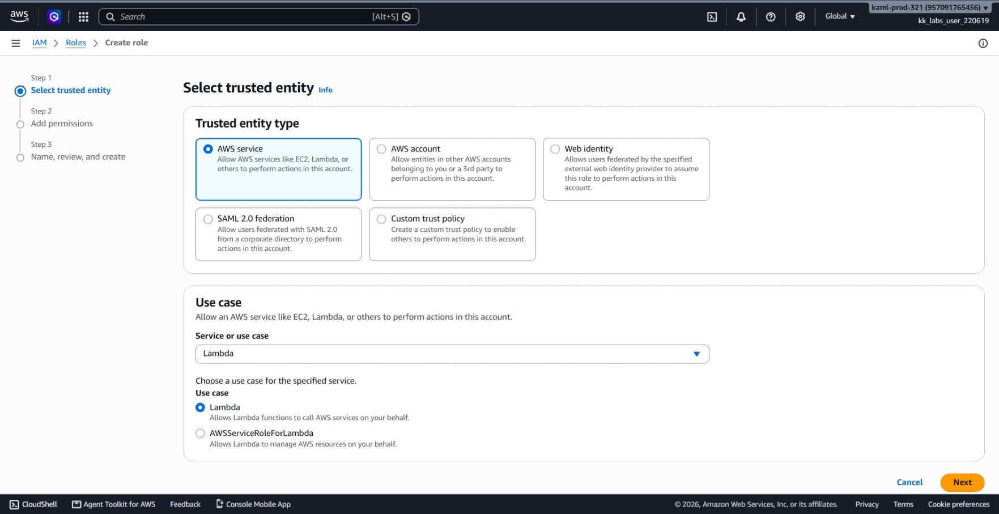
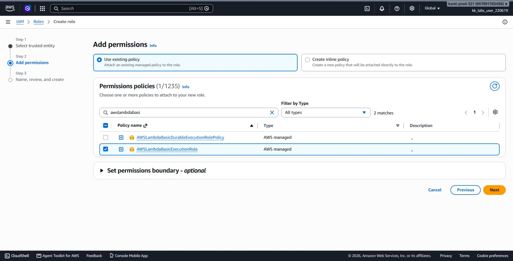
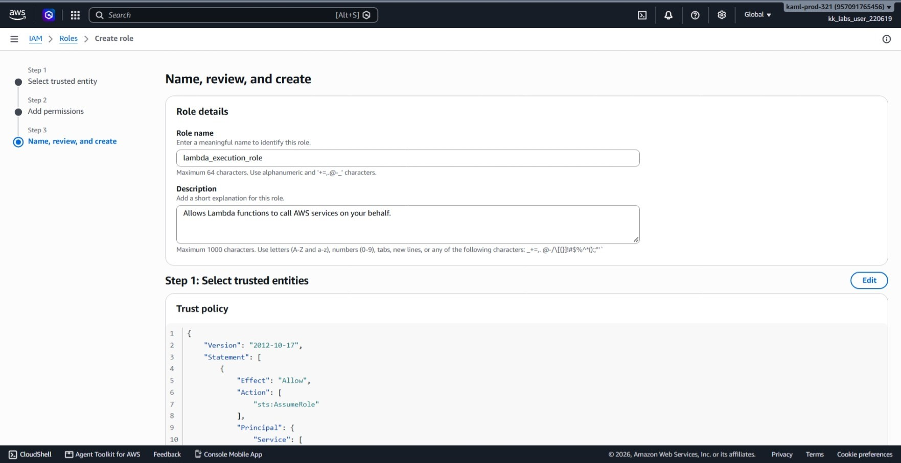
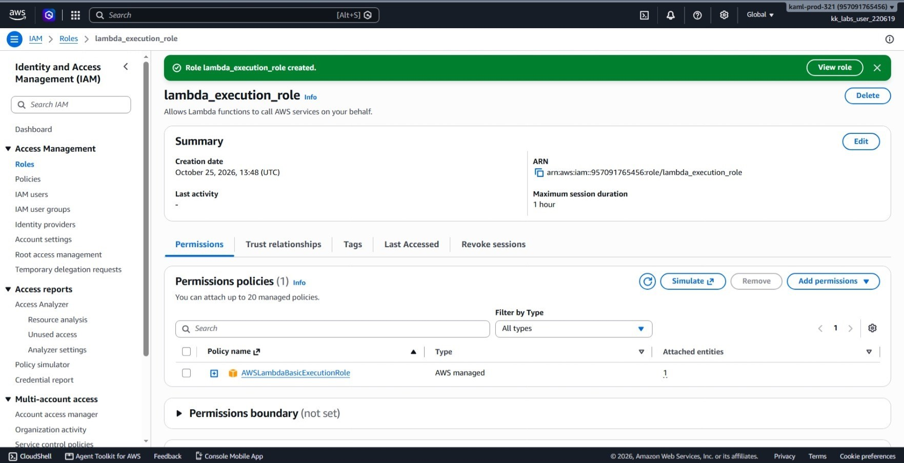
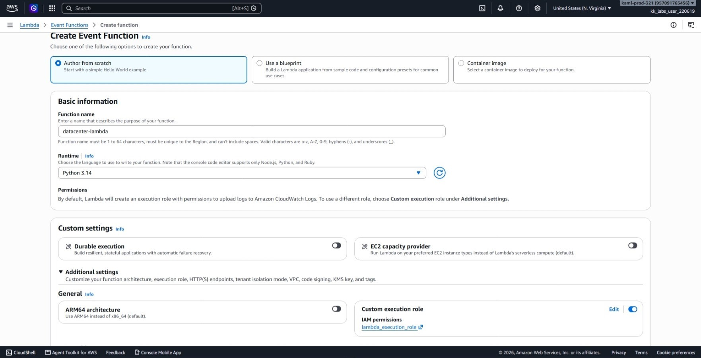
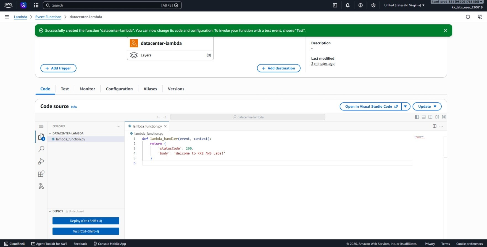
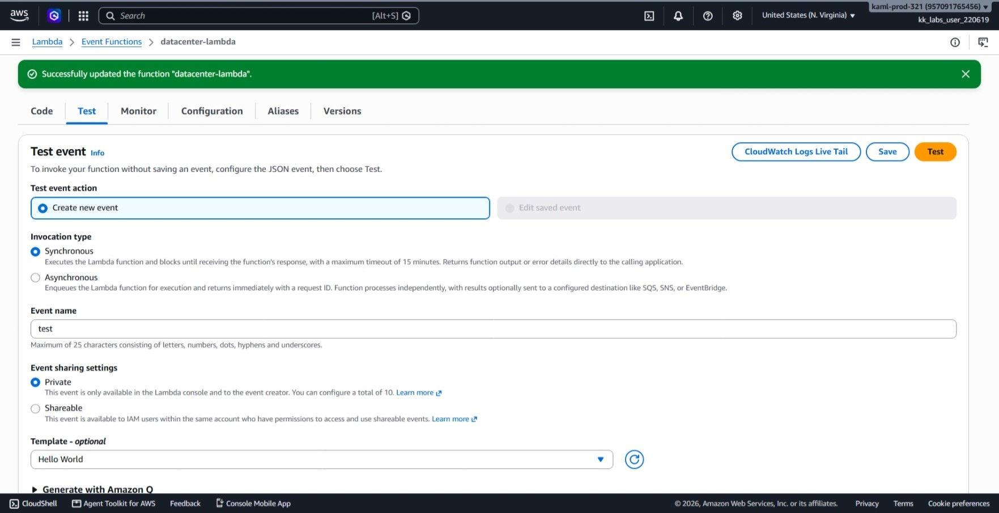
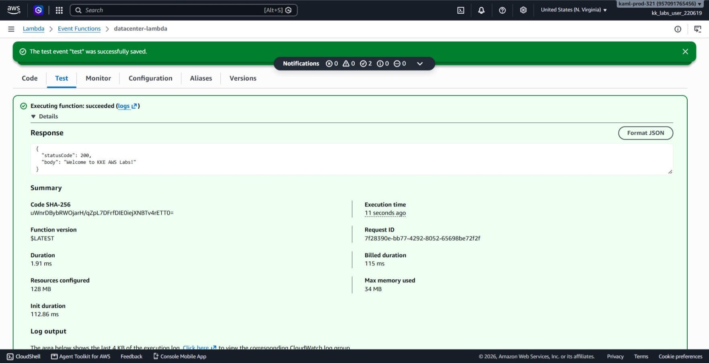
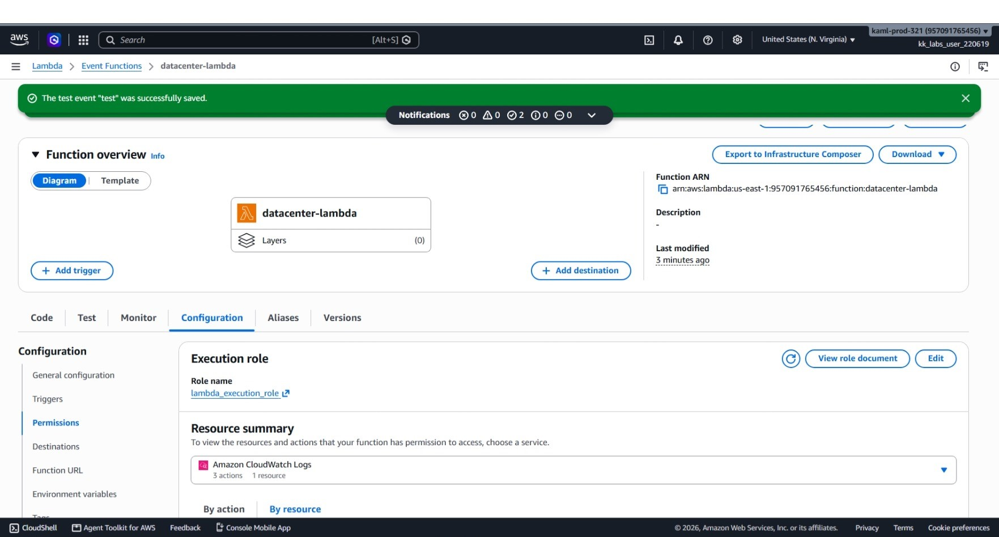

# Day 33: Create a Lambda Function

## Objective

The objective is to deploy an AWS Lambda function named `datacenter-lambda` using the Python runtime. I created a dedicated IAM execution role (`lambda_execution_role`) with CloudWatch logging permissions, authored the serverless function, deployed the handler code returning an HTTP 200 status code with the greeting `Welcome to KKE AWS Labs!`, and tested execution directly in the AWS Management Console.


## 1. AWS Lambda and Serverless Architecture

**AWS Lambda** is a serverless compute service that executes code in response to events without requiring server management or provisioning.

### How Lambda Works
1. **Serverless Execution:** We only write and upload the application code. AWS automatically handles the underlying operating system, scaling, patching, and availability.
2. **Event-Driven:** Lambda functions stay idle until triggered by an event, an API call, or a manual test invocation. Billing is strictly based on the compute time consumed per millisecond during execution.
3. **Stateless Nature:** Each execution runs in a short-lived container environment. Any temporary local data is cleared between invocations unless stored externally.


### Core Components
* **Handler (`lambda_handler`):** The entry point function that AWS Lambda calls when execution starts. It takes two parameters:
  * `event`: Contains the input data or JSON payload passed to the function.
  * `context`: Provides runtime information about the invocation, time limits, and execution environment.
* **Runtime:** The software environment that interprets the code (such as Python 3.x).
* **IAM Execution Role:** Since a Lambda function runs independently inside AWS, it needs its own identity. The execution role gives the function permission to access AWS services, most notably writing execution output and errors to Amazon CloudWatch Logs.


## 2. Order of Steps

To configure and test the serverless function, I followed these steps in order:

1. **Create IAM Role:** Create an execution role named `lambda_execution_role` trusted by the Lambda service.
2. **Attach Permissions Policy:** Attach the AWS-managed policy `AWSLambdaBasicExecutionRole` so the function can write logs.
3. **Create Lambda Function:** Author a function named `datacenter-lambda` from scratch using Python 3.x and attach the created role.
4. **Deploy Application Code:** Add the return payload (`statusCode: 200`, `body: 'Welcome to KKE AWS Labs!'`) and deploy the changes.
5. **Run Test Event:** Create a test event and invoke the function to verify the response.
6. **Verify Configuration:** Check the function configuration to confirm the execution role is active.


## 3. Console Execution Steps

### Step 1: Create the IAM Execution Role
I navigated to the **IAM** console to create the execution role:
1. Went to **IAM** > **Roles** > **Create role**.
2. **Trusted entity type:** Selected **AWS service**, and chose **Lambda** as the use case. Clicked **Next**.



3. **Add permissions:** Searched for and selected the managed policy **`AWSLambdaBasicExecutionRole`**. Clicked **Next**.



4. **Role name:** Entered `lambda_execution_role`. Clicked **Create role**.



5. Opened the newly created `lambda_execution_role` to confirm the **Permissions** tab shows `AWSLambdaBasicExecutionRole` attached.



### Step 2: Create the Lambda Function
I navigated to the **AWS Lambda** console:
1. Went to **Lambda** > **Functions** > **Create function**.
2. Selected **Author from scratch**.
3. **Function name:** Entered `datacenter-lambda`.
4. **Runtime:** Selected the latest **Python 3.x**.
5. **Change default execution role:** Selected **Use an existing role**, then picked **`lambda_execution_role`**.



6. Clicked **Create function**.

### Step 3: Add and Deploy the Function Code
1. Under the **Code** tab, I opened `lambda_function.py`, removed the default template, and added the code:

```python
def lambda_handler(event, context):
    return {
        'statusCode': 200,
        'body': 'Welcome to KKE AWS Labs!'
    }
```

2. Clicked the **Deploy** button to publish the changes and verified that the "Changes not deployed" banner cleared.



### Step 4: Test the Function
1. Switched to the **Test** tab, selected **Create new event**, named it `test`, kept the default JSON event, and saved it.



2. Clicked **Test** and verified the execution output returned status code `200` and the required body.

The test execution succeeded with the following output:

```json
{
  "statusCode": 200,
  "body": "Welcome to KKE AWS Labs!"
}
```

The execution summary confirmed:
* **Status:** `Succeeded`
* **Status Code:** `200`
* **Response Body:** `Welcome to KKE AWS Labs!`
* **Execution Duration:** Executed in just a few milliseconds with standard CloudWatch logging generated.



### Step 5: Confirm the Configuration
I navigated to the **Configuration** > **Permissions** tab and confirmed that `lambda_execution_role` is set as the active execution role.




## Result
I verified that the `datacenter-lambda` function was successfully created with Python 3.x and linked to the `lambda_execution_role` IAM role. Testing in the AWS Management Console confirmed the function executes cleanly and returns an HTTP status code of 200 along with the required greeting body.