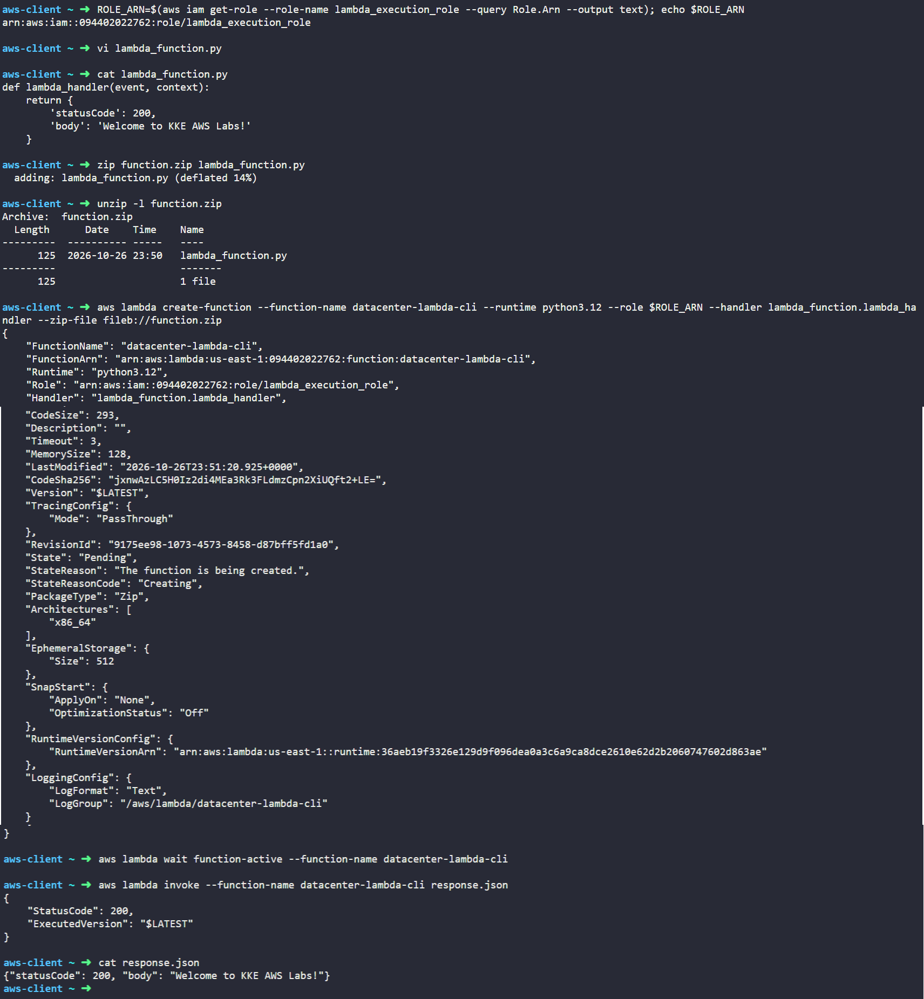

# Day 34: Create a Lambda Function Using CLI

## Objective
The objective is to deploy an AWS Lambda function named `datacenter-lambda-cli` using the AWS CLI. I wrote the Python handler code, packaged it into a zip archive, created the function using the existing `lambda_execution_role` IAM role, and invoked it from the terminal to verify the return payload.

## 1. Deploying Lambda via CLI

When creating a Lambda function from the command line:

1. **Deployment Package:** Lambda expects code uploaded via CLI to be packaged inside a `.zip` file.
2. **Binary Prefix (`fileb://`):** The AWS CLI requires the `fileb://` prefix when passing zip archives so it reads the file as raw binary data rather than text.
3. **Handler Syntax:** The `--handler` argument tells Lambda which file and function to run using the format `<filename>.<function_name>` (here: `lambda_function.lambda_handler`).

## 2. Command Execution

### Step 1: Retrieve the IAM Role ARN
I queried the Amazon Resource Name (ARN) of the pre-existing execution role:

```bash
ROLE_ARN=$(aws iam get-role \
  --role-name lambda_execution_role \
  --query Role.Arn \
  --output text)
```

### Step 2: Create the Python Script
I created `lambda_function.py` with the required handler returning an HTTP 200 status code and message:

```python
def lambda_handler(event, context):
    return {
        'statusCode': 200,
        'body': 'Welcome to KKE AWS Labs!'
    }
```

### Step 3: Package the Script into a Zip File
I compressed the script into `function.zip` and confirmed the archive contents:

```bash
# Create zip file
zip function.zip lambda_function.py

# Verify archive contents
unzip -l function.zip
```

### Step 4: Create the Lambda Function
I deployed the function using the AWS CLI:

```bash
aws lambda create-function \
  --function-name datacenter-lambda-cli \
  --runtime python3.12 \
  --role $ROLE_ARN \
  --handler lambda_function.lambda_handler \
  --zip-file fileb://function.zip
```

### Argument Breakdown:
* `create-function`: The API call that registers a new Lambda function.
* `--function-name datacenter-lambda-cli`: Sets the function identifier.
* `--runtime python3.12`: Specifies Python 3.12 as the execution environment.
* `--role $ROLE_ARN`: Links the IAM role providing basic CloudWatch logging permissions.
* `--handler lambda_function.lambda_handler`: Specifies the entry point inside `lambda_function.py`.
* `--zip-file fileb://function.zip`: Uploads the local binary zip archive.

## 3. Verification

### Step 1: Wait for Active State
I paused execution until AWS finished creating the runtime environment:

```bash
aws lambda wait function-active --function-name datacenter-lambda-cli
```

### Step 2: Invoke the Function
I invoked the Lambda function from the command line and saved the response payload to `response.json`:

```bash
aws lambda invoke --function-name datacenter-lambda-cli response.json
```

Output:
```json
{
    "StatusCode": 200,
    "ExecutedVersion": "$LATEST"
}
```

### Step 3: Inspect the Output Payload
I printed the contents of the response file:

```bash
cat response.json
```

Output:
```json
{"statusCode": 200, "body": "Welcome to KKE AWS Labs!"}
```

## Result
I verified that the `datacenter-lambda-cli` function was successfully created and deployed via the AWS CLI using Python 3.12. The test invocation returned an HTTP 200 status code with the exact expected response body: `Welcome to KKE AWS Labs!`.

## Screenshot
