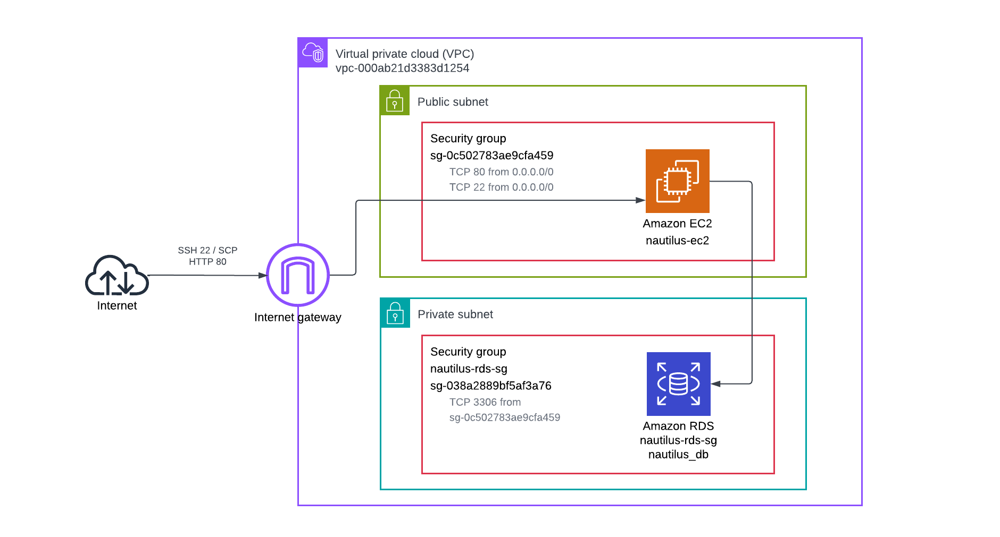
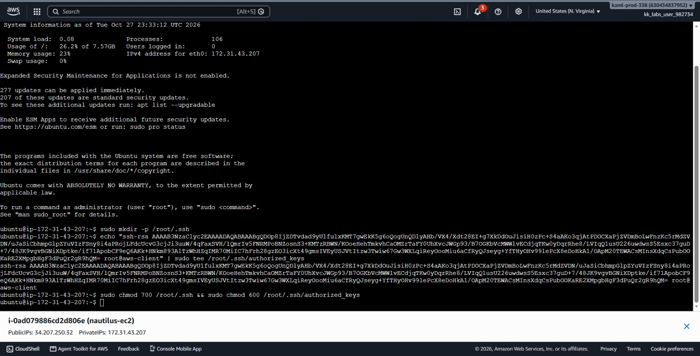
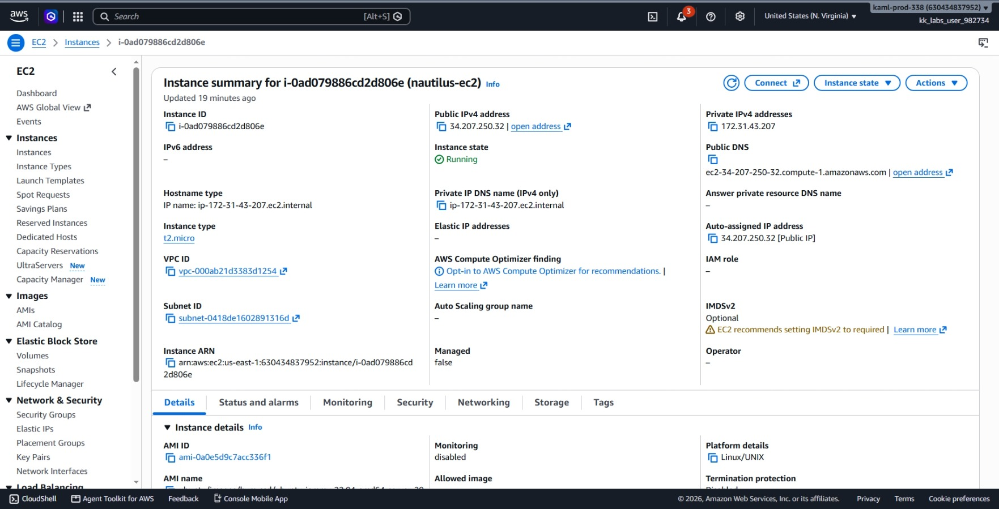
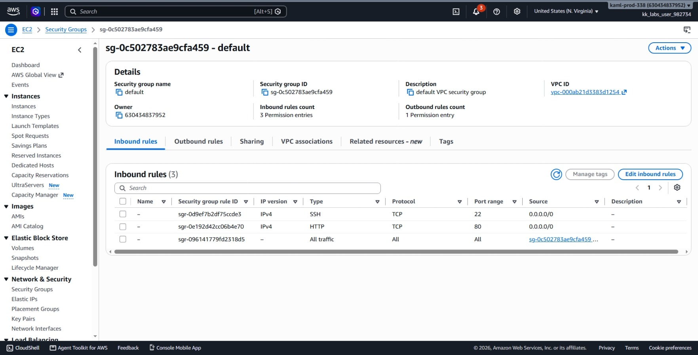
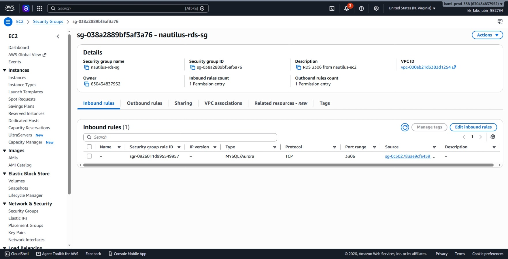
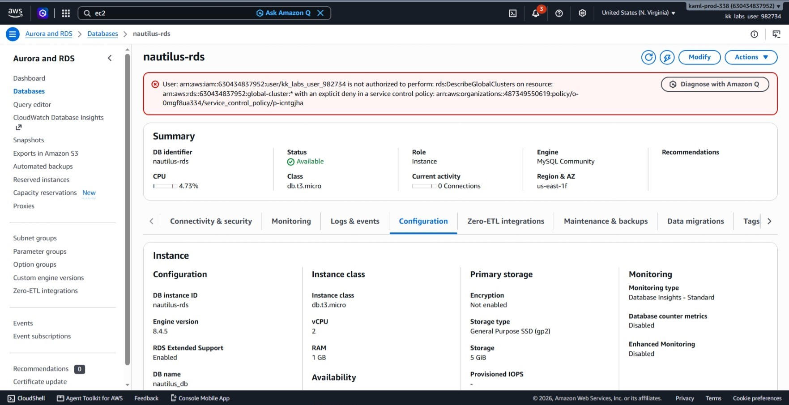

# Day 35: Deploying and Managing Applications on AWS

## Objective
The objective is to deploy a private Amazon RDS MySQL instance named `nautilus-rds` and securely connect an existing EC2 web server (`nautilus-ec2`) to it. I configured security group rules to allow web traffic on port 80 and database traffic on port 3306, set up passwordless SSH access to the server, deployed an updated PHP script to connect to the database, and verified that the application connects successfully.




## 1. EC2 to RDS Architecture

Connecting an application server to a private managed database is a standard cloud pattern.

### Network Isolation
* **Web Tier (EC2):** Lives in a public subnet with a public IP so users can access the website on port 80.
* **Database Tier (RDS):** Set to private (`PubliclyAccessible = false`). It has no public IP and cannot be reached directly from the internet.

### Security Group Referencing
Instead of opening database port 3306 to specific IP addresses, I used **security group referencing**:
* The RDS security group allows inbound traffic on port 3306 only if the request comes from the security group attached to the EC2 instance.
* This ensures only authorized application servers can query the database, even if their IP addresses change.

### Apache DirectoryIndex Behavior
When Apache serves requests for a folder like `/`, it checks files in order of priority (typically `index.html` before `index.php`). If the default placeholder `index.html` remains in the web root, Apache serves that HTML page instead of executing the PHP script which happened when I tried doing this task. Removing the placeholder file allows Apache to run and display `index.php`.


## 2. Order of Steps

To configure the database and connect the web application, I followed these steps in order:

1. **Inspect EC2 Instance:** Collect the instance ID, existing security group, VPC ID, and public IP address.
2. **Create RDS Security Group:** Create `nautilus-rds-sg` and allow inbound port 3306 strictly from the EC2 security group.
3. **Open Port 80 on EC2:** Allow public HTTP ingress on the EC2 instance's security group.
4. **Provision the Private RDS Instance:** Launch `nautilus-rds` with MySQL 8.4.5, 5 GiB gp2 storage, and attach the RDS security group.
5. **Wait for Database Availability:** Monitor the database until status changes to `available`.
6. **Retrieve RDS Endpoint:** Get the internal database hostname.
7. **Configure SSH Access:** Generate an SSH key on `aws-client` and install the public key in root's `authorized_keys` on the EC2 instance.
8. **Update Application Code:** Edit `/root/index.php` with the database endpoint, database name, username, and password.
9. **Deploy Application File:** Copy `index.php` to `/var/www/html/` on the EC2 instance.
10. **Troubleshoot Apache File Conflict:** Remove the default `index.html` so Apache serves `index.php`.
11. **Verify Connectivity:** Test via `curl` and a web browser to confirm the `Connected successfully` message.

## 3. Command Execution

### Step 1: Collect Existing EC2 Information
I retrieved the EC2 instance ID, security group ID, VPC ID, and public IP:

```bash
EC2_ID=$(aws ec2 describe-instances \
  --filters Name=tag:Name,Values=nautilus-ec2 Name=instance-state-name,Values=running \
  --query 'Reservations[0].Instances[0].InstanceId' \
  --output text)

EC2_SG=$(aws ec2 describe-instances \
  --instance-ids $EC2_ID \
  --query 'Reservations[0].Instances[0].SecurityGroups[0].GroupId' \
  --output text)

VPC_ID=$(aws ec2 describe-instances \
  --instance-ids $EC2_ID \
  --query 'Reservations[0].Instances[0].VpcId' \
  --output text)

EC2_IP=$(aws ec2 describe-instances \
  --instance-ids $EC2_ID \
  --query 'Reservations[0].Instances[0].PublicIpAddress' \
  --output text)
```

Values found:
* **EC2 ID:** `i-0ad079886cd2d806e`
* **EC2 SG:** `sg-0c502783ae9cfa459`
* **VPC ID:** `vpc-000ab21d3383d1254`
* **Public IP:** `34.207.250.32`

### Step 2: Create RDS Security Group and Allow Port 3306
I created a security group for the database in the same VPC and allowed MySQL access strictly from the EC2 security group:

```bash
# Create security group for RDS
RDS_SG=$(aws ec2 create-security-group \
  --group-name nautilus-rds-sg \
  --description "RDS 3306 from nautilus-ec2" \
  --vpc-id $VPC_ID \
  --query GroupId \
  --output text)

# Authorize inbound port 3306 from the EC2 security group
aws ec2 authorize-security-group-ingress \
  --group-id $RDS_SG \
  --protocol tcp \
  --port 3306 \
  --source-group $EC2_SG
```

Created RDS SG ID: `sg-038a2889bf5af3a76`

### Step 3: Open HTTP Port 80 on the EC2 Instance
I added an inbound rule allowing public HTTP traffic on the EC2 instance's security group:

```bash
aws ec2 authorize-security-group-ingress \
  --group-id $EC2_SG \
  --protocol tcp \
  --port 80 \
  --cidr 0.0.0.0/0
```

### Step 4: Create the Private RDS Database
I created the MySQL database instance with 5 GiB storage and public access disabled:

```bash
aws rds create-db-instance \
  --db-instance-identifier nautilus-rds \
  --db-instance-class db.t3.micro \
  --engine mysql \
  --engine-version 8.4.5 \
  --master-username nautilus_admin \
  --master-user-password Nautilus12345 \
  --storage-type gp2 \
  --allocated-storage 5 \
  --db-name nautilus_db \
  --vpc-security-group-ids $RDS_SG \
  --no-publicly-accessible \
  --no-multi-az
```

I waited for the database to complete provisioning:

```bash
aws rds wait db-instance-available \
  --db-instance-identifier nautilus-rds
```

### Step 5: Retrieve the RDS Endpoint Address
I retrieved the database connection hostname:

```bash
RDS_HOST=$(aws rds describe-db-instances \
  --db-instance-identifier nautilus-rds \
  --query 'DBInstances[0].Endpoint.Address' \
  --output text)

echo $RDS_HOST
# Result: nautilus-rds.ctzyrwhwwriv.us-east-1.rds.amazonaws.com
```

### Step 6: Configure SSH Access to the EC2 Instance
I generated an RSA key pair on `aws-client`:

```bash
ssh-keygen -t rsa -f /root/.ssh/id_rsa -N ""
cat /root/.ssh/id_rsa.pub
```

I connected to `nautilus-ec2` via the EC2 Instance Connect browser console, created `/root/.ssh`, and added the public key to `/root/.ssh/authorized_keys`.




I verified the connection from `aws-client`:

```bash
ssh -o StrictHostKeyChecking=no root@$EC2_IP "echo ok"
# Result: ok
```

### Step 7: Update and Copy `index.php`
I updated `/root/index.php` with the database details:

```php
<?php
$dbname = 'nautilus_db';
$dbuser = 'nautilus_admin';
$dbpass = 'Nautilus12345';
$dbhost = 'nautilus-rds.ctzyrwhwwriv.us-east-1.rds.amazonaws.com';

$link = mysqli_connect($dbhost, $dbuser, $dbpass) or die("Unable to Connect to '$dbhost'");
mysqli_select_db($link, $dbname) or die("Could not open the db '$dbname'");

$test_query = "SHOW TABLES FROM $dbname";
$result = mysqli_query($link, $test_query);

$tblCnt = 0;
while($tbl = mysqli_fetch_array($result)) {
  $tblCnt++;
}

if (!$tblCnt) {
  echo "Connected successfully<br />\n";
} else {
  echo "Connected successfully<br />\n";
}
?>
```

I copied the file to the web server's document root:

```bash
scp /root/index.php root@$EC2_IP:/var/www/html/index.php
```

## 4. Troubleshooting Journal (The Default Apache Page Conflict)

After copying `index.php`, I ran a `curl` request against the public IP to test the database connection:

```bash
curl http://$EC2_IP
```

**Issue:** Instead of returning the database response, the output returned the standard "Apache2 Ubuntu Default Page: It works" HTML document.

**Root Cause:** The default Apache installation places an `index.html` file in `/var/www/html/`. Because Apache's directory configuration evaluates `index.html` before `index.php`, it served the static page and completely ignored the PHP script.

**Resolution:** I connected via SSH and deleted the placeholder HTML file:

```bash
ssh root@$EC2_IP "rm /var/www/html/index.html"
```

I immediately re-tested the endpoint:

```bash
curl http://$EC2_IP
```

Output:
```text
Connected successfully<br />
```

## 5. Verification


### Console UI Verification
I confirmed the resources in the AWS Management Console:
1. **EC2 > Instances:** Selected `nautilus-ec2` and verified it is **Running** with public IP `34.207.250.32`.



2. **EC2 > Security Groups:**
   * Checked `sg-0c502783ae9cfa459` (`nautilus-ec2` SG): Confirmed inbound rule for **HTTP (Port 80)** from `0.0.0.0/0`.
   * Checked `sg-038a2889bf5af3a76` (`nautilus-rds-sg`): Confirmed inbound rule for **MySQL (Port 3306)** sourced strictly from `sg-0c502783ae9cfa459`.






3. **RDS > Databases:** Selected `nautilus-rds` and confirmed:
   * **Status:** `Available`
   * **Engine:** MySQL 8.4.5
   * **Publicly accessible:** `No`



4. **Browser Test:** Opened `http://34.207.250.32` in a browser and confirmed the page displays:
   `Connected successfully`


### CLI Verification
I queried the public IP from the terminal to confirm the PHP application communicates with the database:

```bash
curl http://$EC2_IP
```

Output:
```text
Connected successfully<br />
```


## Result
I verified that the private RDS instance `nautilus-rds` is running and properly protected behind `nautilus-rds-sg`. The EC2 instance `nautilus-ec2` can reach the database on port 3306 while serving HTTP traffic on port 80. The deployed PHP application successfully connects to the MySQL database and displays `Connected successfully`.

## Screenshots
