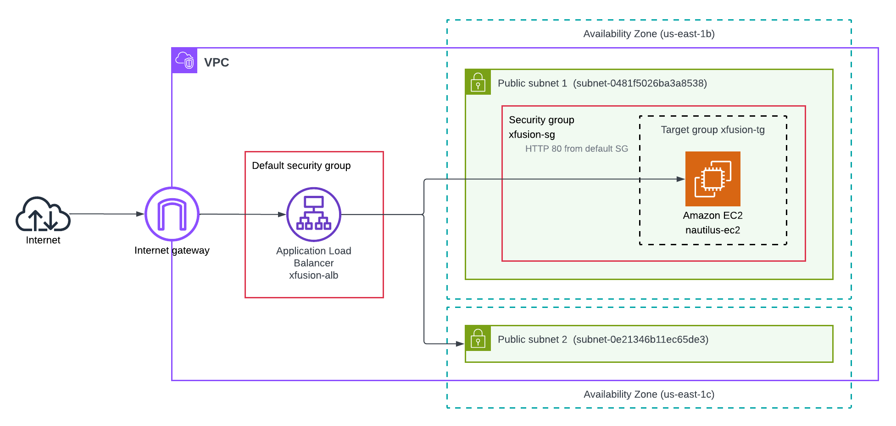
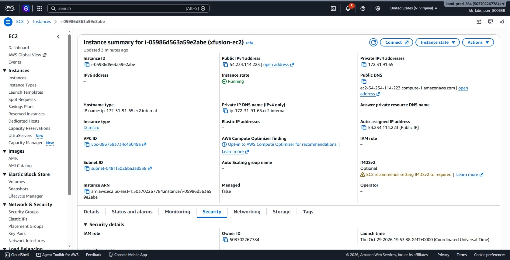
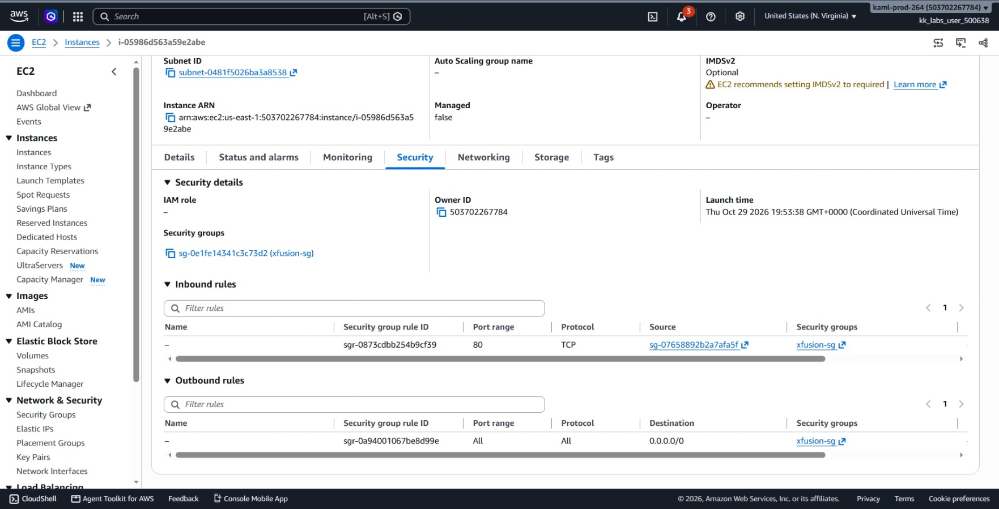
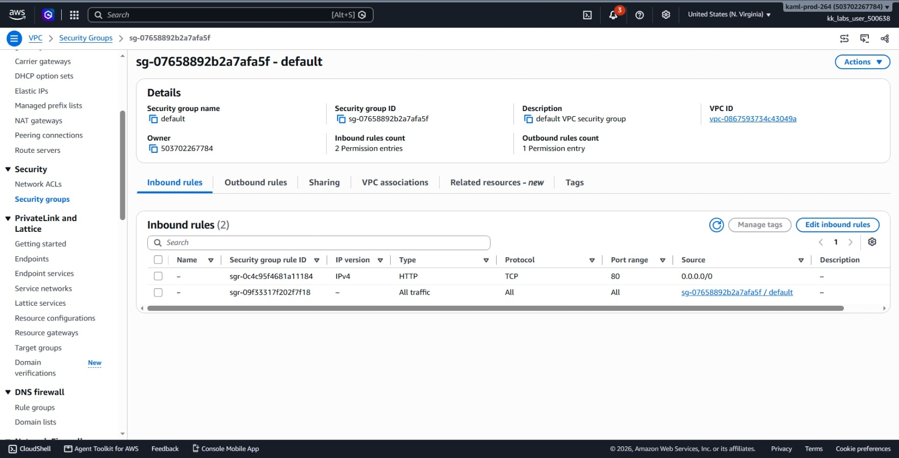
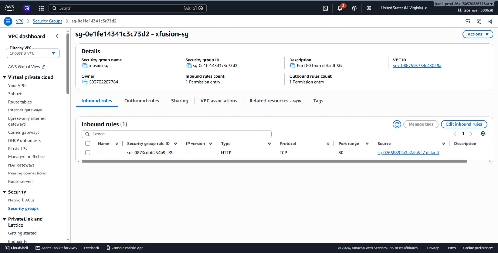
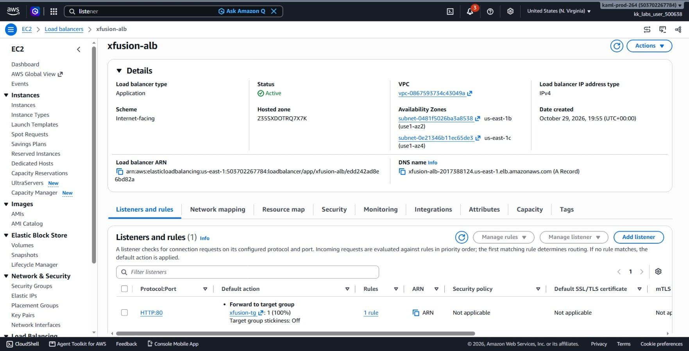
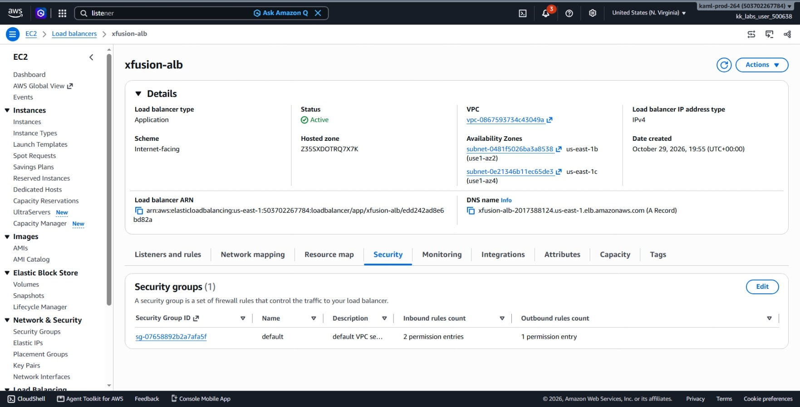
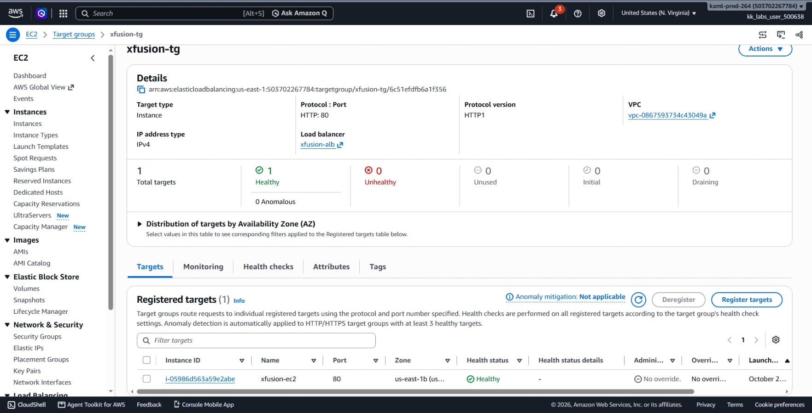
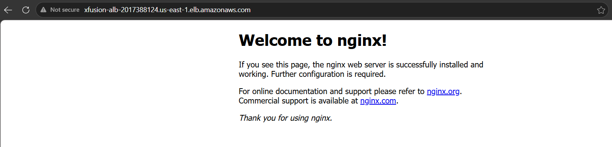
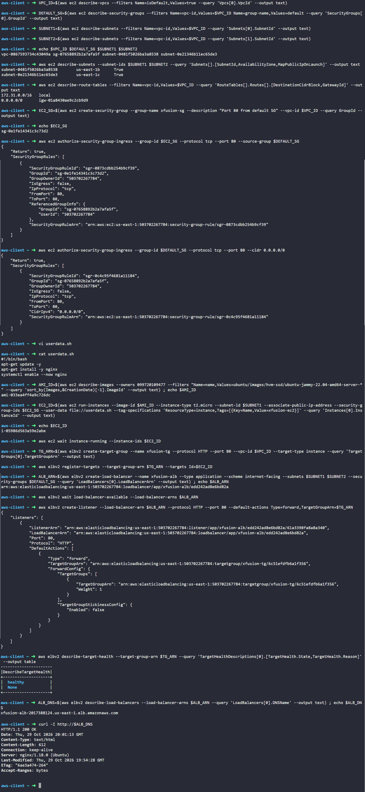

# Day 36: Load Balancing EC2 Instances with Application Load Balancer

## Objective
The objective is to set up an Application Load Balancer (ALB) named `xfusion-alb` to route public HTTP traffic on port 80 to a newly launched Ubuntu EC2 instance named `xfusion-ec2`. I configured an automated User Data bootstrap script to install and run Nginx, chained security group rules so only the ALB can reach the instance, registered the server to a target group (`xfusion-tg`), and verified public accessibility via the ALB DNS name.




## 1. Application Load Balancer and Security Group Chaining

An **Application Load Balancer (ALB)** distributes incoming web traffic across multiple targets, such as EC2 instances, to improve application availability.

### How Traffic Flows Through the Setup
1. A user on the internet sends an HTTP request to the public DNS name of the ALB on port 80.
2. The ALB receives the request, evaluates its listener rule, and forwards the packet to the target group (`xfusion-tg`).
3. The target group routes the traffic to the registered EC2 instance (`xfusion-ec2`), where Nginx responds.

### Security Group Chaining
To secure backend web servers, we should never expose them directly to the public internet if a load balancer sits in front of them:
* **ALB Security Group (`default`):** Configured to accept public HTTP traffic on port 80 from anywhere (`0.0.0.0/0`).
* **EC2 Security Group (`xfusion-sg`):** Configured to accept port 80 traffic **only** if it comes from the default security group ID.
This ensures nobody can bypass the load balancer to hit the instance directly.

### Target Groups and Health Checks
A target group tells the load balancer where to send requests and continuously monitors the health of registered instances:
* It periodically sends an HTTP GET request to `/`.
* If the backend instance returns an HTTP 200 response, its status is marked as `healthy`.
* If an instance fails health checks, the load balancer automatically stops sending traffic to it.


## 2. Order of Steps

To build the architecture, I followed these steps in order:

1. **Query VPC and Subnets:** Collect the default VPC ID, the default security group ID, and two subnets in different Availability Zones (required for an internet-facing ALB).
2. **Create EC2 Security Group:** Create `xfusion-sg` and allow inbound port 80 only from the default security group.
3. **Open Port 80 on Default Security Group:** Allow public inbound HTTP (port 80) from `0.0.0.0/0` on the default security group for the ALB.
4. **Prepare User Data Script:** Create a startup script to update packages, install Nginx, and start the service.
5. **Launch the EC2 Instance:** Deploy `xfusion-ec2` with the user data script and attach `xfusion-sg`.
6. **Create Target Group & Register Instance:** Create `xfusion-tg` and register `xfusion-ec2` as a target.
7. **Create the ALB:** Deploy `xfusion-alb` across two subnets and attach the default security group.
8. **Create HTTP Listener:** Add a listener on port 80 to forward incoming traffic to `xfusion-tg`.
9. **Verify Health & Web Access:** Confirm target health is `healthy` and curl the ALB DNS name.


## 3. Command Execution

### Step 1: Collect VPC, Security Group, and Subnet Information
I retrieved the default VPC ID, its default security group, and two subnets in different Availability Zones:

```bash
# Retrieve VPC ID
VPC_ID=$(aws ec2 describe-vpcs \
  --filters Name=isDefault,Values=true \
  --query 'Vpcs[0].VpcId' \
  --output text)

# Retrieve Default Security Group ID
DEFAULT_SG=$(aws ec2 describe-security-groups \
  --filters Name=vpc-id,Values=$VPC_ID Name=group-name,Values=default \
  --query 'SecurityGroups[0].GroupId' \
  --output text)

# Retrieve Subnet IDs across two Availability Zones
SUBNET1=$(aws ec2 describe-subnets \
  --filters Name=vpc-id,Values=$VPC_ID \
  --query 'Subnets[0].SubnetId' \
  --output text)

SUBNET2=$(aws ec2 describe-subnets \
  --filters Name=vpc-id,Values=$VPC_ID \
  --query 'Subnets[1].SubnetId' \
  --output text)
```

Values found:
* **VPC ID:** `vpc-0867593734c43049a`
* **Default SG:** `sg-07658892b2a7afa5f`
* **Subnet 1:** `subnet-0481f5026ba3a8538` (`us-east-1b`)
* **Subnet 2:** `subnet-0e21346b11ec65de3` (`us-east-1c`)

### Step 2: Create EC2 Security Group and Chain to Default SG
I created `xfusion-sg` and authorized port 80 only when traffic comes from the default security group:

```bash
# Create custom security group for EC2
EC2_SG=$(aws ec2 create-security-group \
  --group-name xfusion-sg \
  --description "Port 80 from default SG" \
  --vpc-id $VPC_ID \
  --query GroupId \
  --output text)

# Allow port 80 sourced only from the default security group
aws ec2 authorize-security-group-ingress \
  --group-id $EC2_SG \
  --protocol tcp \
  --port 80 \
  --source-group $DEFAULT_SG
```

Created EC2 SG ID: `sg-0e1fe14341c3c73d2`

### Step 3: Allow Public Port 80 on Default Security Group for the ALB
I modified the default security group so external users can reach the load balancer on port 80:

```bash
aws ec2 authorize-security-group-ingress \
  --group-id $DEFAULT_SG \
  --protocol tcp \
  --port 80 \
  --cidr 0.0.0.0/0
```

### Step 4: Write User Data Bootstrap Script
I created a script to automate the Nginx installation on first boot:

```bash
cat << 'EOF' > userdata.sh
#!/bin/bash
apt-get update -y
apt-get install -y nginx
systemctl enable --now nginx
EOF
```

### Step 5: Launch the EC2 Instance
I looked up the latest Ubuntu 22.04 AMI and launched `xfusion-ec2`:

```bash
# Get latest Ubuntu 22.04 AMI ID
AMI_ID=$(aws ec2 describe-images \
  --owners 099720109477 \
  --filters "Name=name,Values=ubuntu/images/hvm-ssd/ubuntu-jammy-22.04-amd64-server-*" \
  --query 'sort_by(Images,&CreationDate)[-1].ImageId' \
  --output text)

# Launch the instance
EC2_ID=$(aws ec2 run-instances \
  --image-id $AMI_ID \
  --instance-type t2.micro \
  --subnet-id $SUBNET1 \
  --associate-public-ip-address \
  --security-group-ids $EC2_SG \
  --user-data file://userdata.sh \
  --tag-specifications 'ResourceType=instance,Tags=[{Key=Name,Value=xfusion-ec2}]' \
  --query 'Instances[0].InstanceId' \
  --output text)

# Wait until the instance is running
aws ec2 wait instance-running --instance-ids $EC2_ID
```

Created Instance ID: `i-05986d563a59e2abe`

### Step 6: Create Target Group and Register EC2 Instance
I created the target group `xfusion-tg` and registered the new instance:

```bash
# Create target group
TG_ARN=$(aws elbv2 create-target-group \
  --name xfusion-tg \
  --protocol HTTP \
  --port 80 \
  --vpc-id $VPC_ID \
  --target-type instance \
  --query 'TargetGroups[0].TargetGroupArn' \
  --output text)

# Register the instance into the target group
aws elbv2 register-targets \
  --target-group-arn $TG_ARN \
  --targets Id=$EC2_ID
```

### Step 7: Create Application Load Balancer and Listener
I created the internet-facing load balancer across the two subnets and added a listener on port 80:

```bash
# Create the ALB
ALB_ARN=$(aws elbv2 create-load-balancer \
  --name xfusion-alb \
  --type application \
  --scheme internet-facing \
  --subnets $SUBNET1 $SUBNET2 \
  --security-groups $DEFAULT_SG \
  --query 'LoadBalancers[0].LoadBalancerArn' \
  --output text)

# Wait for ALB to become active
aws elbv2 wait load-balancer-available --load-balancer-arns $ALB_ARN

# Create HTTP listener on port 80 forwarding to the target group
aws elbv2 create-listener \
  --load-balancer-arn $ALB_ARN \
  --protocol HTTP \
  --port 80 \
  --default-actions Type=forward,TargetGroupArn=$TG_ARN
```


## 4. Verification


### Console UI & Browser Verification
I verified the resources in the AWS Management Console and browser:

1. **EC2 > Instances:** Verified `xfusion-ec2` (`i-05986d563a59e2abe`) is in the **Running** state.



2. **EC2 Instance Details (Security):** Confirmed the instance is attached to `xfusion-sg`.




3. **EC2 > Security Groups (`default`):** Verified the inbound rule allows **HTTP (Port 80)** from `0.0.0.0/0`.




4. **EC2 > Security Groups (`xfusion-sg`):** Verified the inbound rule allows **HTTP (Port 80)** sourced only from `sg-07658892b2a7afa5f`.




5. **EC2 > Load Balancers:** Selected `xfusion-alb` and verified status is **Active** with an active HTTP:80 listener forwarding to `xfusion-tg`.





6. **EC2 > Target Groups:** Selected `xfusion-tg` and verified on the **Targets** tab that `xfusion-ec2` is listed as **Healthy**.




7. **Web Browser Check:** Navigated to `http://xfusion-alb-2017388124.us-east-1.elb.amazonaws.com` in a browser and confirmed the default "Welcome to nginx!" landing page loaded.




### CLI Verification
I queried the target group health to verify Nginx was running and responding to health checks:

```bash
aws elbv2 describe-target-health \
  --target-group-arn $TG_ARN \
  --query 'TargetHealthDescriptions[0].[TargetHealth.State,TargetHealth.Reason]' \
  --output table
```

Output:
```text
----------------------
|DescribeTargetHealth|
+--------------------+
|  healthy           |
|  None              |
+--------------------+
```

I retrieved the ALB DNS name and sent an HTTP request to verify end-to-end traffic routing:

```bash
# Get DNS name
ALB_DNS=$(aws elbv2 describe-load-balancers \
  --load-balancer-arns $ALB_ARN \
  --query 'LoadBalancers[0].DNSName' \
  --output text)

# Test HTTP request via ALB DNS
curl -I http://$ALB_DNS
```

Output:
```text
HTTP/1.1 200 OK
Date: Thu, 29 Oct 2026 20:01:13 GMT
Content-Type: text/html
Content-Length: 612
Connection: keep-alive
Server: nginx/1.18.0 (Ubuntu)
```


## Result
I verified that the `xfusion-alb` Application Load Balancer is active and routing public HTTP port 80 traffic to `xfusion-ec2` via the `xfusion-tg` target group. Security groups are correctly chained so only the ALB can communicate with Nginx, and requests to the ALB DNS successfully return the Nginx welcome page.

## Screenshots
