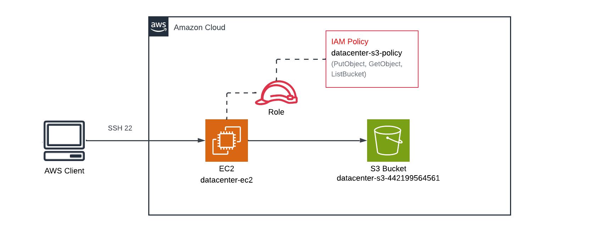
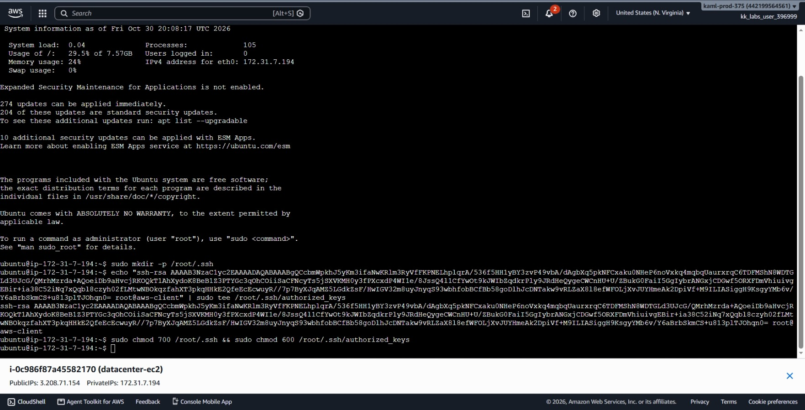
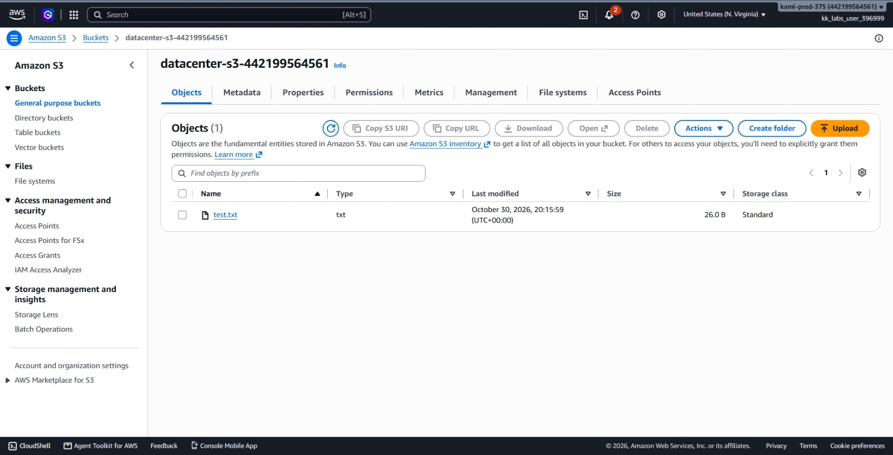
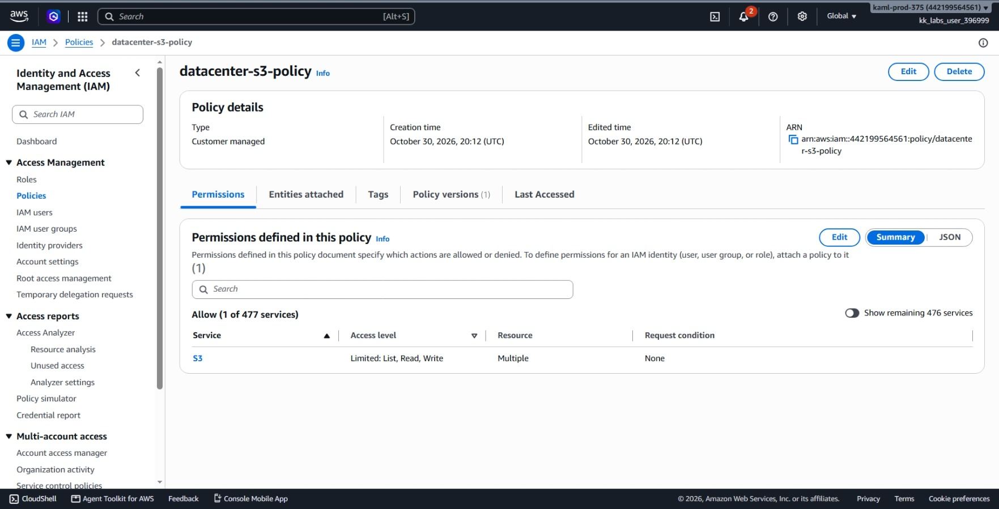
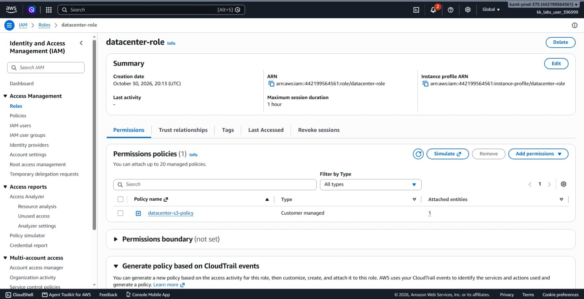
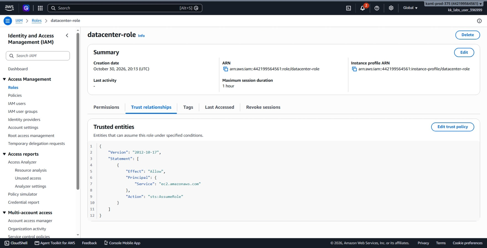
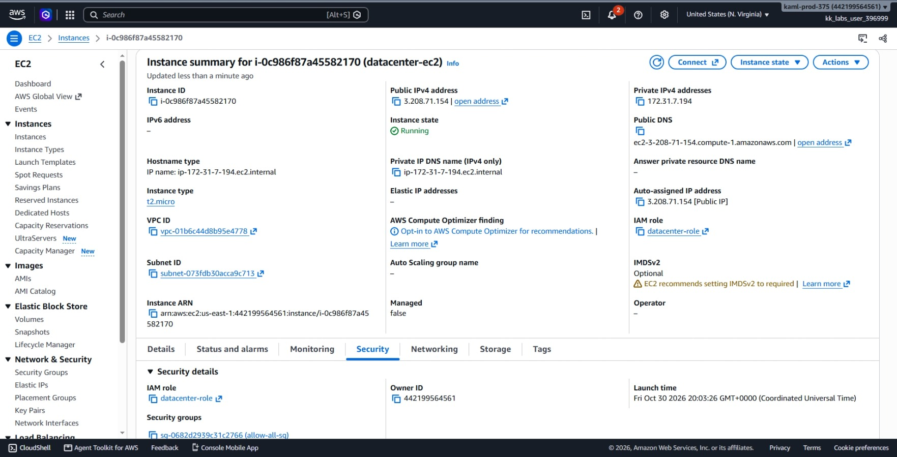
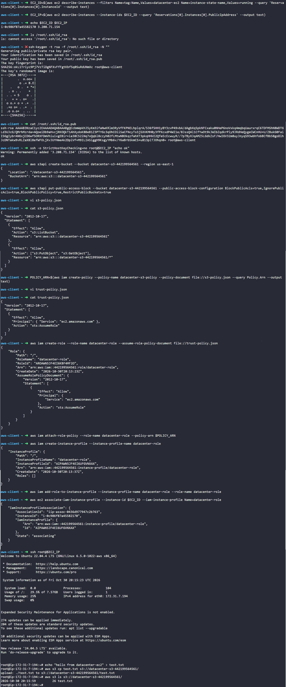

# Day 37: Managing EC2 Access with S3 Role-based Permissions

## Objective
The objective is to grant an existing Amazon EC2 instance named `datacenter-ec2` secure, keyless access to an Amazon S3 bucket using an IAM role. I created a private S3 bucket named `datacenter-s3-442199564561`, defined a scoped IAM policy for specific S3 actions, created an IAM role with an EC2 instance profile, attached it to `datacenter-ec2`, and verified file upload and listing capabilities directly from the instance.





## 1. IAM Roles, Instance Profiles, and S3 Permissions

Accessing AWS services from an EC2 instance should never involve saving permanent access keys or secret keys on the server. Instead, AWS uses IAM roles and temporary credentials.

### How EC2 Accesses S3 Using Roles
1. **IAM Role:** Defines the permissions (what actions are allowed) and a trust policy (allowing `ec2.amazonaws.com` to assume the role).
2. **Instance Profile:** A container in IAM used to pass an IAM role to an EC2 instance. When using the AWS Console, this is created automatically. When using the AWS CLI, we must create the instance profile, add the role to it, and associate it with the EC2 instance.
3. **Automatic Credential Rotation:** Once attached, the EC2 instance metadata service automatically supplies temporary, rotating security credentials to applications and the AWS CLI running on that server.

### Bucket-Level vs. Object-Level Permissions
S3 distinguishes between the bucket itself and the files inside it:
* **`s3:ListBucket`:** Operates on the bucket root (`arn:aws:s3:::datacenter-s3-442199564561`). This allows listing the files inside.
* **`s3:PutObject` & `s3:GetObject`:** Operate on the objects inside the bucket (`arn:aws:s3:::datacenter-s3-442199564561/*`). This allows uploading and downloading files.
Both resource paths must be defined in the policy for full read and write file operations to work.

## 2. Order of Steps

To complete the setup, I followed these steps in order:

1. **Get EC2 Info:** Retrieve the instance ID and public IP of `datacenter-ec2`.
2. **Configure SSH Keys:** Generate an RSA key pair on `aws-client` and install the public key into the root user's `authorized_keys` file on `datacenter-ec2`.
3. **Create Private S3 Bucket:** Create `datacenter-s3-442199564561` and enable public access blocking.
4. **Create IAM Policy:** Write `s3-policy.json` allowing `ListBucket`, `PutObject`, and `GetObject`, then create `datacenter-s3-policy`.
5. **Create IAM Role:** Write `trust-policy.json` for EC2, create `datacenter-role`, and attach the policy.
6. **Create and Attach Instance Profile:** Create an instance profile, link `datacenter-role` to it, and attach it to `datacenter-ec2`.
7. **Verify via SSH:** Log into `datacenter-ec2`, upload a test file to the bucket, and list the bucket contents without configuring static AWS credentials.

## 3. Command Execution

### Step 1: Discover EC2 Instance and Set Up SSH Access
I queried AWS to find the instance ID and public IP of `datacenter-ec2`:

```bash
EC2_ID=$(aws ec2 describe-instances \
  --filters Name=tag:Name,Values=datacenter-ec2 Name=instance-state-name,Values=running \
  --query 'Reservations[0].Instances[0].InstanceId' \
  --output text)

EC2_IP=$(aws ec2 describe-instances \
  --instance-ids $EC2_ID \
  --query 'Reservations[0].Instances[0].PublicIpAddress' \
  --output text)

echo $EC2_ID $EC2_IP
```

Target instance ID: `i-0c986f87a45582170` | Public IP: `3.208.71.154`

Next, I generated an RSA key pair on `aws-client`:

```bash
# Generate 3072-bit RSA key pair without a passphrase
ssh-keygen -t rsa -f /root/.ssh/id_rsa -N ""

# Print public key to copy to the instance
cat /root/.ssh/id_rsa.pub
```

I connected to `datacenter-ec2` using EC2 Instance Connect in the console and added this public key to `/root/.ssh/authorized_keys`.




Then, I verified direct SSH connectivity:

```bash
ssh -o StrictHostKeyChecking=no root@$EC2_IP "echo ok"
```

Output: `ok`

### Step 2: Create the Private S3 Bucket
I created the target bucket in `us-east-1` and enabled Block Public Access:

```bash
# Create S3 bucket
aws s3api create-bucket \
  --bucket datacenter-s3-442199564561 \
  --region us-east-1

# Enable Block Public Access
aws s3api put-public-access-block \
  --bucket datacenter-s3-442199564561 \
  --public-access-block-configuration BlockPublicAcls=true,IgnorePublicAcls=true,BlockPublicPolicy=true,RestrictPublicBuckets=true
```

### Step 3: Create the IAM Permissions Policy
I created a local JSON file defining permissions for the bucket and its objects:

```bash
cat << 'EOF' > s3-policy.json
{
  "Version": "2012-10-17",
  "Statement": [
    {
      "Effect": "Allow",
      "Action": "s3:ListBucket",
      "Resource": "arn:aws:s3:::datacenter-s3-442199564561"
    },
    {
      "Effect": "Allow",
      "Action": ["s3:PutObject", "s3:GetObject"],
      "Resource": "arn:aws:s3:::datacenter-s3-442199564561/*"
    }
  ]
}
EOF
```

I created the managed policy in IAM:

```bash
POLICY_ARN=$(aws iam create-policy \
  --policy-name datacenter-s3-policy \
  --policy-document file://s3-policy.json \
  --query Policy.Arn \
  --output text)
```

### Step 4: Create the IAM Role and Attach the Policy
I created a trust policy file allowing EC2 instances to assume the role:

```bash
cat << 'EOF' > trust-policy.json
{
  "Version": "2012-10-17",
  "Statement": [
    {
      "Effect": "Allow",
      "Principal": { "Service": "ec2.amazonaws.com" },
      "Action": "sts:AssumeRole"
    }
  ]
}
EOF
```

I created the role and attached the S3 permissions policy:

```bash
# Create the IAM role
aws iam create-role \
  --role-name datacenter-role \
  --assume-role-policy-document file://trust-policy.json

# Attach the policy to the role
aws iam attach-role-policy \
  --role-name datacenter-role \
  --policy-arn $POLICY_ARN
```

### Step 5: Create Instance Profile and Attach to EC2
An EC2 instance requires an instance profile to assume an IAM role. I created the instance profile, linked the role to it, and attached it to the EC2 instance:

```bash
# Create instance profile
aws iam create-instance-profile \
  --instance-profile-name datacenter-role

# Add the role to the instance profile
aws iam add-role-to-instance-profile \
  --instance-profile-name datacenter-role \
  --role-name datacenter-role

# Associate the instance profile with the running EC2 instance
aws ec2 associate-iam-instance-profile \
  --instance-id $EC2_ID \
  --iam-instance-profile Name=datacenter-role
```

## 4. Dual Verification

### CLI Verification (Testing from Inside the EC2 Instance)
I logged into the EC2 instance as root over SSH, created a test file, uploaded it to the S3 bucket, and listed the bucket contents:

```bash
# SSH into datacenter-ec2
ssh root@$EC2_IP

# Create a local test file
echo "hello from datacenter-ec2" > test.txt

# Upload the file to S3
aws s3 cp test.txt s3://datacenter-s3-442199564561/

# List the files in the bucket
aws s3 ls s3://datacenter-s3-442199564561/
```

Output:
```text
upload: ./test.txt to s3://datacenter-s3-442199564561/test.txt
2026-10-30 20:15:59         26 test.txt
```

The upload and list operations completed successfully without configuring any AWS access keys on the instance, confirming that the instance profile is supplying valid IAM role credentials.

### Console UI Verification
I confirmed each component in the AWS Management Console:
1. **Amazon S3 > Buckets > `datacenter-s3-442199564561`:**
   * **Objects tab:** Verified `test.txt` is listed with a size of 26 bytes.




2. **IAM > Policies > `datacenter-s3-policy`:**
   * Verified permissions show `s3:ListBucket`, `s3:PutObject`, and `s3:GetObject` scoped to the bucket ARN.




3. **IAM > Roles > `datacenter-role`:**
   * **Permissions tab:** Confirmed `datacenter-s3-policy` is attached.
  



   * **Trust relationships tab:** Confirmed `ec2.amazonaws.com` is listed as the trusted service.




4. **EC2 > Instances > `datacenter-ec2`:**



## Result
I verified that the private S3 bucket `datacenter-s3-442199564561` was created and secured with Block Public Access. The IAM role `datacenter-role` was configured with `datacenter-s3-policy` and attached to `datacenter-ec2` through an instance profile. Terminal execution confirmed the instance can upload and list objects in the S3 bucket using temporary role credentials.

## Screenshots

