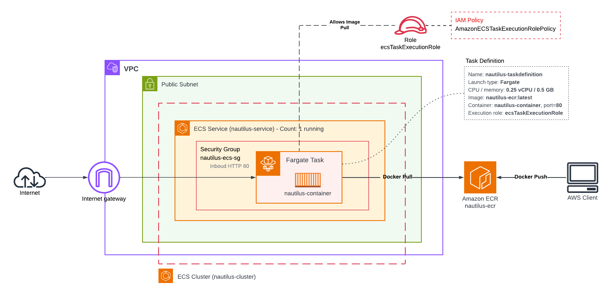
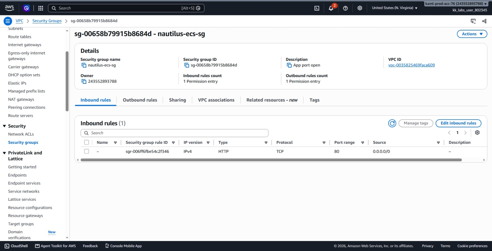
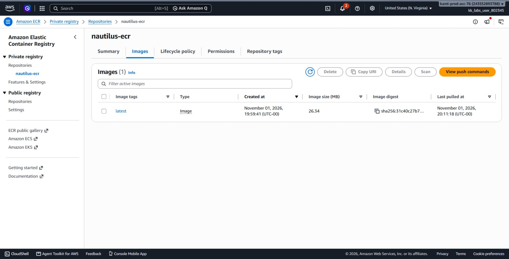
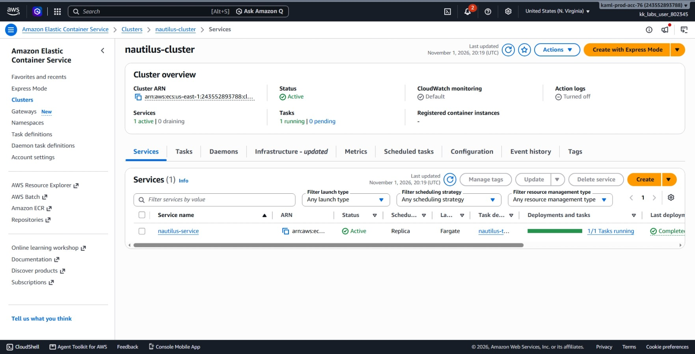
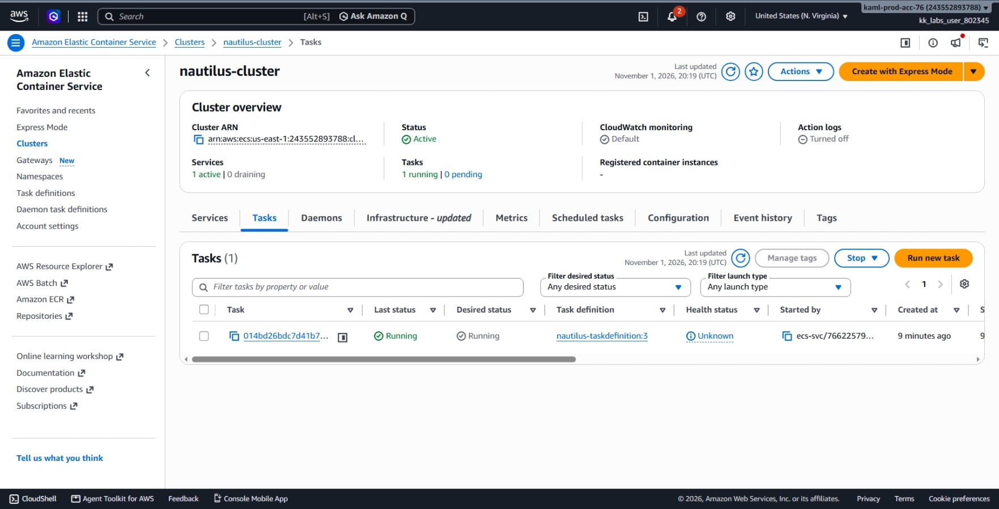
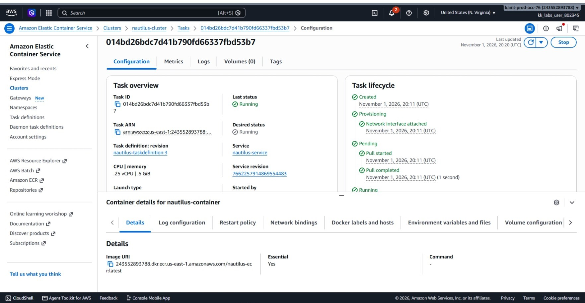
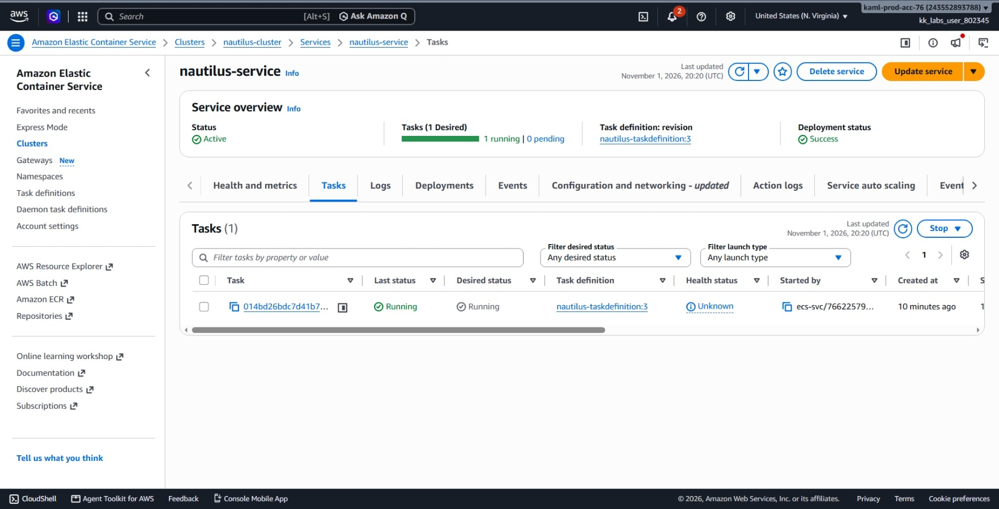
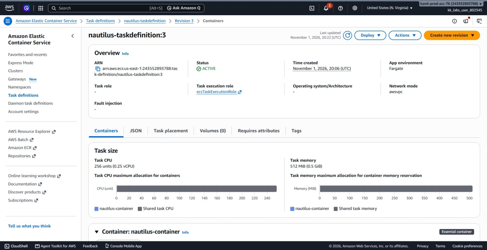
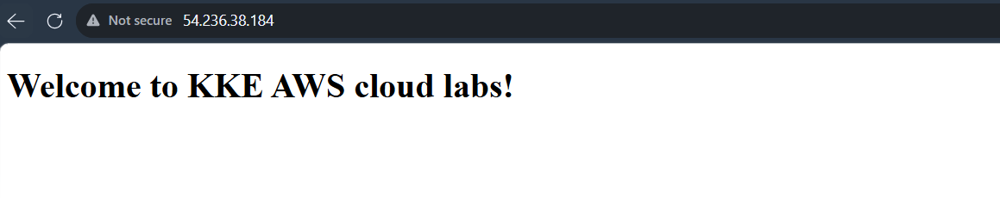

# Day 38: Deploying Containerized Applications with Amazon ECS

## Objective
The objective is to deploy a containerized Python web application using Amazon Elastic Container Service (ECS) and AWS Fargate. I created a private Amazon Elastic Container Registry (ECR) repository, built and pushed a custom Docker image, configured an IAM task execution role, created an ECS cluster, registered a task definition, and launched a long-running ECS service with public internet access.



## 1. Amazon ECS and AWS Fargate

Amazon **Elastic Container Service (ECS)** is a container management service that runs and scales Docker containers in AWS.

### Core Concepts

1. **ECS Cluster:** A logical grouping of container workloads. The cluster itself is just an organizational boundary and does not live inside a subnet.
2. **Task Definition:** The blueprint for the container. It specifies which image to pull from ECR, how much CPU and memory to allocate, which ports to open, and which IAM roles to use. It describes *how* to run a container, but does not define *how many* copies to run.
3. **Task vs. Service:**
   * **Task:** A single running instance of a task definition. If a standalone task stops or crashes, ECS does not restart it.
   * **Service:** A manager that maintains a desired number of running tasks. If a task crashes or stops unexpectedly, the service automatically launches a replacement to keep the application available.
4. **AWS Fargate:** A serverless compute engine for ECS. Instead of managing manually EC2 servers, Fargate runs containers directly on AWS-managed infrastructure.
5. **Task Networking (`awsvpc`):** In Fargate, each running task gets its own Elastic Network Interface (ENI), its own private IP address inside the chosen subnet, and its own Security Group. The Security Group attaches to the task's network card, acting as a firewall directly on the container's port.

### IAM Roles: Trust Policy vs. Permissions Policy
To allow ECS to run tasks, it needs permissions:
* **Trust Policy:** Specifies **who** can assume the role. For ECS, the trusted service is `ecs-tasks.amazonaws.com`.
* **Permissions Policy:** Specifies **what** the role can do. Attaching `AmazonECSTaskExecutionRolePolicy` gives ECS permission to authenticate with ECR, download the container image, and write logs to CloudWatch.

### ECR Authentication Token
The command `aws ecr get-login-password` returns a temporary 12-hour authentication token for our account's ECR registry in that region. Piping this token into `docker login --password-stdin` allows Docker to push images securely without exposing permanent AWS credentials.

## 2. Order of Steps

To deploy the application, I followed these steps in order:

1. **Inspect Application:** Check the `Dockerfile` in `/root/pyapp` to identify the base image and listening port (port 80).
2. **Create ECR Repository:** Create `nautilus-ecr` to store the container image.
3. **Build, Tag, and Push Image:** Authenticate Docker to ECR, build the image locally, tag it with the ECR repository URI, and push it.
4. **Create ECS Cluster:** Create `nautilus-cluster` using the Fargate launch type.
5. **Set Up IAM Task Execution Role:** Create `ecsTaskExecutionRole` with a trust policy for `ecs-tasks.amazonaws.com` and attach `AmazonECSTaskExecutionRolePolicy`.
6. **Register Task Definition:** Create `taskdef.json` specifying Fargate, 256 CPU, 512 Memory, port 80, and the pushed image URI, then register it as `nautilus-taskdefinition`.
7. **Create Security Group:** Create `nautilus-ecs-sg` and allow inbound HTTP traffic on port 80 from `0.0.0.0/0`.
8. **Create ECS Service:** Launch `nautilus-service` in the public subnet with a desired count of 1 and public IP assignment enabled.
9. **Verify Application:** Wait for service, retrieve the task's public IP address, and test connectivity via `curl` and a web browser.


## 3. Command Execution

### Step 1: Inspect the Dockerfile and Set Environment Variables
I inspected the application configuration to check its exposed port:

```bash
ACCOUNT_ID=$(aws sts get-caller-identity --query Account --output text)
REGION=us-east-1

cat /root/pyapp/Dockerfile
```

The Dockerfile uses `nginx:alpine` and exposes port 80:

```bash
APP_PORT=80
```

### Step 2: Create the Private ECR Repository
I created the ECR repository named `nautilus-ecr`:

```bash
aws ecr create-repository \
  --repository-name nautilus-ecr \
  --region $REGION
```

Created Repository URI: `243552893788.dkr.ecr.us-east-1.amazonaws.com/nautilus-ecr`

```bash
REPO_URI=$ACCOUNT_ID.dkr.ecr.$REGION.amazonaws.com/nautilus-ecr
```

### Step 3: Build, Authenticate, and Push the Docker Image
I built the Docker image locally, logged into ECR using a temporary token, tagged the image, and pushed it:

```bash
# Build the local Docker image
docker build -t nautilus-ecr:latest /root/pyapp

# Tag image with remote repository URI
docker tag nautilus-ecr:latest $REPO_URI:latest

# Authenticate Docker against the private ECR registry
aws ecr get-login-password --region $REGION | \
  docker login --username AWS --password-stdin $ACCOUNT_ID.dkr.ecr.$REGION.amazonaws.com

# Push image to ECR
docker push $REPO_URI:latest
```

The image pushed successfully with digest `sha256:31c40c27b7a5a25951edd9b8d286eacb4bfad3e89b1ca920faffeccaa08bce3c`.

### Step 4: Create the ECS Cluster
I created the cluster named `nautilus-cluster`:

```bash
aws ecs create-cluster \
  --cluster-name nautilus-cluster \
  --region $REGION
```

### Step 5: Configure the IAM Task Execution Role
I checked if `ecsTaskExecutionRole` existed. Because it was missing, I created the trust policy and role, then attached the required managed policy:

```bash
# Create trust policy file
cat << 'EOF' > ecs-trust.json
{
  "Version": "2012-10-17",
  "Statement": [
    {
      "Effect": "Allow",
      "Principal": { "Service": "ecs-tasks.amazonaws.com" },
      "Action": "sts:AssumeRole"
    }
  ]
}
EOF

# Create IAM role
aws iam create-role \
  --role-name ecsTaskExecutionRole \
  --assume-role-policy-document file://ecs-trust.json

# Attach managed execution policy
aws iam attach-role-policy \
  --role-name ecsTaskExecutionRole \
  --policy-arn arn:aws:iam::aws:policy/service-role/AmazonECSTaskExecutionRolePolicy

# Save the role ARN
EXEC_ROLE_ARN=$(aws iam get-role \
  --role-name ecsTaskExecutionRole \
  --query Role.Arn \
  --output text)
```

### Step 6: Register the Task Definition
I created `taskdef.json` using the Fargate launch type, `awsvpc` network mode, 256 CPU units (0.25 vCPU), 512 MiB memory, port 80 mapping, and the ECR image URI:

```bash
cat << 'EOF' > taskdef.json
{
  "family": "nautilus-taskdefinition",
  "networkMode": "awsvpc",
  "requiresCompatibilities": ["FARGATE"],
  "cpu": "256",
  "memory": "512",
  "executionRoleArn": "EXEC_ROLE_ARN",
  "containerDefinitions": [
    {
      "name": "nautilus-container",
      "image": "IMAGE_URI",
      "essential": true,
      "portMappings": [
        { "containerPort": PORT_NUMBER, "protocol": "tcp" }
      ]
    }
  ]
}
EOF

# Replace placeholders with active values
sed -i "s|IMAGE_URI|$REPO_URI:latest|;s|PORT_NUMBER|$APP_PORT|;s|EXEC_ROLE_ARN|$EXEC_ROLE_ARN|" taskdef.json

# Register the task definition in ECS
aws ecs register-task-definition \
  --cli-input-json file://taskdef.json \
  --region $REGION
```

Registered Task Definition ARN: `arn:aws:ecs:us-east-1:243552893788:task-definition/nautilus-taskdefinition:3`

### Step 7: Create Security Group for the Task
I gathered the default VPC and public subnet, created a security group for the task's network interface, and opened port 80:

```bash
# Get default VPC and a public subnet ID
VPC_ID=$(aws ec2 describe-vpcs \
  --filters Name=isDefault,Values=true \
  --query 'Vpcs[0].VpcId' \
  --output text)

SUBNET1=$(aws ec2 describe-subnets \
  --filters Name=vpc-id,Values=$VPC_ID \
  --query 'Subnets[0].SubnetId' \
  --output text)

# Create security group
ECS_SG=$(aws ec2 create-security-group \
  --group-name nautilus-ecs-sg \
  --description "App port open" \
  --vpc-id $VPC_ID \
  --query GroupId \
  --output text)

# Authorize inbound HTTP port 80 from anywhere
aws ec2 authorize-security-group-ingress \
  --group-id $ECS_SG \
  --protocol tcp \
  --port $APP_PORT \
  --cidr 0.0.0.0/0
```

Created Security Group ID: `sg-00658b79915b8684d`

### Step 8: Create the ECS Service
I created the service with a desired count of 1 task, using Fargate and automatic public IP assignment:

```bash
aws ecs create-service \
  --cluster nautilus-cluster \
  --service-name nautilus-service \
  --task-definition nautilus-taskdefinition \
  --desired-count 1 \
  --launch-type FARGATE \
  --network-configuration "awsvpcConfiguration={subnets=[$SUBNET1],securityGroups=[$ECS_SG],assignPublicIp=ENABLED}" \
  --region $REGION
```

I paused execution until the service stabilized:

```bash
aws ecs wait services-stable \
  --cluster nautilus-cluster \
  --services nautilus-service \
  --region $REGION
```


## 4. Verification


### Console UI Verification
I confirmed each component in the AWS Management Console:

1. **EC2 > Security Groups:** Selected `nautilus-ecs-sg` (`sg-00658b79915b8684d`) and verified it allows inbound HTTP traffic on port 80 from `0.0.0.0/0`.



2. **Amazon ECR > Repositories > `nautilus-ecr`:** Opened the **Images** tab and verified that the image with tag `latest` is present.



3. **ECS > Clusters > `nautilus-cluster` (Services Tab):** Verified that `nautilus-service` is listed with status **Active** and running count **1/1**.



4. **ECS > Clusters > `nautilus-cluster` (Tasks Tab):** Confirmed the task is listed with desired status **Running** and last status **Running**.



5. **ECS > Tasks Details Page:** Clicked on the running task and confirmed it shows configuration details, network interface ID, and public IP address.



6. **ECS > Services Details Page:** Opened `nautilus-service` and verified the deployment configuration, launch type **Fargate**, and active task definition revision.



7. **ECS > Task Definitions:** Selected `nautilus-taskdefinition` and verified the container configuration, image URI, memory/CPU specifications, and execution role.



8. **Web Browser Check:** Opened `http://54.236.38.184:80` in a web browser and verified the landing page loaded displaying `Welcome to KKE AWS cloud labs!`.




### CLI Verification
I retrieved the running task ARN, extracted its network interface ID, found the assigned public IP, and sent an HTTP request:

```bash
# Get running task ARN
TASK_ARN=$(aws ecs list-tasks \
  --cluster nautilus-cluster \
  --service-name nautilus-service \
  --query 'taskArns[0]' \
  --output text)

# Get the network interface (ENI) ID attached to the task
ENI_ID=$(aws ecs describe-tasks \
  --cluster nautilus-cluster \
  --tasks $TASK_ARN \
  --query "tasks[0].attachments[0].details[?name=='networkInterfaceId'].value" \
  --output text)

# Get the public IP address of that ENI
TASK_IP=$(aws ec2 describe-network-interfaces \
  --network-interface-ids $ENI_ID \
  --query 'NetworkInterfaces[0].Association.PublicIp' \
  --output text)

echo $TASK_ARN $ENI_ID $TASK_IP
# Result: 54.236.38.184

# Test HTTP access directly
curl http://$TASK_IP:$APP_PORT
```

Output:
```html
<!DOCTYPE html>
<html lang="en">
<head>
    <meta charset="UTF-8">
    <meta name="viewport" content="width=device-width, initial-scale=1.0">
    <title>Welcome to Nautilus</title>
</head>
<body>
    <h1>Welcome to KKE AWS cloud labs!</h1>
</body>
</html>
```


## Result
I verified that the Docker image was built and pushed to the `nautilus-ecr` repository. The ECS cluster `nautilus-cluster` and service `nautilus-service` were deployed successfully on AWS Fargate using the `nautilus-taskdefinition` task definition. The application container is running with its own network interface and public IP, successfully serving the web page over HTTP port 80.

## Screenshots
