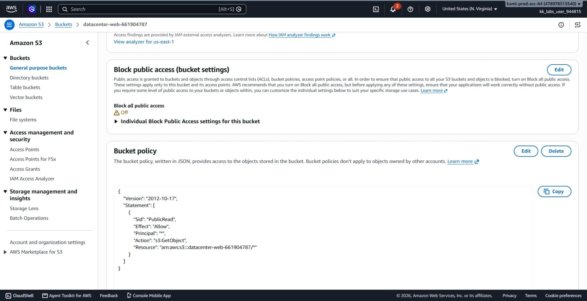
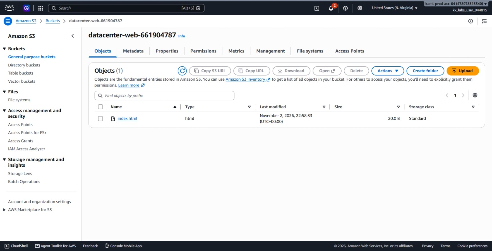
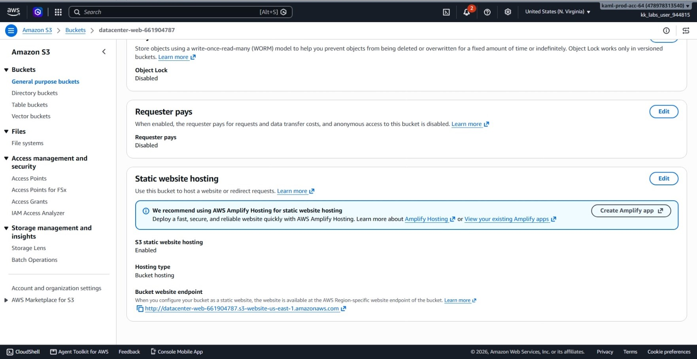
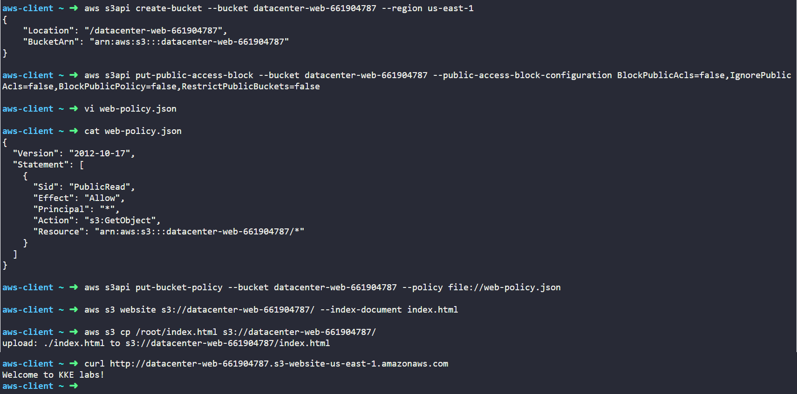

# Day 39: Hosting a Static Website on AWS S3

## Objective
The objective is to host a public static website on Amazon S3 using the AWS CLI. I created an S3 bucket named `datacenter-web-661904787` in the `us-east-1` region, disabled the Block Public Access settings, attached a public-read bucket policy, enabled static website hosting with `index.html` as the default document, uploaded the website files, and verified public accessibility through the S3 website endpoint.

## 1. S3 Static Website Hosting Concepts

Amazon S3 can serve web files directly over HTTP without requiring an EC2 instance, web server container, or load balancer.

### Static Website Hosting
When enabled on a bucket, S3 acts like a standard web server. We specify:
* **Index Document (`index.html`):** The default root page served when a user navigates to the website address.
* **Error Document (optional):** A custom 404 page returned when a requested file does not exist.

### S3 Website Endpoint vs. Standard S3 Endpoint
* **Standard S3 Endpoint (`bucket.s3.amazonaws.com`):** Uses the S3 REST API. Requests to the bucket root return XML listings instead of web pages.
* **Website Endpoint (`bucket.s3-website-region.amazonaws.com`):** Serves the index document directly in the browser, supports HTTP redirects, and returns clean HTML responses.

### Two-Step Requirement for Public Access
To allow public visitors to load the website, two security layers must be configured:
1. **Disable Block Public Access:** AWS protects all buckets by default with four safety controls that reject public policies. I set all four to `false` so the bucket can accept public access rules.
2. **Bucket Policy (`s3:GetObject`):** A JSON policy attached directly to the bucket granting anonymous users (`Principal: *`) permission to download and view any object (`/*`) in the bucket.

## 2. Order of Steps

To configure and host the static website, I followed these steps in order:

1. **Create the S3 Bucket:** Provision `datacenter-web-661904787` in `us-east-1`.
2. **Disable Block Public Access:** Update bucket settings to permit public policies.
3. **Attach Public Read Policy:** Apply a bucket policy granting `s3:GetObject` permission to all users on bucket contents.
4. **Enable Static Website Hosting:** Configure the bucket with `index.html` as the index document.
5. **Upload Website Content:** Copy `/root/index.html` into the root of the S3 bucket.
6. **Verify Website Endpoint:** Query the generated S3 website URL using `curl` and inspect the console.

## 3. Command Execution

### Step 1: Create the S3 Bucket
I created the bucket in the `us-east-1` region:

```bash
aws s3api create-bucket \
  --bucket datacenter-web-661904787 \
  --region us-east-1
```

* `create-bucket`: The API call that initializes the bucket.
* `--bucket datacenter-web-661904787`: Specifies the globally unique bucket name.

### Step 2: Disable Block Public Access
I updated the bucket configuration to disable all four public access blocks:

```bash
aws s3api put-public-access-block \
  --bucket datacenter-web-661904787 \
  --public-access-block-configuration BlockPublicAcls=false,IgnorePublicAcls=false,BlockPublicPolicy=false,RestrictPublicBuckets=false
```

* `put-public-access-block`: Modifies public access restriction settings.
* Setting all four flags to `false` allows the bucket to accept a public read policy.

### Step 3: Apply the Public Read Bucket Policy
I created a local policy file named `web-policy.json` allowing public `s3:GetObject` access:

```json
{
  "Version": "2012-10-17",
  "Statement": [
    {
      "Sid": "PublicRead",
      "Effect": "Allow",
      "Principal": "*",
      "Action": "s3:GetObject",
      "Resource": "arn:aws:s3:::datacenter-web-661904787/*"
    }
  ]
}
```

I attached this policy directly to the bucket:

```bash
aws s3api put-bucket-policy \
  --bucket datacenter-web-661904787 \
  --policy file://web-policy.json
```

* `put-bucket-policy`: Applies an access control policy to the target bucket.
* `Resource: "arn:aws:s3:::datacenter-web-661904787/*"`: Scopes the public read permission to all objects stored inside the bucket.

### Step 4: Enable Static Website Hosting
I configured the bucket to serve web pages using `index.html` as the default document:

```bash
aws s3 website s3://datacenter-web-661904787/ \
  --index-document index.html
```

* `aws s3 website`: Turns on website hosting mode.
* `--index-document index.html`: Sets the home page file name.

### Step 5: Upload the Website File
I copied the local HTML file into the root of the bucket:

```bash
aws s3 cp /root/index.html s3://datacenter-web-661904787/
```

* `aws s3 cp`: Uploads the local file to the target S3 path.

Output:
```text
upload: ./index.html to s3://datacenter-web-661904787/index.html
```

## 4. Dual Verification


### Console UI Verification
I confirmed the bucket configuration in the AWS Management Console:

1. **Amazon S3 > Buckets > `datacenter-web-661904787`:** Opened the bucket overview and checked the **Permissions** tab to verify that the bucket displays the **Publicly accessible** badge.



2. **Objects Tab:** Verified that `index.html` is listed with read access granted.



3. **Properties Tab:** Scrolled down to the **Static website hosting** panel and verified that the status displays as **Enabled** with `index.html` set as the Index document, displaying the active website endpoint URL.




### CLI Verification
I queried the public S3 website endpoint using `curl`:

```bash
curl http://datacenter-web-661904787.s3-website-us-east-1.amazonaws.com
```

Output:
```text
Welcome to KKE labs!
```

The response returned the expected body text without authentication errors, confirming that the website hosting configuration and public bucket policy are working properly.


## Result
I verified that the static website was successfully hosted on the `datacenter-web-661904787` S3 bucket in `us-east-1`. Block Public Access was disabled, a public read policy was applied, and static website hosting was configured. Visiting the website URL returned `Welcome to KKE labs!` via both `curl` and the web browser.

## Screenshots
