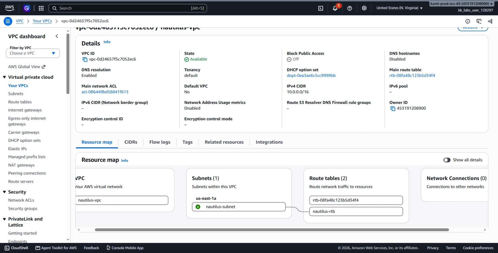
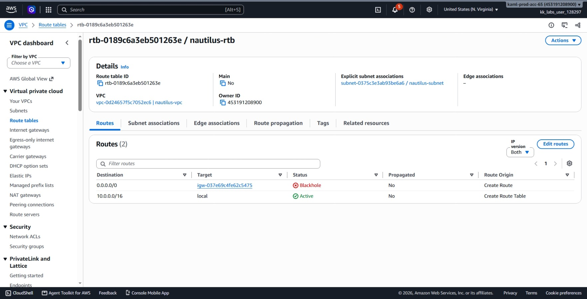
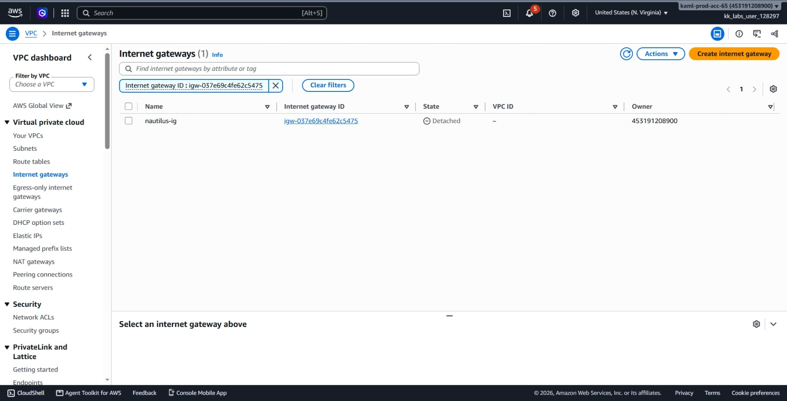
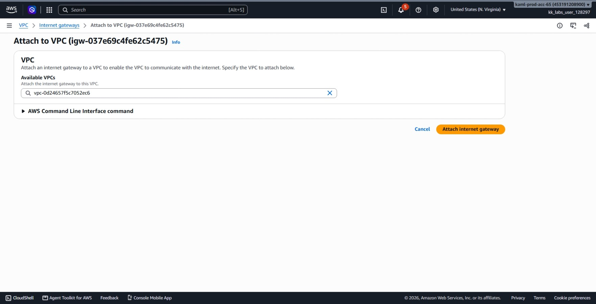
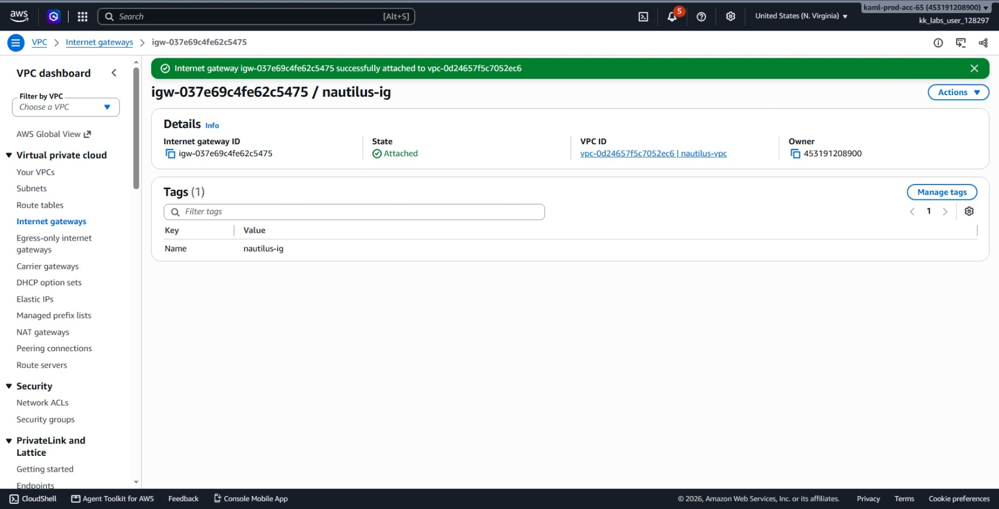
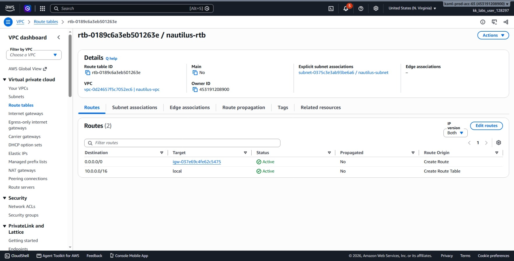
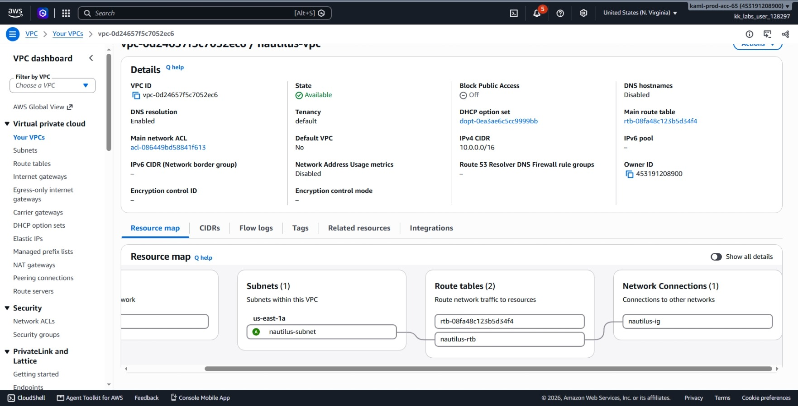
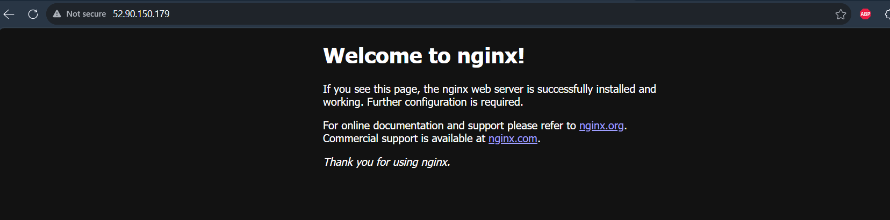

# Day 40: Troubleshooting Internet Accessibility for an EC2-Hosted Application

## Objective

The objective is to troubleshoot and fix an internet connectivity issue for a web application running on an EC2 instance named `nautilus-ec2`. The instance had Nginx running and port 80 open in its security group, but the website was still unreachable from the internet. I investigated the VPC routing components, identified a detached Internet Gateway causing a `Blackhole` route, attached the gateway to `nautilus-vpc`, and verified that the Nginx welcome page became accessible.

I investigated the AWS components to find why internet traffic could not reach the instance:

### Step 1: Inspect the VPC Resource Map
I opened the **VPC** console, selected `nautilus-vpc`, and checked the **Resource map**. I saw that the subnet `nautilus-subnet` had no working path to the internet because there was no active gateway linked to its route table.

### Step 2: Inspect the Route Table Status
I navigated to **Route tables** and checked `nautilus-rtb` (the route table associated with `nautilus-subnet`). 
* The route list included `0.0.0.0/0` pointing to an Internet Gateway ID (`nautilus-ig`).
* However, the **Status** column displayed **`Blackhole`** instead of `Active`.

### Step 3: Inspect the Internet Gateways
I navigated to **Internet Gateways** in the VPC console and checked `nautilus-ig`:
* The gateway existed, but its **State** was **`Detached`**.
* It was not linked to `nautilus-vpc` or any other VPC.

**Root Cause Found:** The route table was attempting to forward all internet traffic to `nautilus-ig`, but because `nautilus-ig` was detached from `nautilus-vpc`, AWS marked the route as a `Blackhole` and dropped all incoming and outgoing web traffic.

## 3. Resolution Steps

### Step 1: Attach the Internet Gateway to the VPC
I selected `nautilus-ig`, clicked **Actions**, and selected **Attach to VPC**.

In the setup window, I selected `nautilus-vpc` from the dropdown and confirmed the attachment.

### Step 2: Confirm Route Table State Changed to Active
I navigated back to **Route tables**, opened `nautilus-rtb`, and checked the **Routes** tab:
* The target route `0.0.0.0/0` targeting `nautilus-ig` automatically switched from `Blackhole` to **`Active`**.

### Step 3: Confirm VPC Resource Map
I revisited the `nautilus-vpc` details page and inspected the **Resource map**. It now showed an unbroken line connecting `nautilus-subnet` through `nautilus-rtb` directly to the attached `nautilus-ig`.

## 4. Verification

### Web Accessibility Check
I navigated to **EC2 > Instances**, selected `nautilus-ec2`, and copied its public IPv4 address.

I opened a web browser, pasted the public IP address, and loaded the page:
`http://<nautilus-ec2-public-ip>`

The default Nginx welcome page loaded immediately:
`Welcome to nginx!`

## Result

I identified that the web server in `nautilus-vpc` was unreachable because the Internet Gateway `nautilus-ig` was detached, causing the default route in `nautilus-rtb` to sit in a `Blackhole` state. Once I attached `nautilus-ig` to `nautilus-vpc`, the route automatically changed to `Active`, and the Nginx server on `nautilus-ec2` became accessible from the internet on port 80.