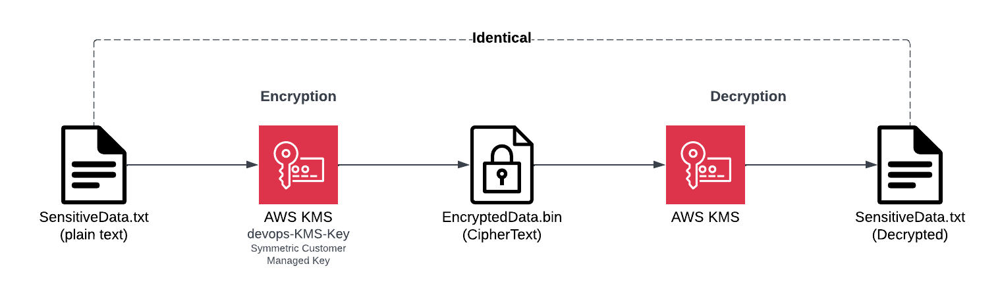
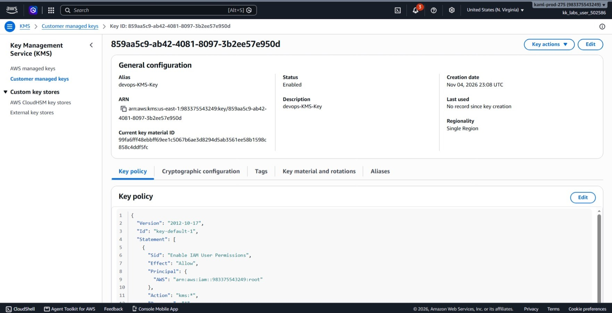

# Day 41: Securing Data with AWS KMS

## Objective
The objective is to protect a sensitive file using AWS Key Management Service (KMS). I created a symmetric customer-managed key with the alias `alias/devops-KMS-Key`, encrypted `/root/SensitiveData.txt` to save the scrambled output as `/root/EncryptedData.bin`, decrypted it back into a new file, and verified that the decrypted file matches the original.




## 1. How AWS KMS and Encryption Work

1. **The Problem:** The file `/root/SensitiveData.txt` contains readable text. Anyone who logs onto the machine can open and read it.
2. **Encryption:** Encryption turns readable text into scrambled data called ciphertext. To turn ciphertext back into readable text, you need the right key.
3. **AWS KMS:** Instead of creating and keeping an encryption key file on our own server, I asked AWS KMS to create and protect the key for me. I used a **symmetric key**, which means the exact same key is used to both encrypt and decrypt the data.
4. **Aliases:** A KMS key ID is a long random string. An alias is a friendly name (like `alias/devops-KMS-Key`) that points to that key ID, making it much easier to reference in commands.
5. **Encrypting:** I sent the file's contents to AWS KMS. KMS used my key to encrypt the data and sent back the scrambled ciphertext.
6. **Base64:** The ciphertext from the AWS CLI comes back as Base64 text. Base64 is just a way to represent raw binary data as text so it can travel over the command line. It does not add any security. I piped it through `base64 --decode` to save the actual raw binary bytes into `EncryptedData.bin`.
7. **Decrypting:** To read the file again, I sent the binary ciphertext back to AWS KMS. KMS recognized the key it used before, decrypted the data, and returned the original text.
8. **Verification:** I compared the decrypted file with the original file. Because they match completely, the encryption and decryption cycle worked as expected.

The main takeaway: AWS KMS manages and guards the key inside AWS, while I use that key to protect and recover my files.

## 2. Order of Steps

To encrypt and verify the data, I followed these steps in order:

1. **Create the KMS Key:** Generate a new symmetric key in AWS KMS.
2. **Create Key Alias:** Give the key a readable alias named `alias/devops-KMS-Key`.
3. **Encrypt the File:** Send `/root/SensitiveData.txt` to KMS, decode the output, and write it to `/root/EncryptedData.bin`.
4. **Decrypt the Data:** Send `/root/EncryptedData.bin` back to KMS, decode it, and write it to `/root/DecryptedData.txt`.
5. **Verify with Diff:** Compare the original file and the decrypted file to ensure they are identical.

## 3. Command Execution

### Step 1: Create the KMS Key
I generated a new customer-managed key in `us-east-1` and saved its key ID:

```bash
KEY_ID=$(aws kms create-key \
  --description "devops-KMS-Key" \
  --query KeyMetadata.KeyId \
  --output text)

echo $KEY_ID
```

* `create-key`: Asks KMS to make a new key (defaults to symmetric).
* `--description`: Adds a note to describe what the key is for.
* `--query KeyMetadata.KeyId`: Grabs only the unique key ID.

Created Key ID: `859aa5c9-ab42-4081-8097-3b2ee57e950d`

### Step 2: Create the Alias
I added a friendly name alias to the key so I can refer to it easily:

```bash
aws kms create-alias \
  --alias-name alias/devops-KMS-Key \
  --target-key-id $KEY_ID
```

* `create-alias`: Links a friendly name to a key.
* `--alias-name alias/devops-KMS-Key`: The alias name (AWS requires it to start with `alias/`).
* `--target-key-id`: The key ID created in Step 1.

### Step 3: Encrypt the Sensitive File
I encrypted the text file and saved the output as binary data:

```bash
aws kms encrypt \
  --key-id alias/devops-KMS-Key \
  --plaintext fileb:///root/SensitiveData.txt \
  --query CiphertextBlob \
  --output text | base64 --decode > /root/EncryptedData.bin
```

### Argument Breakdown:
* `encrypt`: Asks KMS to encrypt data using our key.
* `--key-id alias/devops-KMS-Key`: Specifies which key to use.
* `--plaintext fileb:///root/SensitiveData.txt`: Sends the file bytes directly to KMS (`fileb://` reads it as raw binary).
* `--query CiphertextBlob`: Pulls out just the encrypted data block.
* `base64 --decode > /root/EncryptedData.bin`: Converts the text output back into raw binary bytes and saves it to disk.

I checked that the file was created:

```bash
ls -l /root/EncryptedData.bin
```

Output confirmed a file of 177 bytes was created.

### Step 4: Decrypt the File
I decrypted the binary file to test that it could be recovered:

```bash
aws kms decrypt \
  --ciphertext-blob fileb:///root/EncryptedData.bin \
  --query Plaintext \
  --output text | base64 --decode > /root/DecryptedData.txt
```

### Argument Breakdown:
* `decrypt`: Asks KMS to decrypt ciphertext. (KMS automatically knows which key was used to encrypt it).
* `--ciphertext-blob fileb:///root/EncryptedData.bin`: Sends the raw encrypted file back to KMS.
* `--query Plaintext`: Pulls the decrypted text output.
* `base64 --decode > /root/DecryptedData.txt`: Decodes the Base64 response into plain text and saves it.

## 4. Dual Verification

### CLI Verification
I used `diff` to compare the original file with the decrypted file:

```bash
diff /root/SensitiveData.txt /root/DecryptedData.txt && echo MATCH
```

Output:
```text
MATCH
```

Because `diff` produced no differences and printed `MATCH`, the decrypted content is 100% identical to the original sensitive file.

### Console UI Verification
I confirmed the key in the AWS Management Console:
1. Navigated to **Key Management Service (KMS)** > **Customer managed keys**.
2. Located `devops-KMS-Key` in the table under the **Aliases** column.
3. Clicked on the key and confirmed:
   * **Status:** `Enabled`
   * **Key type:** `Symmetric`
   * **Key usage:** `Encrypt and decrypt`
   * **Key ID:** Matches `859aa5c9-ab42-4081-8097-3b2ee57e950d`.



## Result
I verified that the symmetric KMS key with alias `alias/devops-KMS-Key` was created and enabled. I encrypted `/root/SensitiveData.txt` into `/root/EncryptedData.bin` and successfully decrypted it back to `/root/DecryptedData.txt`. The `diff` check confirmed an exact match, and the AWS Management Console confirms the key is active and ready for use.

## Screenshots
