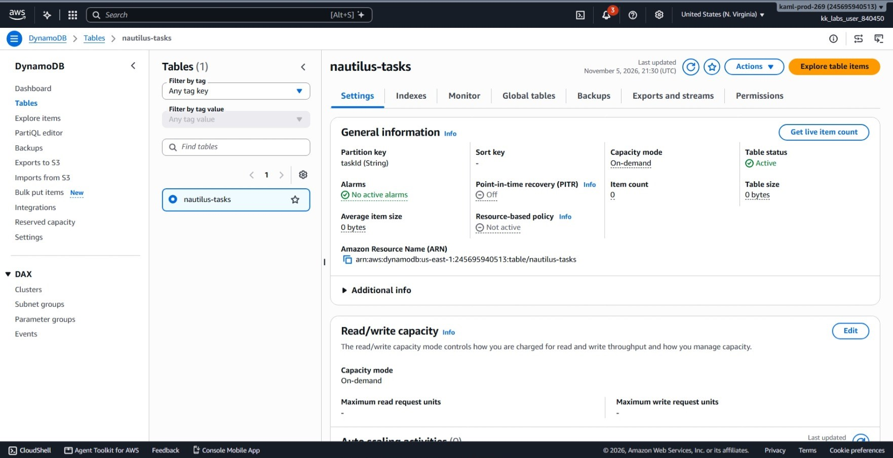
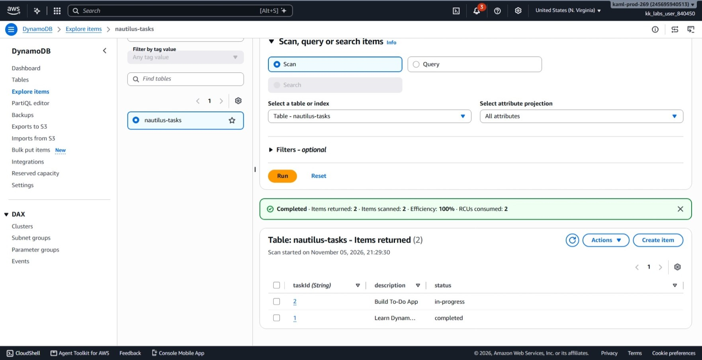
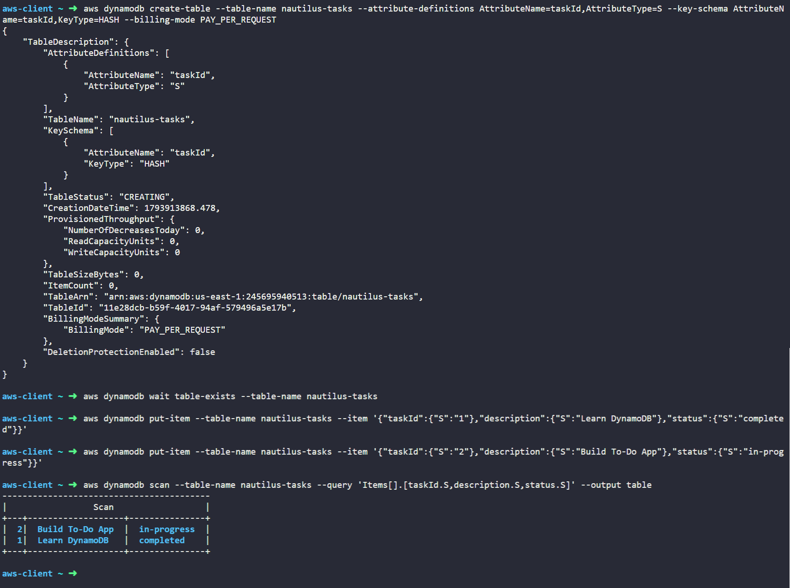

# Day 42: Building and Managing NoSQL Databases with AWS DynamoDB

## Objective
The objective is to create a NoSQL DynamoDB table named `nautilus-tasks` with a primary key of `taskId` (string) using the AWS CLI. I populated the table with two task items and verified that the items and their statuses were stored accurately.


## 1. DynamoDB Core Concepts

**NoSQL Database**
Amazon DynamoDB is a managed NoSQL database service. Unlike traditional SQL databases, we do not need to define every column ahead of time. You only need to define the primary key when creating the table.

**Primary Key (Partition Key / HASH)**
Every item stored in a DynamoDB table must have a unique identifier. In this setup, `taskId` is the partition key (hash key). DynamoDB uses this key to distribute data across physical storage partitions and find items quickly.

**Attributes**
Attributes are the data fields stored inside an item (like `description` and `status`). In the AWS CLI, attributes must have their data type declared, such as `{"S": "completed"}` where `S` stands for String.

**Billing Mode (PAY_PER_REQUEST)**
I set the billing mode to on-demand (`PAY_PER_REQUEST`). Instead of planning and paying for fixed read and write capacity in advance, AWS only charges for the actual read and write operations performed.

## 2. Command Execution

### Step 1: Create the DynamoDB Table
I created the table with `taskId` as a string partition key using on-demand capacity:

```bash
aws dynamodb create-table \
  --table-name nautilus-tasks \
  --attribute-definitions AttributeName=taskId,AttributeType=S \
  --key-schema AttributeName=taskId,KeyType=HASH \
  --billing-mode PAY_PER_REQUEST
```

* `create-table`: Initializes a new DynamoDB table.
* `--attribute-definitions`: Defines the attribute name and type (`S` for String).
* `--key-schema`: Sets `taskId` as the primary partition key (`HASH`).
* `--billing-mode PAY_PER_REQUEST`: Sets on-demand capacity.

I waited for the table creation to finish:

```bash
aws dynamodb wait table-exists \
  --table-name nautilus-tasks
```

### Step 2: Insert the Items
I inserted both task items into the table using `put-item`:

```bash
# Insert Task 1
aws dynamodb put-item \
  --table-name nautilus-tasks \
  --item '{"taskId":{"S":"1"},"description":{"S":"Learn DynamoDB"},"status":{"S":"completed"}}'

# Insert Task 2
aws dynamodb put-item \
  --table-name nautilus-tasks \
  --item '{"taskId":{"S":"2"},"description":{"S":"Build To-Do App"},"status":{"S":"in-progress"}}'
```

* `put-item`: Creates a new item or replaces an existing item in the table.
* `--item`: The JSON payload containing the attributes and their data types (`S` for string).

## 3. Verification


### Console UI Verification

I confirmed the table and items in the AWS Management Console:
1. **DynamoDB > Tables:** Located `nautilus-tasks` and verified its status is **Active** with partition key **taskId (String)**.



2. **Explore Items:** Selected the table, opened **Explore items**, and confirmed that both items appear with their matching `description` and `status` values.




### CLI Verification
I ran a scan to retrieve and display the stored records:

```bash
aws dynamodb scan \
  --table-name nautilus-tasks \
  --query 'Items[].[taskId.S,description.S,status.S]' \
  --output table
```

Output:
```text
-----------------------------------------
|                 Scan                  |
+---+-------------------+---------------+
|  2|  Build To-Do App  |  in-progress  |
|  1|  Learn DynamoDB   |  completed    |
+---+-------------------+---------------+
```

Both tasks were returned with the expected attributes:
* Task 1: `taskId = 1`, `description = Learn DynamoDB`, `status = completed`
* Task 2: `taskId = 2`, `description = Build To-Do App`, `status = in-progress`


## Result
I verified that the `nautilus-tasks` DynamoDB table was successfully created in `Active` state with on-demand capacity. Both task items were written and verified via CLI and AWS Console with their correct descriptions and completion statuses.

## Screenshots
