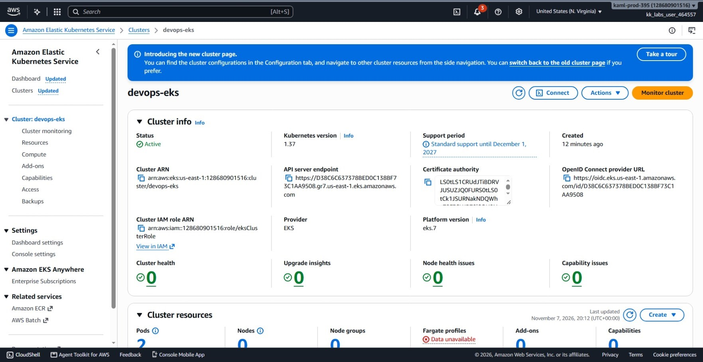
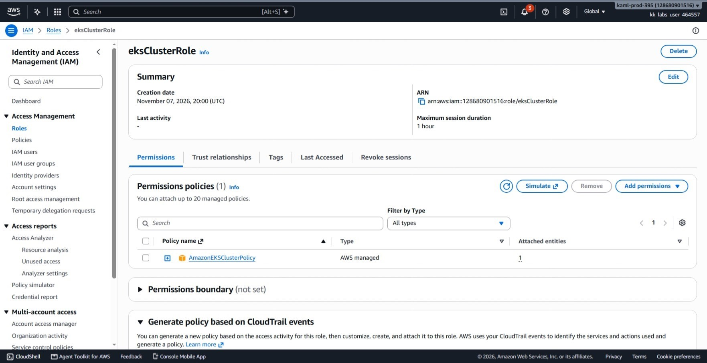
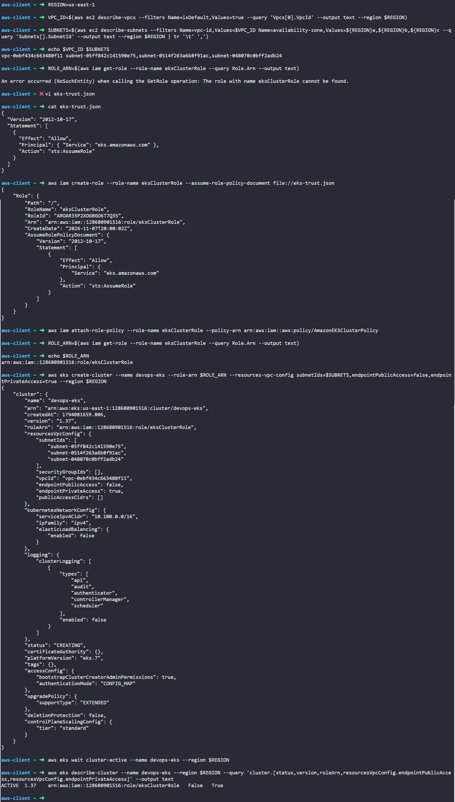

# Day 43: Scaling and Managing Kubernetes Clusters with Amazon EKS

## Objective
The objective is to provision an Amazon Elastic Kubernetes Service (EKS) control plane named `devops-eks` in the `us-east-1` region using the AWS CLI. I created the required IAM service role (`eksClusterRole`), mapped subnets across three Availability Zones (`us-east-1a`, `us-east-1b`, and `us-east-1c`) in the default VPC for high availability, restricted the Kubernetes API server endpoint to private access only, and verified that the cluster reached the `ACTIVE` state.


## 1. Amazon EKS Architecture & Private Endpoints

Amazon **Elastic Kubernetes Service (EKS)** is a managed service that runs the Kubernetes control plane in AWS.

### EKS Control Plane Management
With Amazon EKS, AWS runs and manages the Kubernetes master nodes (API server, etcd storage, and controller managers) across multiple Availability Zones. We do not manage the underlying virtual machines that run the Kubernetes control plane.

### The Cluster IAM Role
The EKS control plane needs permission to manage AWS resources on our behalf.
* **Trust Policy:** Allows the `eks.amazonaws.com` service to assume the role.
* **Permissions Policy:** Attaching `AmazonEKSClusterPolicy` grants EKS permissions to create elastic network interfaces (ENIs), configure security groups, and route traffic to worker nodes.

### High Availability Across Multiple Zones
EKS requires subnets across at least two Availability Zones, but best practice is three. By selecting subnets in `us-east-1a`, `us-east-1b`, and `us-east-1c`, the Kubernetes control plane can distribute its components across distinct physical datacenters.

### Private Endpoint Access
By default, the EKS API server has a public endpoint accessible over the internet.
* Setting `endpointPublicAccess=false` and `endpointPrivateAccess=true` locks down the cluster.
* The Kubernetes API server can only be reached from inside the VPC (or via connected VPNs/peered networks). It has no public IP address, preventing exposure to the public internet.

## 2. Order of Steps

To configure and launch the cluster, I followed these steps in order:

1. **Query VPC and Subnets:** Discover the default VPC ID and select subnets located in `us-east-1a`, `us-east-1b`, and `us-east-1c`.
2. **Create EKS Trust Policy:** Write `eks-trust.json` allowing `eks.amazonaws.com` to assume an IAM role.
3. **Create IAM Role:** Create `eksClusterRole` and attach `AmazonEKSClusterPolicy`.
4. **Create EKS Cluster:** Provision `devops-eks` with private endpoint access enabled and public access disabled.
5. **Wait for Cluster Availability:** Monitor the deployment until the cluster transitions from `CREATING` to `ACTIVE`.
6. **Verify Settings:** Check cluster status, version, and networking attributes using the CLI and AWS Management Console.

## 3. Command Execution

### Step 1: Collect VPC and Multi-AZ Subnet IDs
I retrieved the default VPC ID and collected subnets in Availability Zones `a`, `b`, and `c`:

```bash
REGION=us-east-1

# Get default VPC ID
VPC_ID=$(aws ec2 describe-vpcs \
  --filters Name=isDefault,Values=true \
  --query 'Vpcs[0].VpcId' \
  --output text \
  --region $REGION)

# Get comma-separated list of subnets in us-east-1a, us-east-1b, and us-east-1c
SUBNETS=$(aws ec2 describe-subnets \
  --filters Name=vpc-id,Values=$VPC_ID Name=availability-zone,Values=${REGION}a,${REGION}b,${REGION}c \
  --query 'Subnets[].SubnetId' \
  --output text \
  --region $REGION | tr '\t' ',')

echo $VPC_ID $SUBNETS
```

Values found:
* **VPC ID:** `vpc-0ebf434c663480f11`
* **Subnets:** `subnet-05ff842c141590e75,subnet-0514f263a6b8f91ac,subnet-048070c0bff2adb24`

### Step 2: Create IAM Role for EKS
I checked for the `eksClusterRole`. Because it did not exist, I created the trust policy file and the role:

```bash
# Create trust policy
cat << 'EOF' > eks-trust.json
{
  "Version": "2012-10-17",
  "Statement": [
    {
      "Effect": "Allow",
      "Principal": {
        "Service": "eks.amazonaws.com"
      },
      "Action": "sts:AssumeRole"
    }
  ]
}
EOF

# Create IAM role
aws iam create-role \
  --role-name eksClusterRole \
  --assume-role-policy-document file://eks-trust.json

# Attach managed EKS cluster policy
aws iam attach-role-policy \
  --role-name eksClusterRole \
  --policy-arn arn:aws:iam::aws:policy/AmazonEKSClusterPolicy

# Save the Role ARN
ROLE_ARN=$(aws iam get-role \
  --role-name eksClusterRole \
  --query Role.Arn \
  --output text)

echo $ROLE_ARN
```

Created Role ARN: `arn:aws:iam::128680901516:role/eksClusterRole`

### Step 3: Create the EKS Cluster
I created the EKS cluster with private endpoint access enabled and public endpoint access disabled:

```bash
aws eks create-cluster \
  --name devops-eks \
  --role-arn $ROLE_ARN \
  --resources-vpc-config subnetIds=$SUBNETS,endpointPublicAccess=false,endpointPrivateAccess=true \
  --region $REGION
```

### Argument Breakdown:
* `create-cluster`: Provisions an Amazon EKS control plane.
* `--name devops-eks`: The name of the Kubernetes cluster.
* `--role-arn`: The IAM role that grants EKS permission to manage AWS resources.
* `--resources-vpc-config`: Specifies networking settings:
  * `subnetIds=$SUBNETS`: Assigns subnets across 3 Availability Zones.
  * `endpointPublicAccess=false`: Turns off the public internet endpoint.
  * `endpointPrivateAccess=true`: Turns on internal VPC endpoint access.

### Step 4: Wait for the Cluster to Become Active
EKS control plane provisioning takes several minutes while AWS deploys the underlying Kubernetes master infrastructure. I paused execution until the status changed to `ACTIVE`:

```bash
aws eks wait cluster-active \
  --name devops-eks \
  --region $REGION
```

* `wait cluster-active`: Pauses the terminal until the cluster status reaches `ACTIVE`.

## 4. Verification


### Console UI Verification
I confirmed the resources in the AWS Management Console:

1. **Amazon EKS > Clusters > `devops-eks`:**
   * **Overview tab:** Confirms **Status** displays as **Active** with Kubernetes version **1.37**.
   * **Networking tab:** Confirms **API server endpoint access** shows **Private** enabled and **Public** disabled. Confirms subnets cover zones `us-east-1a`, `us-east-1b`, and `us-east-1c`.



2. **IAM > Roles > `eksClusterRole`:**
   * **Permissions tab:** Confirms `AmazonEKSClusterPolicy` is attached.
   * **Trust relationships tab:** Confirms trusted entity is `eks.amazonaws.com`.




### CLI Verification
I queried the cluster details to verify status, Kubernetes version, role ARN, and network endpoint flags:

```bash
aws eks describe-cluster \
  --name devops-eks \
  --region $REGION \
  --query 'cluster.[status,version,roleArn,resourcesVpcConfig.endpointPublicAccess,resourcesVpcConfig.endpointPrivateAccess]' \
  --output text
```

Output:
```text
ACTIVE  1.37    arn:aws:iam::128680901516:role/eksClusterRole   False   True
```

The output confirms:
* **Status:** `ACTIVE`
* **Kubernetes Version:** `1.37` (latest stable platform version)
* **Role ARN:** Matches `eksClusterRole`
* **endpointPublicAccess:** `False`
* **endpointPrivateAccess:** `True`


## Result
I verified that the `devops-eks` Amazon EKS cluster was successfully deployed in `us-east-1` and reached the `ACTIVE` state. The cluster uses subnets across three Availability Zones for high availability, communicates using the dedicated `eksClusterRole` IAM role, and keeps the Kubernetes API server endpoint fully private inside the VPC.

## Screenshots
