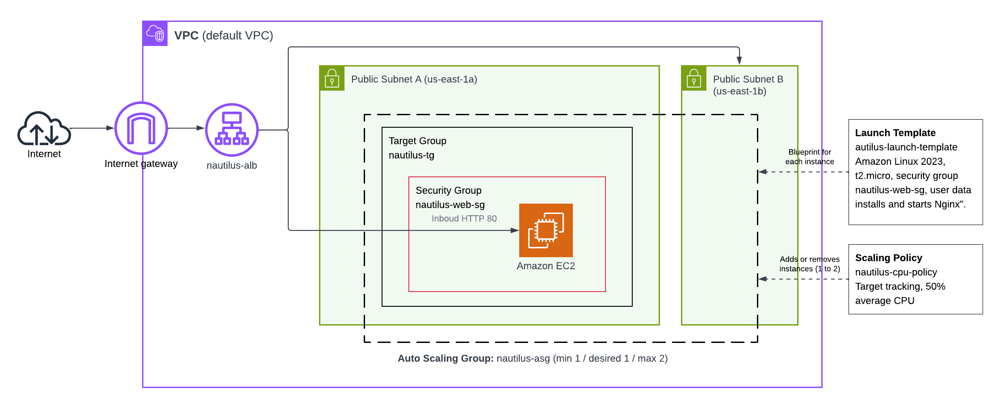
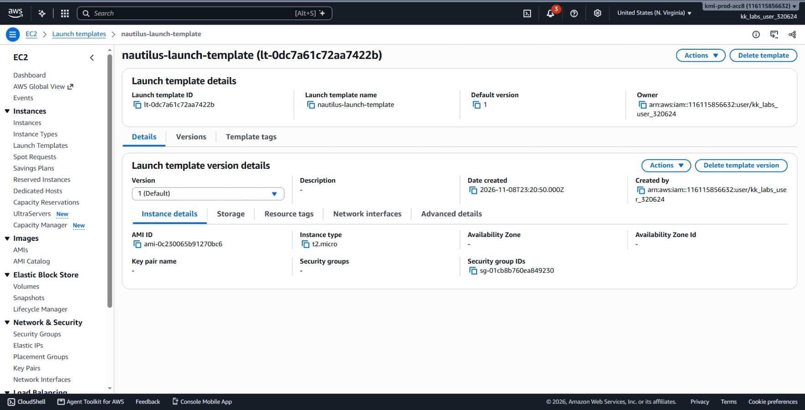
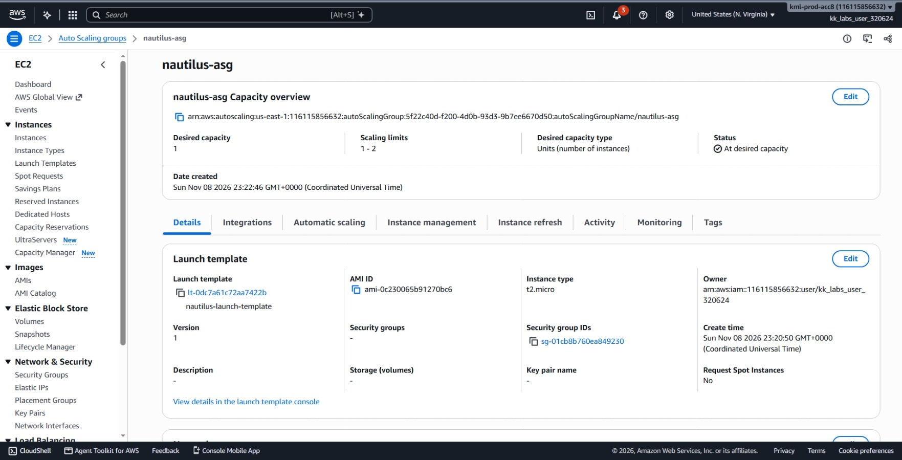
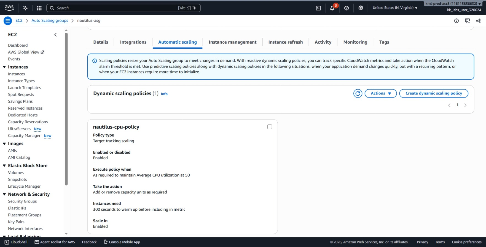
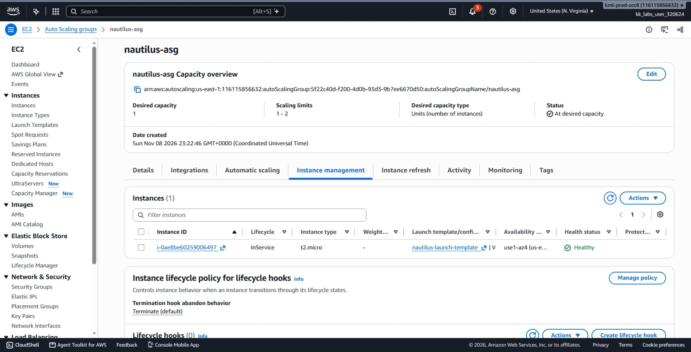
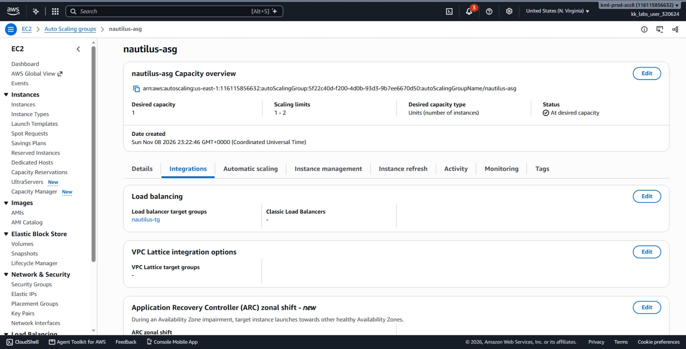
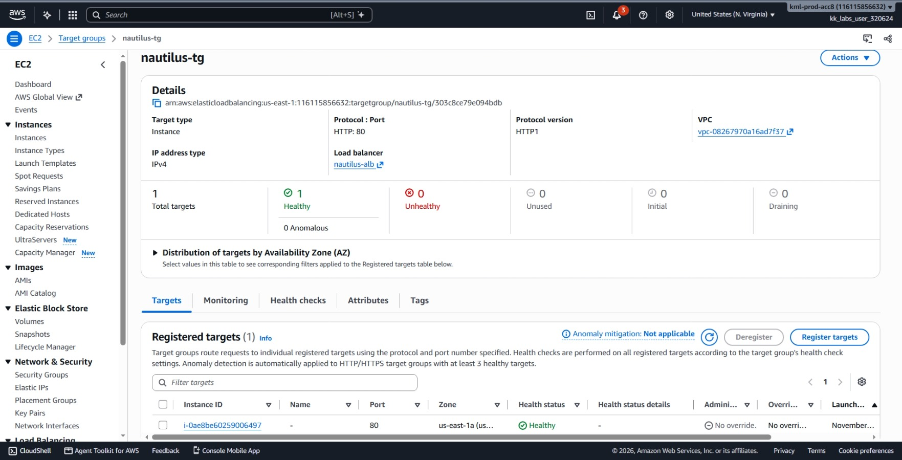
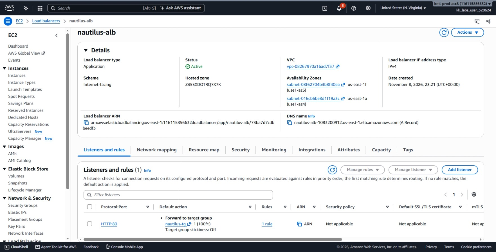
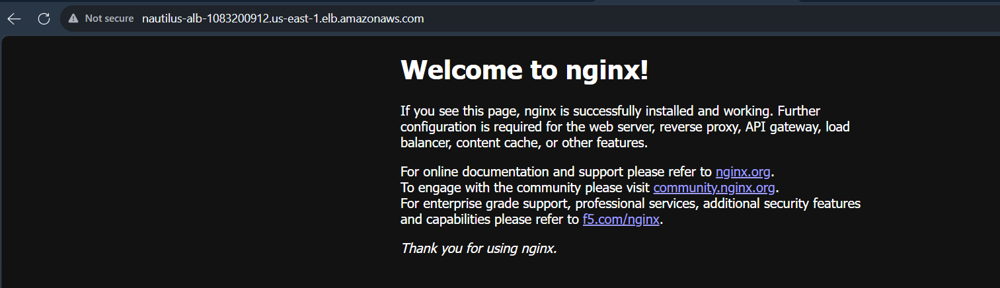
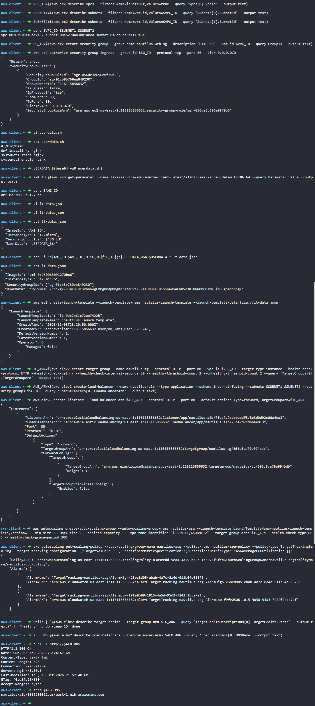

# Day 44: Implementing Auto Scaling for High Availability in AWS

## Objective

The objective is to set up a highly available, self-healing, and scalable web tier on AWS using the AWS CLI. I created a Launch Template with an automated Nginx User Data script, an Application Load Balancer (ALB) with a Target Group, an Auto Scaling Group (ASG) maintaining between 1 and 2 instances, and a Target Tracking Scaling Policy that adjusts capacity based on a 50% CPU utilization target.




## 1. High Availability with Auto Scaling and Load Balancing

This architecture combines two services to keep web applications reliable and scalable: an Application Load Balancer and an Auto Scaling Group.

### Launch Template (The Blueprint)
A Launch Template stores all the settings needed to create an EC2 instance:
* The AMI ID (Amazon Linux 2023).
* The instance size (`t2.micro`).
* The Security Group (allowing inbound traffic on port 80).
* The User Data bootstrap script.

The Auto Scaling Group uses this template whenever it needs to spin up a new server.

### User Data (Automated Setup)
User Data is a shell script that runs on the instance during its very first boot. It installs Nginx, starts the web service, and enables it so Nginx restarts automatically if the server reboots. This ensures every instance created by Auto Scaling is immediately ready to serve web requests without manual setup.

### Auto Scaling Group (ASG)
An Auto Scaling Group manages the number of running instances across subnets:
* **Minimum Size (1):** The fleet will never drop below 1 instance.
* **Desired Capacity (1):** The standard number of instances running under normal conditions.
* **Maximum Size (2):** The ceiling limit the group will never exceed.

If an instance crashes or fails health checks, the ASG automatically terminates it and launches a fresh replacement from the Launch Template.

### Target Tracking Scaling Policy (50% CPU)
Instead of manually adding servers during traffic spikes, I configured a Target Tracking policy:
* CloudWatch continuously tracks average CPU utilization across all instances in the group.
* If average CPU usage rises above 50%, the ASG adds an instance (up to the maximum of 2).
* When demand decreases and CPU usage drops, the ASG safely removes the extra instance (down to the minimum of 1).

### Application Load Balancer (ALB) and Target Group
* **Target Group (`nautilus-tg`):** A list of instances that receive traffic. It constantly runs health checks against `/`. If an instance answers with HTTP 200, it is marked `healthy`.
* **ALB (`nautilus-alb`):** The public entry point. It receives incoming user traffic on port 80 and sends it only to healthy instances in the target group.
* **The Connection:** The ASG is attached directly to the Target Group. When Auto Scaling launches a new instance, it automatically registers it with the Target Group. When it terminates an instance, it deregisters it cleanly.

## 2. Order of Steps

To build the architecture, I followed these steps in order:

1. **Find Network Resources:** Get the default VPC ID and two subnets in different Availability Zones.
2. **Create Security Group:** Create `nautilus-web-sg` and open inbound TCP port 80 to the public.
3. **Write User Data Script:** Create `userdata.sh` and encode it in Base64 for the launch template.
4. **Get Amazon Linux 2023 AMI:** Query the SSM Parameter Store for the newest image.
5. **Create Launch Template:** Build `lt-data.json` and register `nautilus-launch-template`.
6. **Create Target Group:** Create `nautilus-tg` on port 80 with HTTP health checks on `/`.
7. **Create ALB and Listener:** Deploy `nautilus-alb` across the two subnets and add an HTTP:80 listener forwarding to `nautilus-tg`.
8. **Create Auto Scaling Group:** Launch `nautilus-asg` (min 1, desired 1, max 2) linked to the launch template and target group.
9. **Attach Scaling Policy:** Configure a 50% average CPU target tracking policy.
10. **Verify Health and Connectivity:** Wait for the target instance to report `healthy` and curl the ALB DNS name.

## 3. Command Execution

### Step 1: Collect VPC and Multi-AZ Subnet IDs
I retrieved the default VPC ID and two subnets in different Availability Zones:

```bash
VPC_ID=$(aws ec2 describe-vpcs \
  --filters Name=isDefault,Values=true \
  --query 'Vpcs[0].VpcId' \
  --output text)

SUBNET1=$(aws ec2 describe-subnets \
  --filters Name=vpc-id,Values=$VPC_ID \
  --query 'Subnets[0].SubnetId' \
  --output text)

SUBNET2=$(aws ec2 describe-subnets \
  --filters Name=vpc-id,Values=$VPC_ID \
  --query 'Subnets[1].SubnetId' \
  --output text)

echo $VPC_ID $SUBNET1 $SUBNET2
```

Values found:
* **VPC ID:** `vpc-08267970a16ad7f37`
* **Subnet 1:** `subnet-08f62704b3b8f40ea`
* **Subnet 2:** `subnet-016cb6be8d1f19a3c`

### Step 2: Create Security Group and Allow HTTP Port 80
I created `nautilus-web-sg` to allow web traffic for both the load balancer and the web instances:

```bash
# Create security group
SG_ID=$(aws ec2 create-security-group \
  --group-name nautilus-web-sg \
  --description "HTTP 80" \
  --vpc-id $VPC_ID \
  --query GroupId \
  --output text)

# Allow inbound HTTP port 80
aws ec2 authorize-security-group-ingress \
  --group-id $SG_ID \
  --protocol tcp \
  --port 80 \
  --cidr 0.0.0.0/0
```

Created Security Group ID: `sg-01cb8b760ea849230`

### Step 3: Write and Encode User Data Script
Amazon Linux 2023 uses `dnf` for package management. I created `userdata.sh` and converted it to Base64 format:

```bash
cat << 'EOF' > userdata.sh
#!/bin/bash
dnf install -y nginx
systemctl start nginx
systemctl enable nginx
EOF

USERDATA=$(base64 -w0 userdata.sh)
```

### Step 4: Retrieve Amazon Linux 2023 AMI ID
I queried the Systems Manager Parameter Store for the latest official AMI:

```bash
AMI_ID=$(aws ssm get-parameter \
  --name /aws/service/ami-amazon-linux-latest/al2023-ami-kernel-default-x86_64 \
  --query Parameter.Value \
  --output text)

echo $AMI_ID
# Result: ami-0c230065b91270bc6
```

### Step 5: Create the Launch Template
I wrote `lt-data.json`, replaced the placeholders with active variables, and created `nautilus-launch-template`:

```bash
cat << 'EOF' > lt-data.json
{
  "ImageId": "AMI_ID",
  "InstanceType": "t2.micro",
  "SecurityGroupIds": ["SG_ID"],
  "UserData": "USERDATA_B64"
}
EOF

# Inject active configuration values
sed -i "s|AMI_ID|$AMI_ID|;s|SG_ID|$SG_ID|;s|USERDATA_B64|$USERDATA|" lt-data.json

# Create the launch template
aws ec2 create-launch-template \
  --launch-template-name nautilus-launch-template \
  --launch-template-data file://lt-data.json
```

### Step 6: Create the Target Group
I created `nautilus-tg` with health checks running on path `/` every 30 seconds:

```bash
TG_ARN=$(aws elbv2 create-target-group \
  --name nautilus-tg \
  --protocol HTTP \
  --port 80 \
  --vpc-id $VPC_ID \
  --target-type instance \
  --health-check-protocol HTTP \
  --health-check-path / \
  --health-check-interval-seconds 30 \
  --healthy-threshold-count 2 \
  --unhealthy-threshold-count 2 \
  --query 'TargetGroups[0].TargetGroupArn' \
  --output text)
```

Target Group ARN: `arn:aws:elasticloadbalancing:us-east-1:116115856632:targetgroup/nautilus-tg/303c8ce79e094bdb`

### Step 7: Create the Application Load Balancer and Listener
I created the public ALB across the two subnets and added the port 80 forwarding rule:

```bash
# Create the ALB
ALB_ARN=$(aws elbv2 create-load-balancer \
  --name nautilus-alb \
  --type application \
  --scheme internet-facing \
  --subnets $SUBNET1 $SUBNET2 \
  --security-groups $SG_ID \
  --query 'LoadBalancers[0].LoadBalancerArn' \
  --output text)

# Create the port 80 listener forwarding to the target group
aws elbv2 create-listener \
  --load-balancer-arn $ALB_ARN \
  --protocol HTTP \
  --port 80 \
  --default-actions Type=forward,TargetGroupArn=$TG_ARN
```

### Step 8: Create the Auto Scaling Group
I created `nautilus-asg` with a minimum of 1, maximum of 2, and desired capacity of 1 instance. I linked it to the launch template and the target group, and set the health check type to `ELB` with a 300-second grace period:

```bash
aws autoscaling create-auto-scaling-group \
  --auto-scaling-group-name nautilus-asg \
  --launch-template LaunchTemplateName=nautilus-launch-template,Version=1 \
  --min-size 1 \
  --max-size 2 \
  --desired-capacity 1 \
  --vpc-zone-identifier "$SUBNET1,$SUBNET2" \
  --target-group-arns $TG_ARN \
  --health-check-type ELB \
  --health-check-grace-period 300
```

### Step 9: Add the Target Tracking CPU Scaling Policy
I configured the policy to maintain an average CPU utilization of 50%:

```bash
aws autoscaling put-scaling-policy \
  --auto-scaling-group-name nautilus-asg \
  --policy-name nautilus-cpu-policy \
  --policy-type TargetTrackingScaling \
  --target-tracking-configuration '{"TargetValue":50.0,"PredefinedMetricSpecification":{"PredefinedMetricType":"ASGAverageCPUUtilization"}}'
```

## 4. Verification

### CLI Verification
I monitored the health check until the newly launched EC2 instance passed inspection and became `healthy`:

```bash
while [ "$(aws elbv2 describe-target-health --target-group-arn $TG_ARN --query 'TargetHealthDescriptions[0].TargetHealth.State' --output text)" != "healthy" ]; do sleep 15; done
```

I retrieved the ALB DNS name and sent an HTTP request to verify traffic routing:

```bash
# Retrieve ALB DNS
ALB_DNS=$(aws elbv2 describe-load-balancers \
  --load-balancer-arns $ALB_ARN \
  --query 'LoadBalancers[0].DNSName' \
  --output text)

echo $ALB_DNS
# Result: nautilus-alb-1083200912.us-east-1.elb.amazonaws.com

# Test HTTP response through ALB
curl -I http://$ALB_DNS
```

Output:
```text
HTTP/1.1 200 OK
Date: Sun, 08 Nov 2026 23:24:47 GMT
Content-Type: text/html
Content-Length: 896
Connection: keep-alive
Server: nginx/1.30.6
```

The `HTTP/1.1 200 OK` and `Server: nginx/1.30.6` headers confirm that:
1. The ASG successfully launched the instance using the launch template.
2. The User Data script automatically installed and started Nginx.
3. The Target Group marked the instance as healthy.
4. The ALB successfully routed traffic to the instance.

### Console UI Verification
I confirmed each component in the AWS Management Console:

1. **EC2 > Launch Templates:** Selected `nautilus-launch-template` and verified the AMI ID (`ami-0c230065b91270bc6`), instance type (`t2.micro`), security group, and User Data script.



2. **EC2 > Auto Scaling Groups (Details Tab):** Selected `nautilus-asg` and verified Group size shows **Min: 1**, **Desired: 1**, **Max: 2**.



3. **ASG > Automatic Scaling Tab:** Verified the target tracking policy `nautilus-cpu-policy` is active with target metric **Average CPU utilization = 50%**.



4. **ASG > Instance Management Tab:** Verified 1 instance is listed with Lifecycle status **InService** and Health status **Healthy**.



5. **ASG > Integrations Tab:** Confirmed that `nautilus-tg` is attached under Target Groups.



6. **EC2 > Target Groups (Targets Tab):** Opened `nautilus-tg` and verified the registered instance has a Health status of **Healthy**.



7. **EC2 > Load Balancers (Listeners Tab):** Selected `nautilus-alb` and verified the HTTP:80 listener forwards to `nautilus-tg`, noting the public DNS name.



8. **Web Browser Check:** Visited `http://nautilus-alb-1083200912.us-east-1.elb.amazonaws.com` in a browser and verified the default Nginx welcome page loaded.



## Result
I verified that the Auto Scaling Group `nautilus-asg` is active and maintaining instances based on `nautilus-launch-template`. The Application Load Balancer `nautilus-alb` routes incoming port 80 traffic to healthy instances in `nautilus-tg`, and the target tracking policy monitors average CPU usage against the 50% target threshold.

## Screenshots
