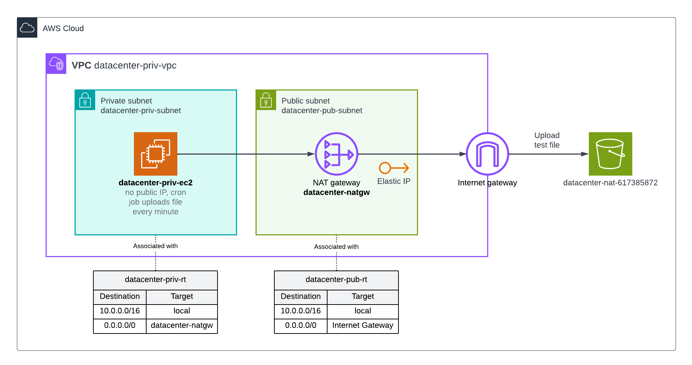
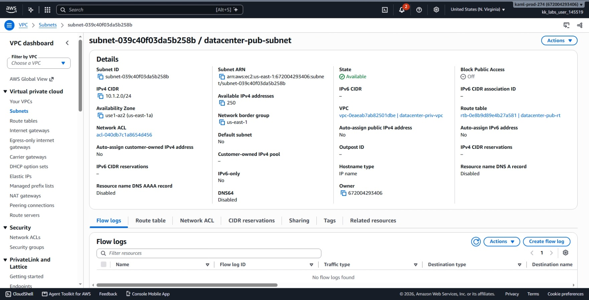
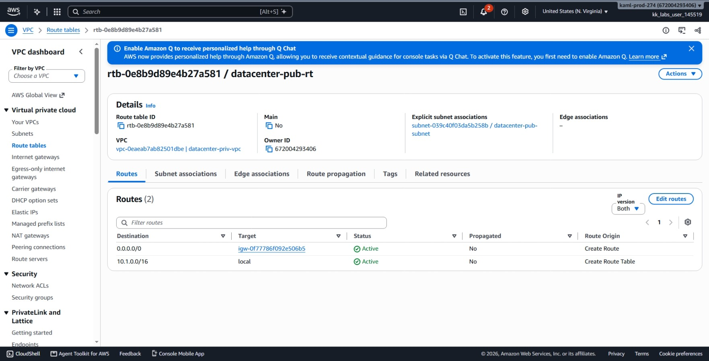
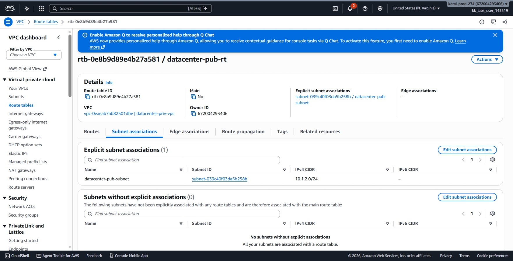
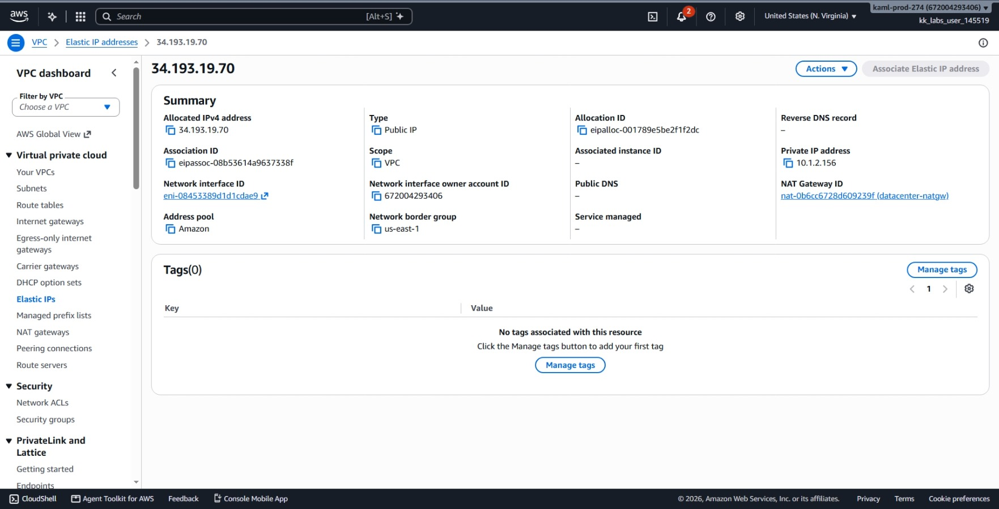
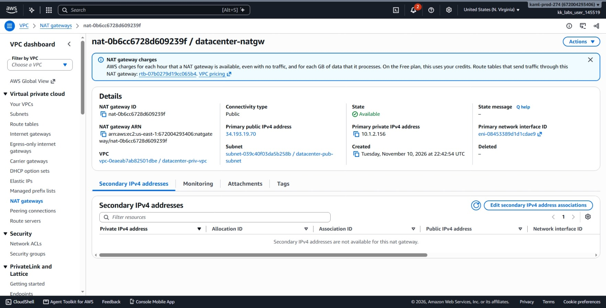
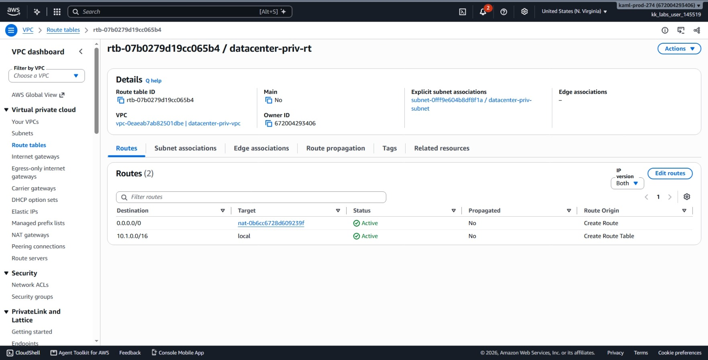
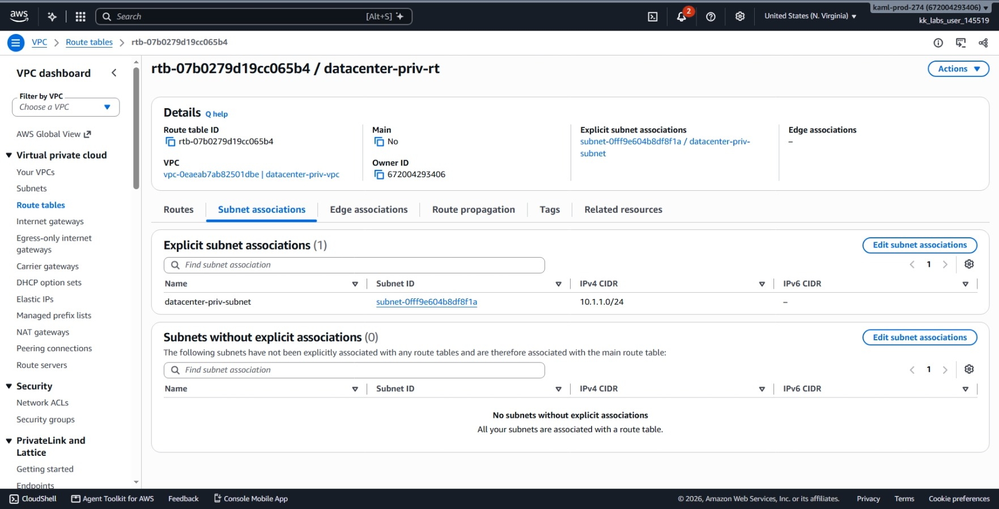
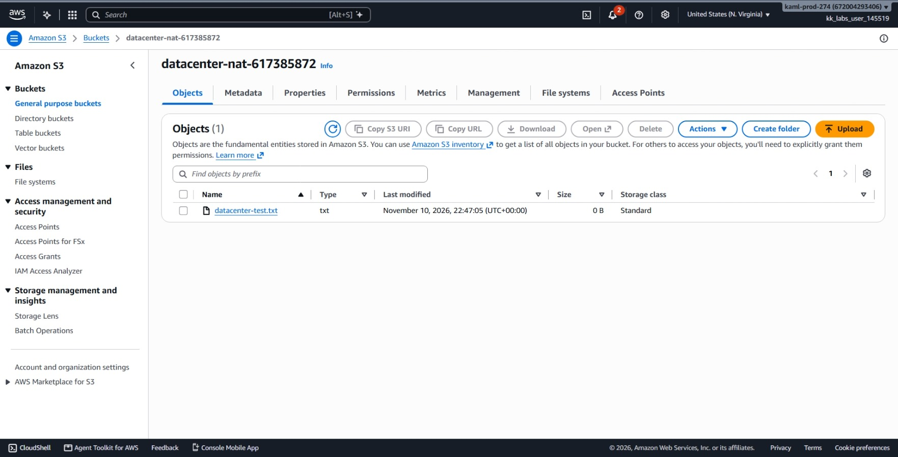
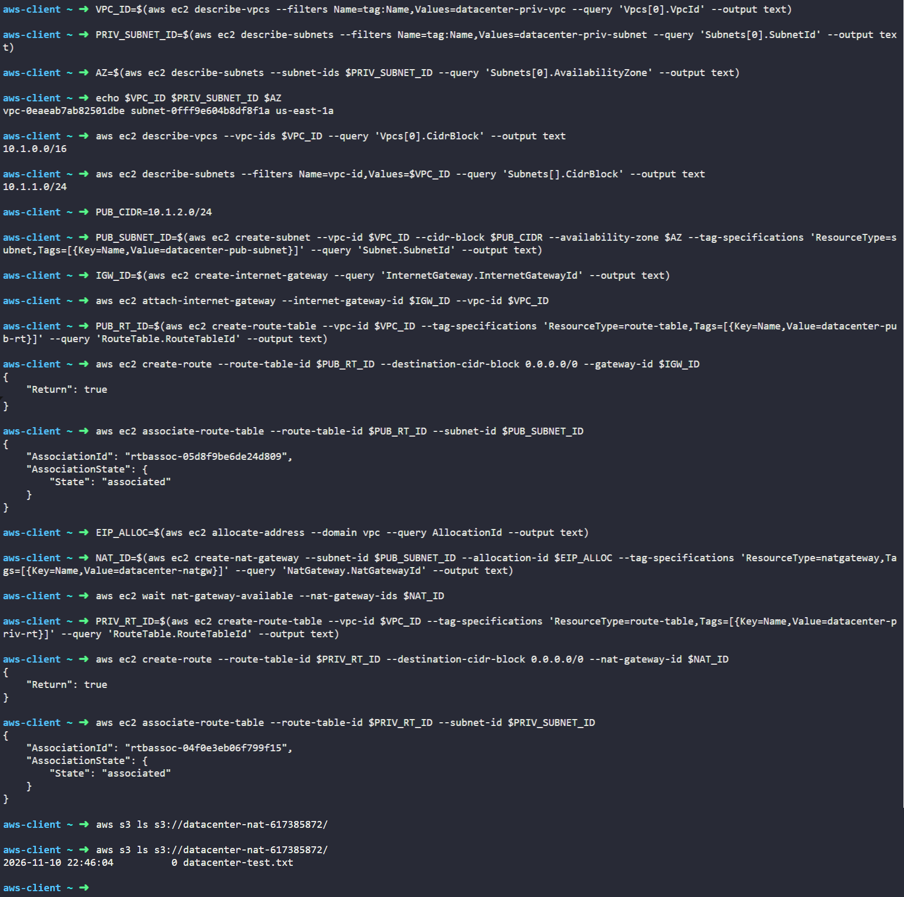

# Day 45: Configure NAT Gateway for Internet Access in a Private VPC

## Objective
The objective is to provide secure outbound internet access for an isolated EC2 instance (`datacenter-priv-ec2`) residing in a private subnet. I created a public subnet, attached an Internet Gateway, created a dedicated public route table, allocated an Elastic IP, deployed an AWS-managed NAT Gateway (`datacenter-natgw`), created a dedicated private route table routing `0.0.0.0/0` to the NAT Gateway, and verified internet access when the private instance successfully uploaded a test file to an S3 bucket.



## 1. Managed NAT Gateway Architecture

A private subnet has no direct path to the internet. Any instance inside it has only a private IP address, preventing external servers from sending traffic directly to it.

### How a Managed NAT Gateway Works
A **NAT Gateway** is an AWS-managed network service that sits in a public subnet:
1. When a private EC2 instance makes an outbound request (such as uploading files to S3), the private route table sends that traffic to the NAT Gateway.
2. The NAT Gateway replaces the private source IP with its own public Elastic IP address (Source Network Address Translation).
3. The NAT Gateway sends the request out to the internet through the Internet Gateway.
4. When the response returns from the internet, the NAT Gateway translates the destination back to the private IP and forwards it to the private instance.

### Managed NAT Gateway vs. NAT Instance
Unlike the EC2-based NAT Instance used in Day 30:
* A managed NAT Gateway does not require manual OS patching, `iptables` configuration, or disabling source/destination checks.
* It scales bandwidth automatically up to 100 Gbps and is maintained directly by AWS.

### Why Dedicated Route Tables Matter
To keep network boundaries secure, I do not reuse the default Main route table:
* **Public Route Table (`datacenter-pub-rt`):** Associates with `datacenter-pub-subnet` and points `0.0.0.0/0` to the Internet Gateway (`igw-040259c07b42e8855`).
* **Private Route Table (`datacenter-priv-rt`):** Associates with `datacenter-priv-subnet` and points `0.0.0.0/0` to the NAT Gateway (`nat-xxxx`).

This separation guarantees that private instances remain unreachable from incoming internet connections while retaining full outbound connectivity.

## 2. Order of Steps

To configure outbound access for the private instance, I followed these steps in order:

1. **Collect VPC and Subnet Details:** Find the VPC ID, private subnet ID, and Availability Zone.
2. **Create Public Subnet:** Carve out a new non-overlapping CIDR block (`10.1.2.0/24`) in the same Availability Zone.
3. **Create and Attach Internet Gateway:** Create an Internet Gateway and link it to the VPC.
4. **Configure Public Route Table:** Create `datacenter-pub-rt`, add the route to the Internet Gateway, and associate it with the public subnet.
5. **Allocate Elastic IP and Create NAT Gateway:** Allocate a static public IP and launch `datacenter-natgw` inside the public subnet.
6. **Wait for NAT Gateway:** Pause until the NAT Gateway status changes from `pending` to `available`.
7. **Configure Dedicated Private Route Table:** Create `datacenter-priv-rt`, add the route to the NAT Gateway, and associate it with the private subnet.
8. **Verify S3 Upload:** Check the S3 bucket to confirm the private instance uploaded `datacenter-test.txt`.

## 3. Command Execution

### Step 1: Collect Existing VPC and Subnet Information
I queried AWS to find the IDs, CIDR range, and Availability Zone of the existing private infrastructure:

```bash
VPC_ID=$(aws ec2 describe-vpcs \
  --filters Name=tag:Name,Values=datacenter-priv-vpc \
  --query 'Vpcs[0].VpcId' \
  --output text)

PRIV_SUBNET_ID=$(aws ec2 describe-subnets \
  --filters Name=tag:Name,Values=datacenter-priv-subnet \
  --query 'Subnets[0].SubnetId' \
  --output text)

AZ=$(aws ec2 describe-subnets \
  --subnet-ids $PRIV_SUBNET_ID \
  --query 'Subnets[0].AvailabilityZone' \
  --output text)

echo $VPC_ID $PRIV_SUBNET_ID $AZ
```

Values found:
* **VPC ID:** `vpc-0eaeab7ab82501dbe` (`10.1.0.0/16`)
* **Private Subnet ID:** `subnet-0fff9e604b8df8f1a` (`10.1.1.0/24`)
* **Availability Zone:** `us-east-1a`

### Step 2: Create the Public Subnet
I checked existing subnets and provisioned `datacenter-pub-subnet` using the next free CIDR block (`10.1.2.0/24`) in `us-east-1a`:

```bash
PUB_SUBNET_ID=$(aws ec2 create-subnet \
  --vpc-id $VPC_ID \
  --cidr-block 10.1.2.0/24 \
  --availability-zone $AZ \
  --tag-specifications 'ResourceType=subnet,Tags=[{Key=Name,Value=datacenter-pub-subnet}]' \
  --query 'Subnet.SubnetId' \
  --output text)
```

Created Public Subnet ID: `subnet-003ef803d847fe2f7`

### Step 3: Create and Attach Internet Gateway
I created a new Internet Gateway and attached it to the VPC:

```bash
# Create Internet Gateway
IGW_ID=$(aws ec2 create-internet-gateway \
  --query 'InternetGateway.InternetGatewayId' \
  --output text)

# Attach it to the VPC
aws ec2 attach-internet-gateway \
  --internet-gateway-id $IGW_ID \
  --vpc-id $VPC_ID
```

Created IGW ID: `igw-040259c07b42e8855`

### Step 4: Configure the Public Route Table
I created `datacenter-pub-rt`, added a default route pointing to the Internet Gateway, and associated it with the public subnet:

```bash
# Create public route table
PUB_RT_ID=$(aws ec2 create-route-table \
  --vpc-id $VPC_ID \
  --tag-specifications 'ResourceType=route-table,Tags=[{Key=Name,Value=datacenter-pub-rt}]' \
  --query 'RouteTable.RouteTableId' \
  --output text)

# Route all outbound traffic to the Internet Gateway
aws ec2 create-route \
  --route-table-id $PUB_RT_ID \
  --destination-cidr-block 0.0.0.0/0 \
  --gateway-id $IGW_ID

# Associate with the public subnet
aws ec2 associate-route-table \
  --route-table-id $PUB_RT_ID \
  --subnet-id $PUB_SUBNET_ID
```

Created Public Route Table ID: `rtb-0b816d107669b60f1`

### Step 5: Allocate Elastic IP and Create NAT Gateway
A public NAT Gateway requires an Elastic IP. I allocated a new static IP and launched `datacenter-natgw` inside the public subnet:

```bash
# Allocate Elastic IP
EIP_ALLOC=$(aws ec2 allocate-address \
  --domain vpc \
  --query AllocationId \
  --output text)

# Create NAT Gateway
NAT_ID=$(aws ec2 create-nat-gateway \
  --subnet-id $PUB_SUBNET_ID \
  --allocation-id $EIP_ALLOC \
  --tag-specifications 'ResourceType=natgateway,Tags=[{Key=Name,Value=datacenter-natgw}]' \
  --query 'NatGateway.NatGatewayId' \
  --output text)

# Wait for NAT Gateway to become available
aws ec2 wait nat-gateway-available \
  --nat-gateway-ids $NAT_ID
```

### Step 6: Create Dedicated Private Route Table and Route to NAT
I created a separate, dedicated route table named `datacenter-priv-rt`, routed all internet traffic (`0.0.0.0/0`) through the NAT Gateway, and explicitly associated it with the private subnet:

```bash
# Create dedicated private route table
PRIV_RT_ID=$(aws ec2 create-route-table \
  --vpc-id $VPC_ID \
  --tag-specifications 'ResourceType=route-table,Tags=[{Key=Name,Value=datacenter-priv-rt}]' \
  --query 'RouteTable.RouteTableId' \
  --output text)

# Route all outbound traffic to the NAT Gateway ID
aws ec2 create-route \
  --route-table-id $PRIV_RT_ID \
  --destination-cidr-block 0.0.0.0/0 \
  --nat-gateway-id $NAT_ID

# Explicitly associate with the private subnet
aws ec2 associate-route-table \
  --route-table-id $PRIV_RT_ID \
  --subnet-id $PRIV_SUBNET_ID
```

## 4. Verification


### Console UI Verification
I confirmed each component in the AWS Management Console:

1. **VPC > Subnets:** Verified `datacenter-pub-subnet` exists within `datacenter-priv-vpc`.




2. **VPC > Route Tables > `datacenter-pub-rt` (Routes Tab):** Verified `0.0.0.0/0` points to the Internet Gateway ID with status **Active**.



3. **VPC > Route Tables > `datacenter-pub-rt` (Subnet Associations Tab):** Verified `datacenter-pub-subnet` is associated.



4. **VPC > Elastic IPs:** Verified one Elastic IP address is allocated and shows **Associated to** the NAT Gateway.



5. **VPC > NAT Gateways:** Selected `datacenter-natgw` and confirmed **Status** is **Available**, assigned subnet is `datacenter-pub-subnet`, and the Elastic IP is attached.



6. **VPC > Route Tables > `datacenter-priv-rt` (Routes Tab):** Verified `0.0.0.0/0` points to `datacenter-natgw` with status **Active**.



7. **VPC > Route Tables > `datacenter-priv-rt` (Subnet Associations Tab):** Confirmed `datacenter-priv-subnet` is explicitly associated.



8. **Amazon S3 > Buckets > `datacenter-nat-617385872` (Objects Tab):** Verified `datacenter-test.txt` is listed in the bucket with its timestamp updating periodically.




### CLI Verification
I monitored the S3 bucket to verify that the private EC2 instance's automated cron job could reach the internet and upload its file:

```bash
aws s3 ls s3://datacenter-nat-617385872/
```

Output:
```text
2026-11-10 22:46:04          0 datacenter-test.txt
```

The appearance of `datacenter-test.txt` confirms that `datacenter-priv-ec2` successfully established outbound internet access through the NAT Gateway.

## Result
I verified that the NAT Gateway `datacenter-natgw` was successfully provisioned in the public subnet with an Elastic IP and routed to the Internet Gateway. The private subnet was associated with a dedicated private route table forwarding outbound internet traffic to the NAT Gateway. The private instance `datacenter-priv-ec2` successfully reached the internet and uploaded its test file to the S3 bucket.

## Screenshots
