# Day 46: Event-Driven Processing with Amazon S3 and Lambda

## Objective
The objective is to build an automated, serverless file-copying and logging pipeline on AWS. When a file is uploaded to a public S3 bucket (`xfusion-public-16349702`), an S3 event notification triggers an AWS Lambda function (`xfusion-copyfunction`). The function automatically copies the file to a secure private S3 bucket (`xfusion-private-16349702`) and records an audit log entry in an Amazon DynamoDB table (`xfusion-S3CopyLogs`).

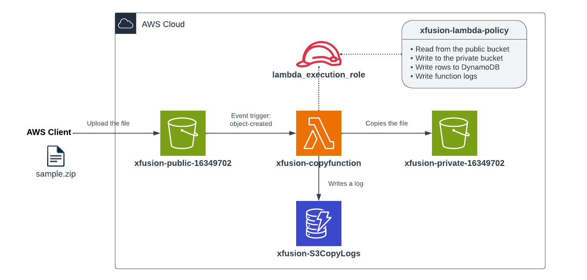


## 1. Event-Driven Processing Pipeline

Instead of manually copying files or running a continuous background server, this architecture uses an **event-driven serverless model** where resources run only when work arrives.

### The Four Main Components
1. **Public S3 Bucket (`xfusion-public-16349702`):** Receives uploaded files and publishes an `s3:ObjectCreated:*` event notification.
2. **AWS Lambda (`xfusion-copyfunction`):** The processing engine. It executes Python code using the Boto3 SDK to copy the object and insert a record into the database.
3. **Private S3 Bucket (`xfusion-private-16349702`):** The permanent, secure storage destination where public access is completely blocked.
4. **DynamoDB Table (`xfusion-S3CopyLogs`):** Stores a record for each transfer with fields like `LogID`, `SourceBucket`, `DestinationBucket`, and `ObjectKey`.

### How the Flow Works
1. A file (`sample.zip`) is uploaded to the public bucket.
2. S3 detects the upload (`ObjectCreated` event) and automatically invokes the Lambda function.
3. Lambda starts up and receives the event payload containing the source bucket and object key.
4. Lambda copies the file directly from the public bucket to the private bucket using `s3.copy_object`.
5. Lambda writes a new log item into DynamoDB using `table.put_item`.

### What the IAM Role Does
Lambda does not have permission to touch other AWS resources by default. I created an IAM role named `lambda_execution_role` to serve as its identity:
* **Trust Policy:** Allows the Lambda service (`lambda.amazonaws.com`) to assume the role.
* **Permissions Policy:** Defines what the function is allowed to do (`s3:GetObject` on the public bucket, `s3:PutObject` on the private bucket, `dynamodb:PutItem` on the table, and CloudWatch log writing).
* **Resource-Based Policy (Lambda Permission):** Grants Amazon S3 permission to call `lambda:InvokeFunction` when a new file arrives.

### The Important Distinction
* **Trigger:** S3 tells Lambda that an upload occurred.
* **Processing:** Lambda uses its IAM role permissions to copy the file and insert the database record.
S3 does not move the file itself, and DynamoDB does not trigger anything. Lambda coordinates the entire workflow.

## 2. Order of Steps

To construct this pipeline, I followed these steps in order:

1. **Create DynamoDB Table:** Provision `xfusion-S3CopyLogs` with `LogID` as the partition key.
2. **Create Public S3 Bucket:** Provision `xfusion-public-16349702`, disable Block Public Access, and attach a public read policy.
3. **Create Private S3 Bucket:** Provision `xfusion-private-16349702` with Block Public Access enabled.
4. **Create IAM Policy & Role:** Define `xfusion-lambda-policy`, create `lambda_execution_role`, and attach the policy.
5. **Prepare & Deploy Lambda Code:** Edit `lambda_function.py` with the table and private bucket names, package into `function.zip`, and deploy `xfusion-copyfunction`.
6. **Add S3 Invoke Permission:** Allow the public S3 bucket to trigger the Lambda function.
7. **Configure S3 Event Notification:** Map `s3:ObjectCreated:*` events on the public bucket to the Lambda function ARN.
8. **Test & Verify:** Upload `sample.zip` to the public bucket and confirm the file is copied to the private bucket and logged in DynamoDB.

## 3. Command Execution

### Step 1: Create the DynamoDB Table
I created the table using on-demand capacity with `LogID` (String) as the partition key:

```bash
aws dynamodb create-table \
  --table-name xfusion-S3CopyLogs \
  --attribute-definitions AttributeName=LogID,AttributeType=S \
  --key-schema AttributeName=LogID,KeyType=HASH \
  --billing-mode PAY_PER_REQUEST

aws dynamodb wait table-exists --table-name xfusion-S3CopyLogs
```

### Step 2: Create and Configure Public S3 Bucket
I created the public bucket, turned off Block Public Access, and added a public read policy:

```bash
# Create bucket
aws s3api create-bucket \
  --bucket xfusion-public-16349702 \
  --region us-east-1

# Disable Block Public Access
aws s3api put-public-access-block \
  --bucket xfusion-public-16349702 \
  --public-access-block-configuration BlockPublicAcls=false,IgnorePublicAcls=false,BlockPublicPolicy=false,RestrictPublicBuckets=false

# Create policy file
cat << 'EOF' > public-policy.json
{
  "Version": "2012-10-17",
  "Statement": [
    {
      "Sid": "PublicRead",
      "Effect": "Allow",
      "Principal": "*",
      "Action": "s3:GetObject",
      "Resource": "arn:aws:s3:::xfusion-public-16349702/*"
    }
  ]
}
EOF

# Apply bucket policy
aws s3api put-bucket-policy \
  --bucket xfusion-public-16349702 \
  --policy file://public-policy.json
```

### Step 3: Create Private S3 Bucket
I created the destination bucket with Block Public Access enabled:

```bash
# Create bucket
aws s3api create-bucket \
  --bucket xfusion-private-16349702 \
  --region us-east-1

# Enable Block Public Access
aws s3api put-public-access-block \
  --bucket xfusion-private-16349702 \
  --public-access-block-configuration BlockPublicAcls=true,IgnorePublicAcls=true,BlockPublicPolicy=true,RestrictPublicBuckets=true
```

### Step 4: Create IAM Policy and Execution Role
I defined the permissions required by Lambda to read from the public bucket, write to the private bucket, insert items into DynamoDB, and stream logs:

```bash
cat << 'EOF' > lambda-policy.json
{
  "Version": "2012-10-17",
  "Statement": [
    {
      "Effect": "Allow",
      "Action": "s3:GetObject",
      "Resource": "arn:aws:s3:::xfusion-public-16349702/*"
    },
    {
      "Effect": "Allow",
      "Action": "s3:PutObject",
      "Resource": "arn:aws:s3:::xfusion-private-16349702/*"
    },
    {
      "Effect": "Allow",
      "Action": "dynamodb:PutItem",
      "Resource": "arn:aws:dynamodb:*:*:table/xfusion-S3CopyLogs"
    },
    {
      "Effect": "Allow",
      "Action": ["logs:CreateLogGroup", "logs:CreateLogStream", "logs:PutLogEvents"],
      "Resource": "*"
    }
  ]
}
EOF

POLICY_ARN=$(aws iam create-policy \
  --policy-name xfusion-lambda-policy \
  --policy-document file://lambda-policy.json \
  --query Policy.Arn \
  --output text)
```

I created the trust policy and the role:

```bash
cat << 'EOF' > lambda-trust.json
{
  "Version": "2012-10-17",
  "Statement": [
    {
      "Effect": "Allow",
      "Principal": { "Service": "lambda.amazonaws.com" },
      "Action": "sts:AssumeRole"
    }
  ]
}
EOF

aws iam create-role \
  --role-name lambda_execution_role \
  --assume-role-policy-document file://lambda-trust.json

aws iam attach-role-policy \
  --role-name lambda_execution_role \
  --policy-arn $POLICY_ARN

ROLE_ARN=$(aws iam get-role \
  --role-name lambda_execution_role \
  --query Role.Arn \
  --output text)

sleep 10
```

### Step 5: Prepare Code and Deploy Lambda Function
I copied `/root/lambda-function.py` to `/root/lambda_function.py`, replaced the placeholder values with the real resource names, packaged it into a zip file, and deployed the function:

```bash
cp /root/lambda-function.py /root/lambda_function.py

# Replace placeholders
sed -i "s|REPLACE-WITH-YOUR-DYNAMODB-TABLE|xfusion-S3CopyLogs|;s|REPLACE-WITH-YOUR-PRIVATE-BUCKET|xfusion-private-16349702|" /root/lambda_function.py

# Package into zip
cd /root && zip function.zip lambda_function.py

# Create Lambda function
aws lambda create-function \
  --function-name xfusion-copyfunction \
  --runtime python3.12 \
  --role $ROLE_ARN \
  --handler lambda_function.lambda_handler \
  --zip-file fileb://function.zip \
  --memory-size 128 \
  --timeout 10

aws lambda wait function-active --function-name xfusion-copyfunction
```

### Step 6: Grant S3 Permission to Invoke Lambda
I added a resource-based policy to the function allowing the public S3 bucket to invoke it:

```bash
ACCOUNT_ID=$(aws sts get-caller-identity --query Account --output text)

aws lambda add-permission \
  --function-name xfusion-copyfunction \
  --statement-id s3-invoke \
  --action lambda:InvokeFunction \
  --principal s3.amazonaws.com \
  --source-arn arn:aws:s3:::xfusion-public-16349702 \
  --source-account $ACCOUNT_ID
```

### Step 7: Configure S3 Bucket Event Notification
I created `notification.json` to route all object creation events (`s3:ObjectCreated:*`) to the Lambda function ARN:

```bash
FUNCTION_ARN=$(aws lambda get-function \
  --function-name xfusion-copyfunction \
  --query Configuration.FunctionArn \
  --output text)

cat << 'EOF' > notification.json
{
  "LambdaFunctionConfigurations": [
    {
      "LambdaFunctionArn": "FUNCTION_ARN",
      "Events": ["s3:ObjectCreated:*"]
    }
  ]
}
EOF

sed -i "s|FUNCTION_ARN|$FUNCTION_ARN|" notification.json

aws s3api put-bucket-notification-configuration \
  --bucket xfusion-public-16349702 \
  --notification-configuration file://notification.json
```

## 4. Dual Verification

### CLI Verification
I uploaded `/root/sample.zip` to the public S3 bucket to trigger the automation:

```bash
aws s3 cp /root/sample.zip s3://xfusion-public-16349702/
```

I checked the private S3 bucket to confirm the file was copied:

```bash
aws s3 ls s3://xfusion-private-16349702/
```

Output:
```text
2026-11-11 22:30:04        164 sample.zip
```

I scanned the DynamoDB table to verify that an audit entry was created:

```bash
aws dynamodb scan --table-name xfusion-S3CopyLogs --output json
```

Output:
```json
{
    "Items": [
        {
            "DestinationBucket": {
                "S": "xfusion-private-16349702"
            },
            "LogID": {
                "S": "ada061c9-eded-4668-84d0-fa23d538370d"
            },
            "Timestamp": {
                "S": "2026-11-11 22:30:03"
            },
            "Status": {
                "S": "Success"
            },
            "ObjectKey": {
                "S": "sample.zip"
            },
            "SourceBucket": {
                "S": "xfusion-public-16349702"
            }
        }
    ],
    "Count": 1,
    "ScannedCount": 1
}
```

The output confirms that the file was copied and logged automatically within seconds.

### Console UI Verification
I confirmed each component in the AWS Management Console:

1. **S3 > `xfusion-public-16349702` (Permissions Tab):** Verified Block public access is Off and the `PublicRead` bucket policy is active.

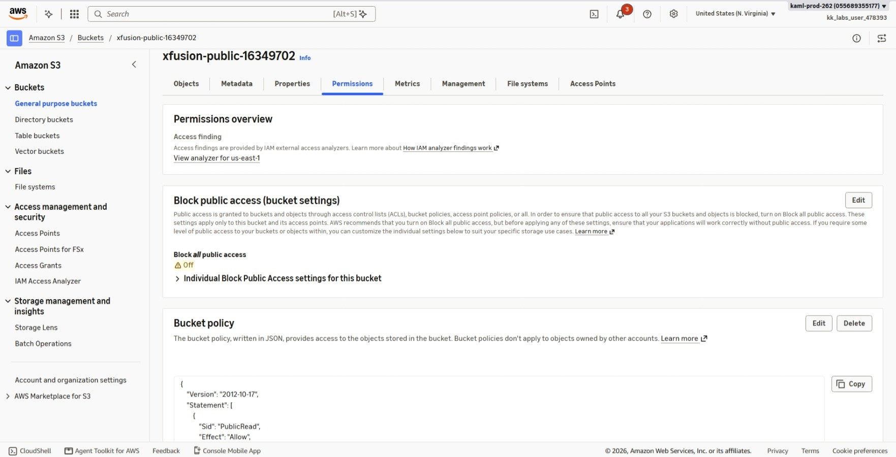

2. **S3 > `xfusion-public-16349702` (Properties Tab):** Verified the Event notification is configured for All object create events targeting `xfusion-copyfunction`.

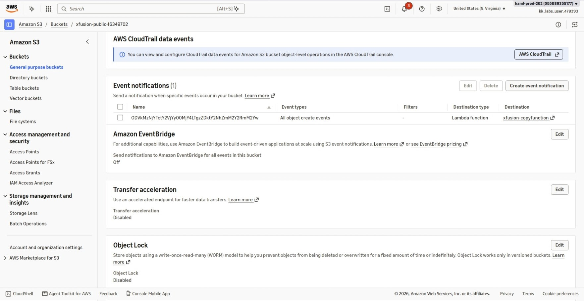

3. **S3 > `xfusion-public-16349702` (Objects Tab):** Verified `sample.zip` is present.

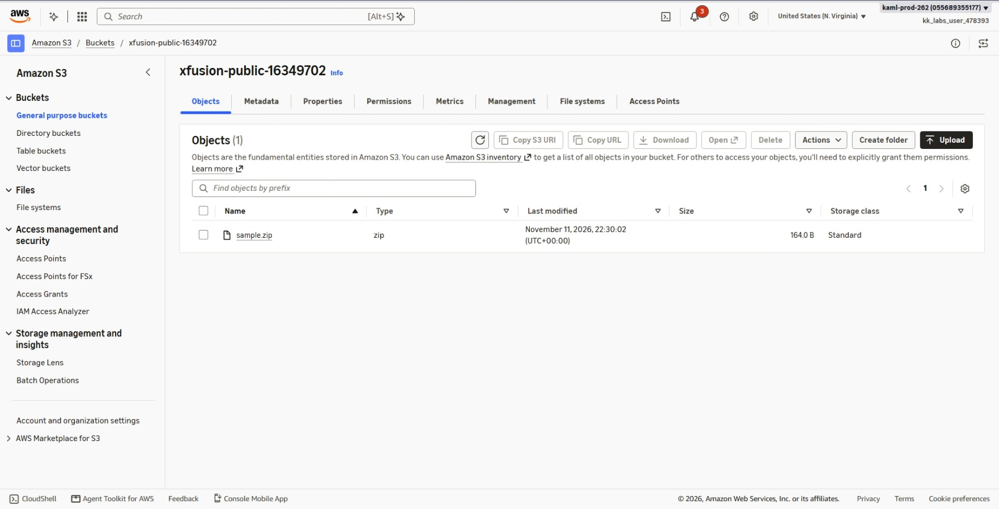

4. **S3 > `xfusion-private-16349702` (Permissions Tab):** Verified Block public access is On.

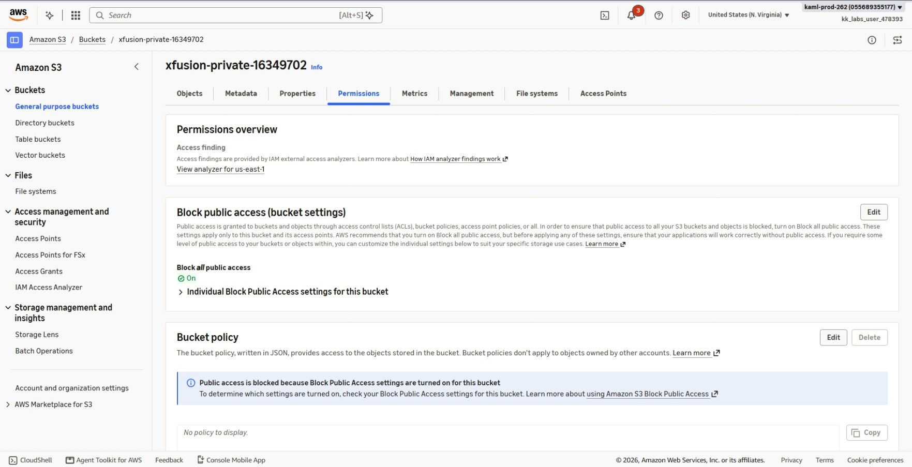

5. **S3 > `xfusion-private-16349702` (Objects Tab):** Verified `sample.zip` is present as a copied object.

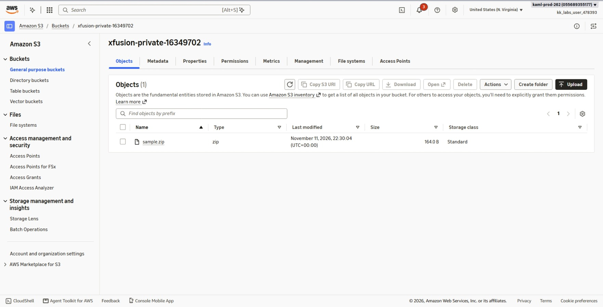

6. **Lambda > `xfusion-copyfunction` (General Configuration):** Verified Memory is set to 128 MB and Timeout is 10 seconds.

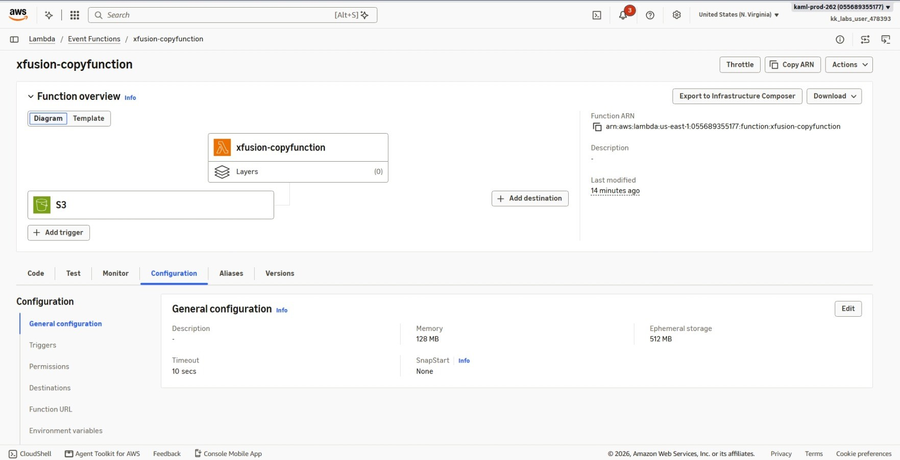

7. **Lambda > `xfusion-copyfunction` (Permissions):** Confirmed the execution role is `lambda_execution_role`.

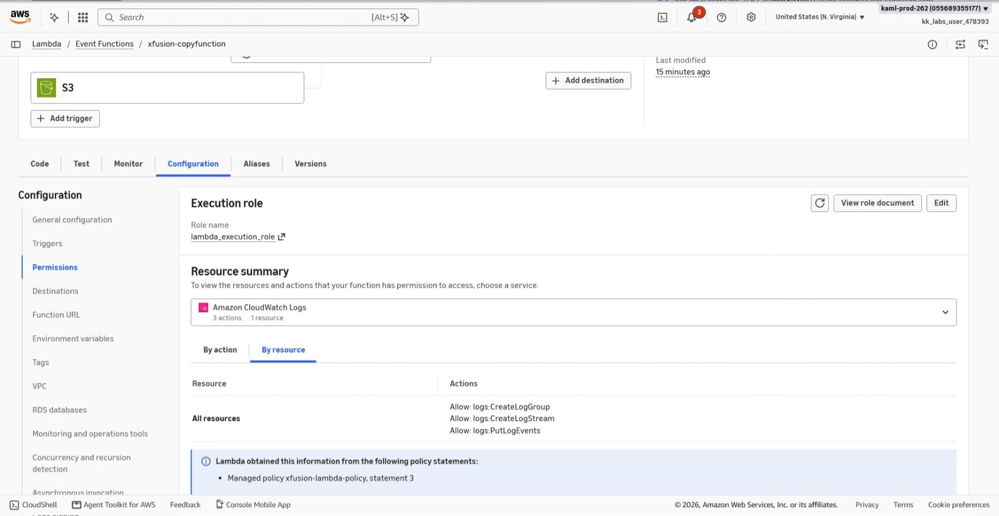

8. **Lambda > `xfusion-copyfunction` (Triggers):** Verified S3 bucket `xfusion-public-16349702` is attached as the active trigger.

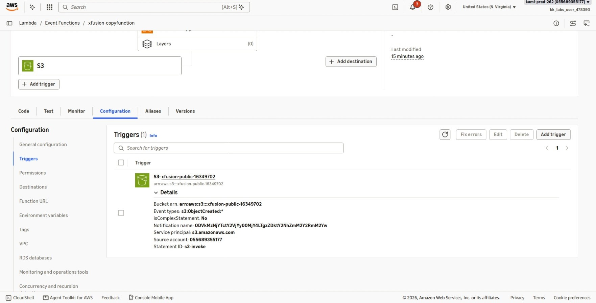

9. **IAM > Roles > `lambda_execution_role`:** Verified `xfusion-lambda-policy` is attached.

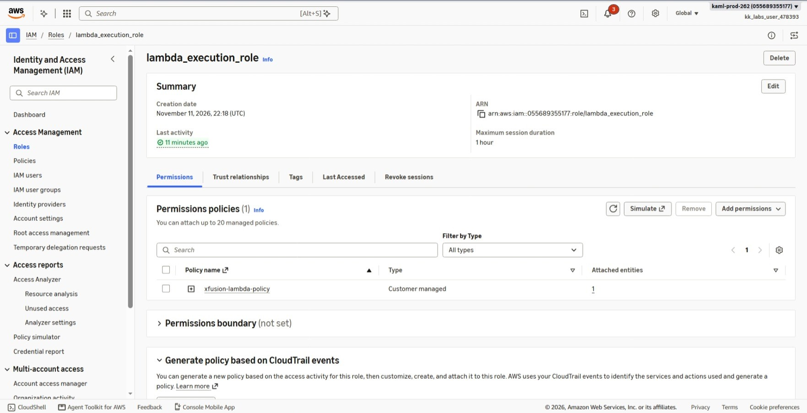

10. **DynamoDB > Tables > `xfusion-S3CopyLogs`:** Verified the table status is Active with partition key `LogID (String)`.

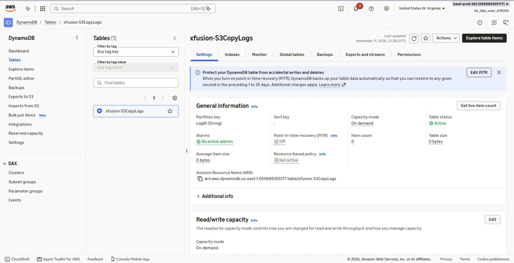

11. **DynamoDB > Explore Table Items:** Verified the logged item showing `SourceBucket`, `DestinationBucket`, and `ObjectKey` matching the file copy operation.

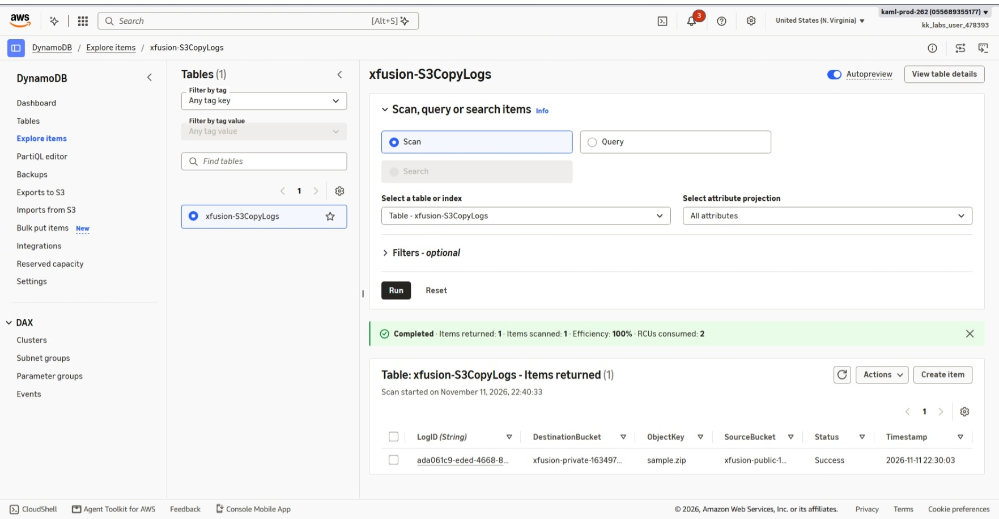

## Result
I verified that the event-driven file management pipeline is fully functional. Uploading `sample.zip` to the public bucket automatically triggered `xfusion-copyfunction`, which copied the file into `xfusion-private-16349702` and inserted a record into `xfusion-S3CopyLogs`. All resources and execution logs were confirmed via both the AWS CLI and the AWS Management Console.

## Screenshots
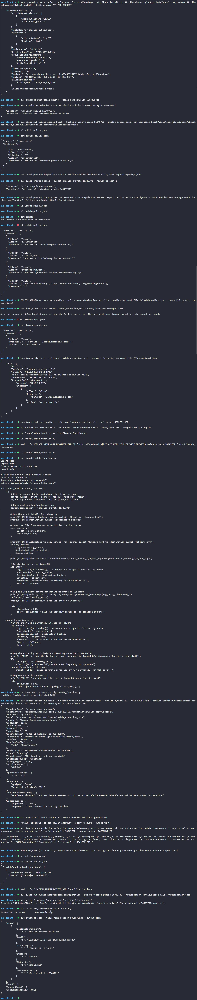