# Day 47: Integrating AWS SQS and SNS for Reliable Messaging

## Objective
The objective is to deploy a priority queuing system using AWS CloudFormation in the `us-east-1` region. I wrote a CloudFormation template to provision an Amazon SNS topic, two Amazon SQS queues (high and low priority), SNS subscription filter policies, an IAM execution role, and a Python AWS Lambda function. When messages are published to the topic with priority attributes, SNS routes them to the correct queue, and the Lambda function processes all high-priority messages before touching low-priority messages.

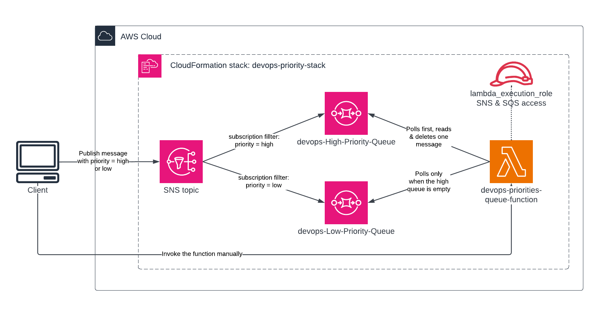

## 1. Priority Messaging with SNS, SQS, and Lambda

This architecture combines publish/subscribe messaging with asynchronous queue buffering and serverless compute to handle priority workloads.

### How the Components Work Together
1. **SNS Topic (`devops-Priority-Queues-Topic`):** The central entry point. Applications publish all messages to this single topic along with metadata attributes (like `priority = high` or `priority = low`).
2. **SQS Queues (`devops-High-Priority-Queue` & `devops-Low-Priority-Queue`):** Storage buffers that hold messages until a consumer processes them. Decoupling the topic from the consumer prevents sudden traffic spikes from overwhelming the backend.
3. **SNS Subscription Filter Policies:** Instead of sending every message to every subscriber, SNS inspects the message attributes:
   * If `priority` equals `high`, SNS delivers the message to the high-priority queue.
   * If `priority` equals `low`, SNS delivers the message to the low-priority queue.
4. **Queue Policy:** Grants the SNS service permission (`sqs:SendMessage`) to deposit messages into both SQS queues when originating from the specific topic ARN.
5. **Priority Consumer (Lambda Function):** When invoked, the Lambda function checks the high-priority queue first. If a message exists, it processes and deletes it. Only when the high-priority queue returns "No more messages to poll" does the function check the low-priority queue.

### CloudFormation Infrastructure as Code
Instead of clicking through multiple consoles to link queues, topics, and code, I defined the entire architecture declaratively in a single template file (`/root/devops-priority-stack.yml`). CloudFormation handles resource creation order, references, and cleanup automatically.

## 2. Order of Steps

To build and test the messaging system, I followed these steps in order:

1. **Review Lambda Script:** Inspect `/root/index.py` to understand the priority polling logic and expected environment variable names.
2. **Write CloudFormation Template:** Create `/root/devops-priority-stack.yml` containing the queues, topic, subscriptions, policies, role, and inline Lambda code.
3. **Validate Template:** Check the CloudFormation template syntax using `aws cloudformation validate-template`.
4. **Deploy Stack:** Deploy `devops-priority-stack` with `CAPABILITY_NAMED_IAM`.
5. **Diagnose and Fix IAM Permissions Issue:** Inspect failed stack events, replace the inline IAM policy with managed policies to bypass the `iam:PutRolePolicy` restriction, and redeploy to `CREATE_COMPLETE`.
6. **Publish Test Messages:** Publish two high-priority messages and two low-priority messages to the SNS topic.
7. **Invoke Lambda and Verify Processing Order:** Call the Lambda function five times in a loop to confirm that high-priority messages are read and deleted before low-priority ones.
8. **Verify in AWS Management Console:** Inspect the stack, queues, topic subscriptions, Lambda settings, and IAM role.

## 3. Template Development & CloudFormation Deployment

### Step 1: Inspect the Provided Lambda Code
I inspected `/root/index.py` on the client host:

```bash
cat /root/index.py
```

The script expects two environment variables:
* `high_priority_queue`: The URL of the high-priority queue.
* `low_priority_queue`: The URL of the low-priority queue.

The function polls `high_priority_queue` first, deletes the message if found, and falls back to `low_priority_queue` only when the high queue is empty.

### Step 2: Write the CloudFormation Template
I created `/root/devops-priority-stack.yml` embedding the Lambda code inline:

```yaml
AWSTemplateFormatVersion: '2010-09-09'
Description: Priority queuing with SQS, SNS and Lambda

Resources:
  HighPriorityQueue:
    Type: AWS::SQS::Queue
    Properties:
      QueueName: devops-High-Priority-Queue

  LowPriorityQueue:
    Type: AWS::SQS::Queue
    Properties:
      QueueName: devops-Low-Priority-Queue

  PriorityTopic:
    Type: AWS::SNS::Topic
    Properties:
      TopicName: devops-Priority-Queues-Topic

  QueuePolicy:
    Type: AWS::SQS::QueuePolicy
    Properties:
      Queues:
        - !Ref HighPriorityQueue
        - !Ref LowPriorityQueue
      PolicyDocument:
        Version: '2012-10-17'
        Statement:
          - Effect: Allow
            Principal:
              Service: sns.amazonaws.com
            Action: sqs:SendMessage
            Resource:
              - !GetAtt HighPriorityQueue.Arn
              - !GetAtt LowPriorityQueue.Arn
            Condition:
              ArnEquals:
                aws:SourceArn: !Ref PriorityTopic

  HighSubscription:
    Type: AWS::SNS::Subscription
    Properties:
      TopicArn: !Ref PriorityTopic
      Protocol: sqs
      Endpoint: !GetAtt HighPriorityQueue.Arn
      RawMessageDelivery: true
      FilterPolicy:
        priority:
          - high

  LowSubscription:
    Type: AWS::SNS::Subscription
    Properties:
      TopicArn: !Ref PriorityTopic
      Protocol: sqs
      Endpoint: !GetAtt LowPriorityQueue.Arn
      RawMessageDelivery: true
      FilterPolicy:
        priority:
          - low

  LambdaRole:
    Type: AWS::IAM::Role
    Properties:
      RoleName: lambda_execution_role
      AssumeRolePolicyDocument:
        Version: '2012-10-17'
        Statement:
          - Effect: Allow
            Principal:
              Service: lambda.amazonaws.com
            Action: sts:AssumeRole
      ManagedPolicyArns:
        - arn:aws:iam::aws:policy/service-role/AWSLambdaBasicExecutionRole
        - arn:aws:iam::aws:policy/AmazonSQSFullAccess
        - arn:aws:iam::aws:policy/AmazonSNSFullAccess

  PriorityFunction:
    Type: AWS::Lambda::Function
    Properties:
      FunctionName: devops-priorities-queue-function
      Runtime: python3.12
      Handler: index.lambda_handler
      Role: !GetAtt LambdaRole.Arn
      MemorySize: 128
      Timeout: 10
      Environment:
        Variables:
          high_priority_queue: !Ref HighPriorityQueue
          low_priority_queue: !Ref LowPriorityQueue
      Code:
        ZipFile: |
          import boto3
          import os
          sqs = boto3.client('sqs')
          def delete_message(queue_url, receipt_handle, message):
              response = sqs.delete_message(QueueUrl=queue_url, ReceiptHandle=receipt_handle)
              return "Message " + "'" + message + "'" + " deleted"

          def poll_messages(queue_url):
              QueueUrl=queue_url
              response = sqs.receive_message(
                  QueueUrl=QueueUrl,
                  AttributeNames=[],
                  MaxNumberOfMessages=1,
                  MessageAttributeNames=['All'],
                  WaitTimeSeconds=3
              )
              if "Messages" in response:
                  receipt_handle=response['Messages'][0]['ReceiptHandle']
                  message = response['Messages'][0]['Body']
                  delete_response = delete_message(QueueUrl,receipt_handle,message)
                  return delete_response
              else:
                  return "No more messages to poll"
          def lambda_handler(event, context):
              response = poll_messages(os.environ['high_priority_queue'])
              if response == "No more messages to poll":
                  response = poll_messages(os.environ['low_priority_queue'])
              return response
```

### Step 3: Validate and Deploy the Stack
I validated the template and launched the stack:

```bash
# Validate template syntax
aws cloudformation validate-template \
  --template-body file:///root/devops-priority-stack.yml

# Create stack
aws cloudformation create-stack \
  --stack-name devops-priority-stack \
  --template-body file:///root/devops-priority-stack.yml \
  --capabilities CAPABILITY_NAMED_IAM

# Wait for completion
aws cloudformation wait stack-create-complete \
  --stack-name devops-priority-stack
```

## 4. Troubleshooting (The IAM PutRolePolicy Error & Fix)

### The Failure
My first stack creation failed and rolled back (`ROLLBACK_COMPLETE`). I queried the stack events to identify why:

```bash
aws cloudformation describe-stack-events \
  --stack-name devops-priority-stack \
  --query 'StackEvents[?ResourceStatus==`CREATE_FAILED`].[LogicalResourceId,ResourceStatusReason]' \
  --output text
```

Output:
```text
LambdaRole      Resource handler returned message: "User: arn:aws:iam::... is not authorized to perform: iam:PutRolePolicy on resource: role lambda_execution_role because no identity-based policy allows the iam:PutRolePolicy action."
```

### Root Cause
In my original draft, I defined an inline policy inside `LambdaRole` under the `Policies:` block. In AWS IAM, creating an inline policy on a role requires the `iam:PutRolePolicy` API permission. The lab user account was restricted and did not have permission to run `PutRolePolicy`.

### The Resolution
Attaching AWS-managed policies requires `iam:AttachRolePolicy`, which my lab user did have permission to run.
1. I deleted the rolled-back stack:
   ```bash
   aws cloudformation delete-stack --stack-name devops-priority-stack
   aws cloudformation wait stack-delete-complete --stack-name devops-priority-stack
   ```
2. I edited `/root/devops-priority-stack.yml` to remove the `Policies:` inline block and instead attached `AmazonSQSFullAccess` and `AmazonSNSFullAccess` under `ManagedPolicyArns`:
   ```yaml
   ManagedPolicyArns:
     - arn:aws:iam::aws:policy/service-role/AWSLambdaBasicExecutionRole
     - arn:aws:iam::aws:policy/AmazonSQSFullAccess
     - arn:aws:iam::aws:policy/AmazonSNSFullAccess
   ```
3. I ran `create-stack` again. The stack successfully reached `CREATE_COMPLETE`:
   ```bash
   aws cloudformation describe-stacks \
     --stack-name devops-priority-stack \
     --query 'Stacks[0].StackStatus' \
     --output text
   # Result: CREATE_COMPLETE
   ```

## 5. Verification

### CLI Verification: Priority Routing and Processing Order
I retrieved the topic ARN:

```bash
topicarn=$(aws sns list-topics \
  --query "Topics[?contains(TopicArn, 'devops-Priority-Queues-Topic')].TopicArn" \
  --output text)
```

I published two high-priority messages and two low-priority messages to the topic:

```bash
# Publish 2 High Priority messages
aws sns publish \
  --topic-arn $topicarn \
  --message 'High Priority message 1' \
  --message-attributes '{"priority" : { "DataType":"String", "StringValue":"high"}}'

aws sns publish \
  --topic-arn $topicarn \
  --message 'High Priority message 2' \
  --message-attributes '{"priority" : { "DataType":"String", "StringValue":"high"}}'

# Publish 2 Low Priority messages
aws sns publish \
  --topic-arn $topicarn \
  --message 'Low Priority message 1' \
  --message-attributes '{"priority" : { "DataType":"String", "StringValue":"low"}}'

aws sns publish \
  --topic-arn $topicarn \
  --message 'Low Priority message 2' \
  --message-attributes '{"priority" : { "DataType":"String", "StringValue":"low"}}'
```

I invoked the Lambda function five times in a loop and printed the result:

```bash
for i in 1 2 3 4 5; do \
  aws lambda invoke --function-name devops-priorities-queue-function out.json > /dev/null; \
  cat out.json; echo; \
done
```

Output:
```text
"Message 'High Priority message 1' deleted"
"Message 'High Priority message 2' deleted"
"Message 'Low Priority message 1' deleted"
"Message 'Low Priority message 2' deleted"
"No more messages to poll"
```

The output confirms:
* High Priority message 1 was consumed first.
* High Priority message 2 was consumed second.
* Only after the high-priority queue was empty did the function poll and process Low Priority message 1 and 2.
* The fifth call returned "No more messages to poll", confirming all queues were cleared.

### Console UI Verification
I confirmed all deployed resources in the AWS Management Console:

1. **CloudFormation > Stacks > `devops-priority-stack` (Stack Info):** Verified status displays as **CREATE_COMPLETE**.

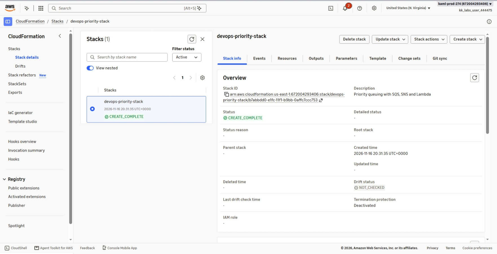

2. **CloudFormation > Resources Tab:** Verified all resources (both queues, the topic, two subscriptions, the queue policy, the role, and the function) show status **CREATE_COMPLETE**.

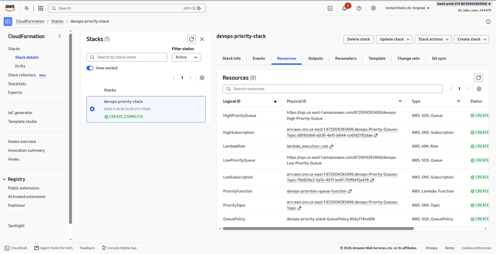

3. **Amazon SQS > Queues:** Verified both `devops-High-Priority-Queue` and `devops-Low-Priority-Queue` exist and are active.

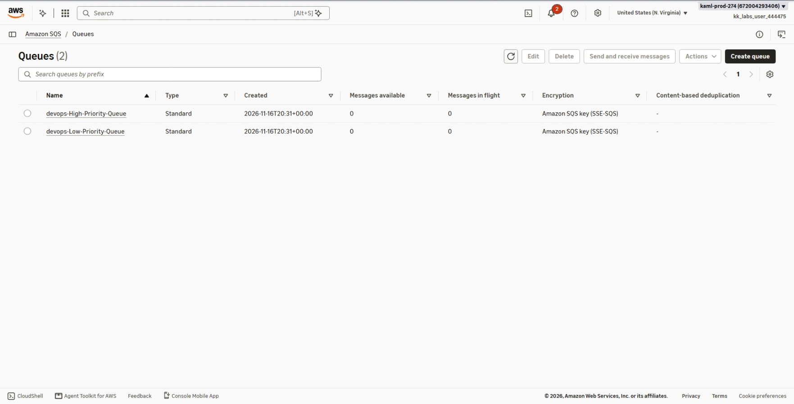

4. **Amazon SNS > Topics > `devops-Priority-Queues-Topic`:** Verified the topic exists with two attached subscriptions.

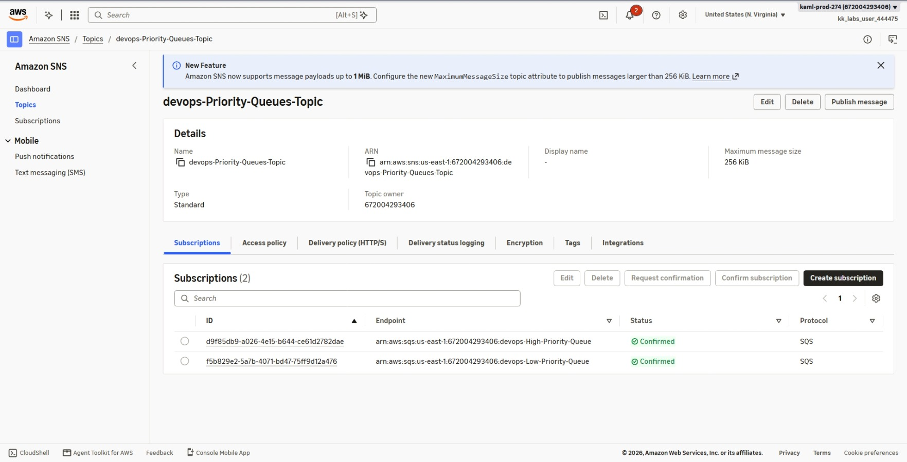

5. **SNS Subscriptions Tab (High Priority):** Verified the subscription for the high-priority queue has the filter policy set to `{"priority": ["high"]}`.

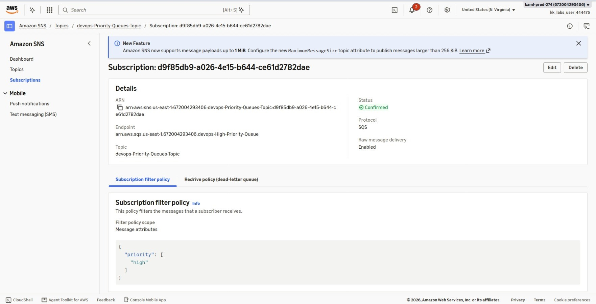

6. **SNS Subscriptions Tab (Low Priority):** Verified the subscription for the low-priority queue has the filter policy set to `{"priority": ["low"]}`.

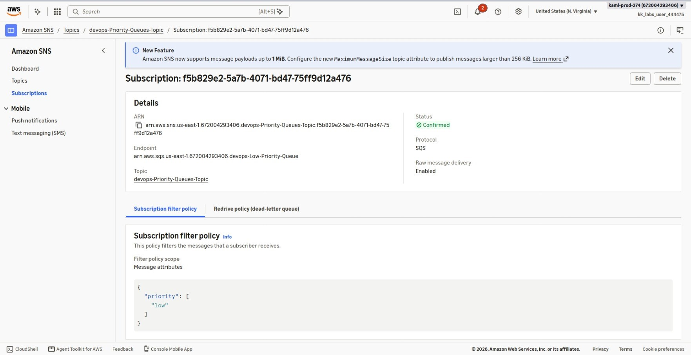

7. **Lambda > `devops-priorities-queue-function` (General Configuration):** Verified memory is set to **128 MB** and timeout is set to **10 seconds**.

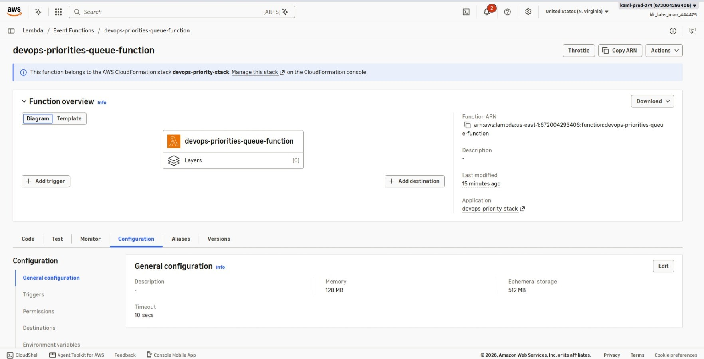

8. **Lambda Configuration > Permissions:** Verified the execution role displays as `lambda_execution_role`.

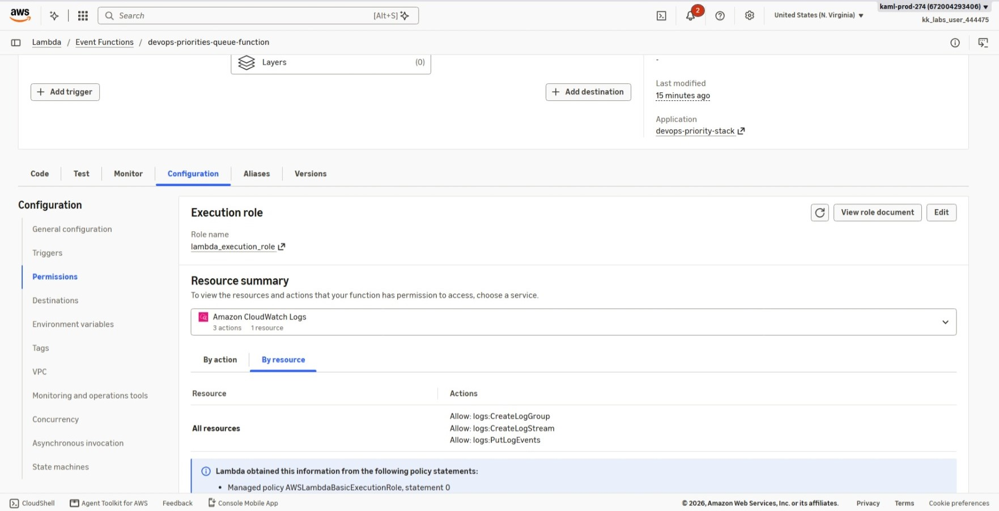

9. **Lambda Configuration > Environment Variables:** Verified `high_priority_queue` points to the URL of the high-priority queue and `low_priority_queue` points to the URL of the low-priority queue.

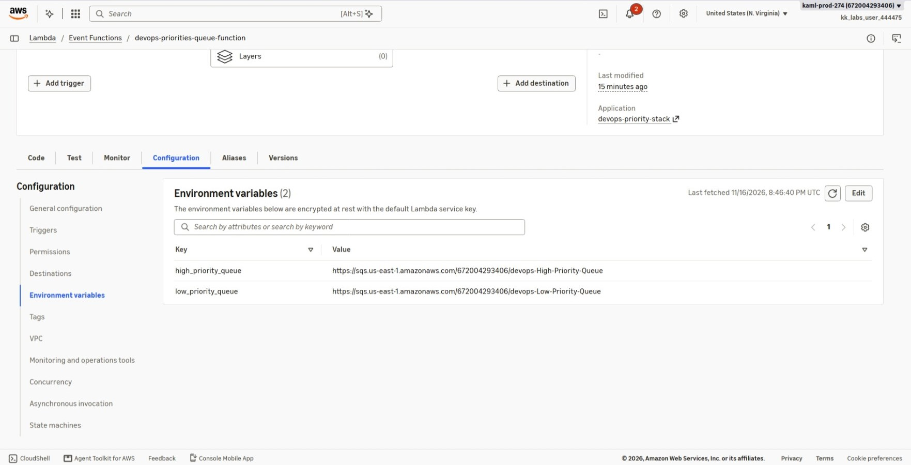

10. **IAM > Roles > `lambda_execution_role` (Permissions Tab):** Verified `AWSLambdaBasicExecutionRole`, `AmazonSQSFullAccess`, and `AmazonSNSFullAccess` are attached.

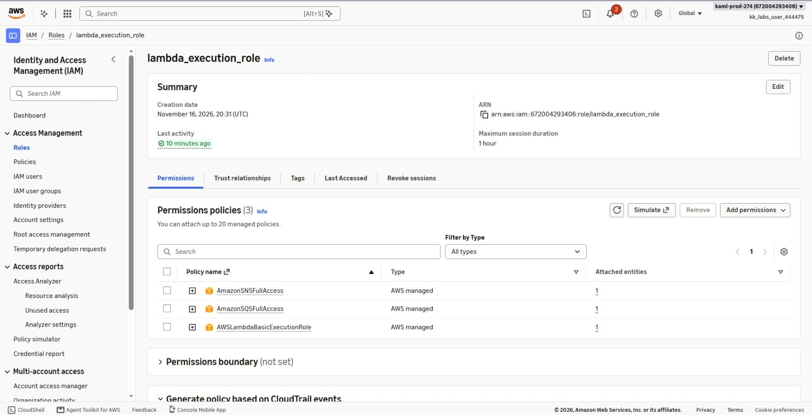

## Result
I verified that the CloudFormation stack `devops-priority-stack` was successfully deployed. Publishing messages to `devops-Priority-Queues-Topic` automatically filtered high and low priority messages into their designated SQS queues. Invoking `devops-priorities-queue-function` confirmed that high-priority messages are always evaluated and processed before low-priority messages.

## Screenshots
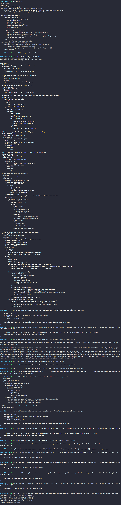