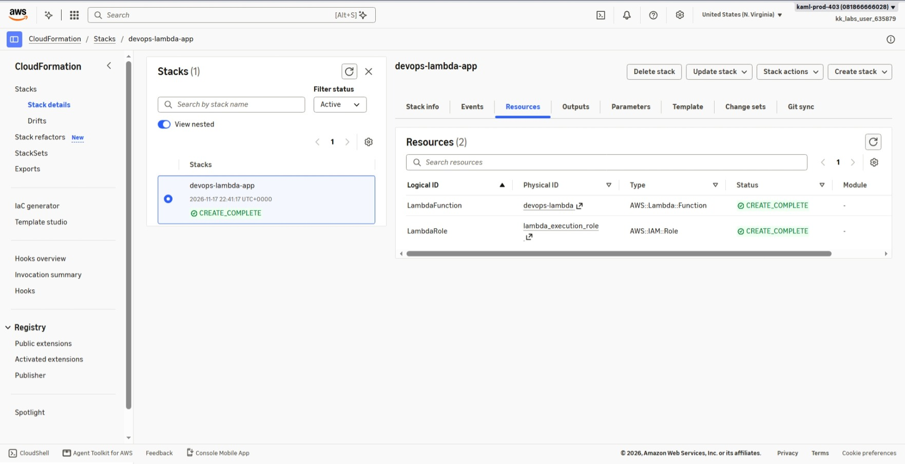
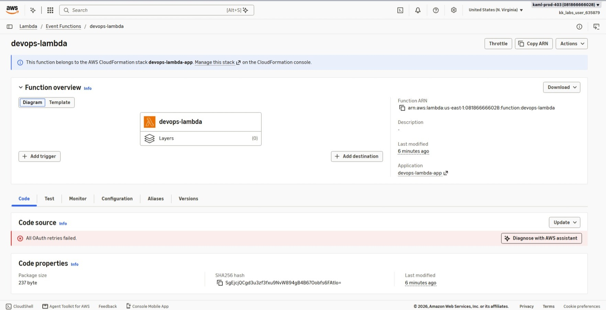
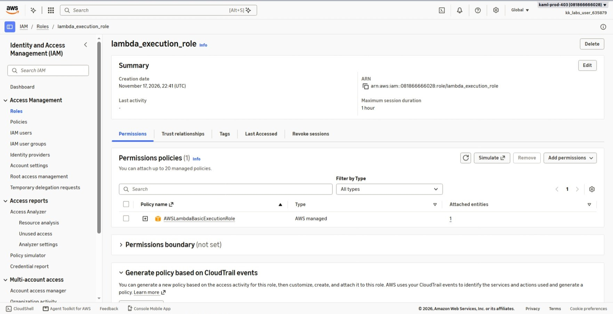
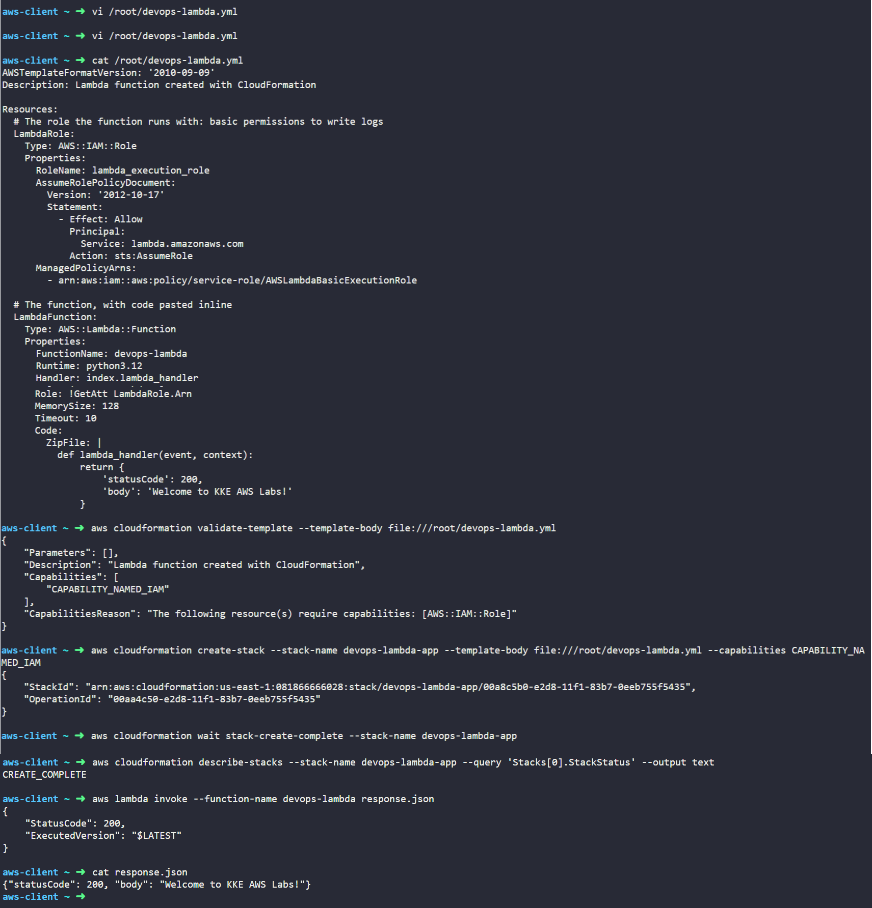

# Day 48: Automating Infrastructure Deployment with AWS CloudFormation

## Objective
The objective is to automate the deployment of a serverless application using AWS CloudFormation. I wrote a CloudFormation template named `/root/devops-lambda.yml` to deploy an IAM execution role (`lambda_execution_role`) and a Python Lambda function (`devops-lambda`) inside a single stack named `devops-lambda-app`. I then tested the function by invoking it through the AWS CLI and verifying the response payload.

## 1. CloudFormation

AWS CloudFormation provides an automated way to model, provision, and manage AWS resources using declarative configuration files.

### Stacks and Templates
* **Template:** JSON or YAML document that describes all the AWS resources we want to deploy, their configurations, and how they connect to one another.
* **Stack:** A single managed unit in AWS that groups all the resources declared in a template. When we delete or update a stack, CloudFormation manages all related resources automatically.

### Inline Lambda Code (`ZipFile`)
For lightweight functions without third-party external libraries, CloudFormation allows embedding the application code directly inside the template under `Properties.Code.ZipFile`. This removes the extra step of manually creating a `.zip` archive or uploading code to an S3 bucket prior to deployment.

### Why `CAPABILITY_NAMED_IAM` is Required
When a CloudFormation template creates an IAM role with a custom name (`RoleName: lambda_execution_role`), AWS requires an explicit acknowledgment. Passing the `--capabilities CAPABILITY_NAMED_IAM` flag confirms to AWS that I am intentionally creating an identity with security permissions in my account.

## 2. Order of Steps

To provision and test the serverless stack, I followed these steps in order:

1. **Write the Template:** Create `/root/devops-lambda.yml` defining the IAM role and the Lambda function with inline Python code.
2. **Validate Syntax:** Run `aws cloudformation validate-template` to verify the template structure before launching.
3. **Deploy the Stack:** Execute `aws cloudformation create-stack` passing `CAPABILITY_NAMED_IAM`.
4. **Wait for Completion:** Monitor the stack deployment until it transitions to `CREATE_COMPLETE`.
5. **Invoke the Function:** Test execution via the AWS CLI and verify the JSON response.
6. **Verify in AWS Management Console:** Check the stack resources, the Lambda function code, and the attached IAM role permissions.

## 3. Template Development & Command Execution

### Step 1: Write the CloudFormation Template
I created `/root/devops-lambda.yml` to define the execution role and the function:

```yaml
AWSTemplateFormatVersion: '2010-09-09'
Description: Lambda function created with CloudFormation

Resources:
  # The role the function runs with: basic permissions to write logs
  LambdaRole:
    Type: AWS::IAM::Role
    Properties:
      RoleName: lambda_execution_role
      AssumeRolePolicyDocument:
        Version: '2012-10-17'
        Statement:
          - Effect: Allow
            Principal:
              Service: lambda.amazonaws.com
            Action: sts:AssumeRole
      ManagedPolicyArns:
        - arn:aws:iam::aws:policy/service-role/AWSLambdaBasicExecutionRole

  # The function, with code pasted inline
  LambdaFunction:
    Type: AWS::Lambda::Function
    Properties:
      FunctionName: devops-lambda
      Runtime: python3.12
      Handler: index.lambda_handler
      Role: !GetAtt LambdaRole.Arn
      MemorySize: 128
      Timeout: 10
      Code:
        ZipFile: |
          def lambda_handler(event, context):
              return {
                  'statusCode': 200,
                  'body': 'Welcome to KKE AWS Labs!'
              }
```

### Step 2: Validate the Template
I checked the template structure and verified required capabilities:

```bash
aws cloudformation validate-template \
  --template-body file:///root/devops-lambda.yml
```

Output confirmed the syntax is valid and highlighted the requirement for `CAPABILITY_NAMED_IAM`.

### Step 3: Create the CloudFormation Stack
I deployed the stack using the validated template:

```bash
aws cloudformation create-stack \
  --stack-name devops-lambda-app \
  --template-body file:///root/devops-lambda.yml \
  --capabilities CAPABILITY_NAMED_IAM
```

* `create-stack`: Initiates the creation of resources declared in the template.
* `--stack-name devops-lambda-app`: Names the CloudFormation stack.
* `--capabilities CAPABILITY_NAMED_IAM`: Authorizes the creation of a named IAM role.

I waited for the resources to finish deploying:

```bash
aws cloudformation wait stack-create-complete \
  --stack-name devops-lambda-app
```

I checked the stack status to confirm success:

```bash
aws cloudformation describe-stacks \
  --stack-name devops-lambda-app \
  --query 'Stacks[0].StackStatus' \
  --output text
```

Output:
```text
CREATE_COMPLETE
```

## 4. Verification

### CLI Verification
I invoked the deployed Lambda function directly from the terminal to test its execution:

```bash
aws lambda invoke \
  --function-name devops-lambda \
  response.json
```

Output:
```json
{
    "StatusCode": 200,
    "ExecutedVersion": "$LATEST"
}
```

I checked the content of the response file:

```bash
cat response.json
```

Output:
```json
{"statusCode": 200, "body": "Welcome to KKE AWS Labs!"}
```

The output confirms that the function was deployed with the inline code and successfully returned status code 200 with the required body text.

### Console UI Verification
I confirmed the deployed resources in the AWS Management Console:

1. **CloudFormation > Stacks > `devops-lambda-app` (Resources Tab):** Verified both `LambdaRole` and `LambdaFunction` display a status of **CREATE_COMPLETE**.



2. **Lambda > Functions > `devops-lambda` (Code Tab):** Verified the inline Python code is loaded inside `index.py`, runtime is set to **Python 3.12**, memory is **128 MB**, and timeout is **10 sec**.



3. **IAM > Roles > `lambda_execution_role` (Permissions Tab):** Verified the AWS-managed policy `AWSLambdaBasicExecutionRole` is attached, and the trust relationship lists `lambda.amazonaws.com`.



## Result
I verified that the `devops-lambda-app` CloudFormation stack was successfully provisioned in `us-east-1`. The `devops-lambda` function and its `lambda_execution_role` IAM role were deployed via Infrastructure as Code. CLI invocation and console inspection confirmed that the function executed cleanly and returned HTTP 200 with `Welcome to KKE AWS Labs!`.

## Screenshots
