# Day 49: Centralized Audit Logging with VPC Peering

## Objective
The objective is to build an automated, multi-VPC log shipping pipeline on AWS. I created a new public VPC (`nautilus-pub-vpc`), deployed a public relay EC2 instance (`nautilus-pub-ec2`) with an IAM role granting `s3:PutObject` access, created a private S3 bucket (`nautilus-s3-logs-943437996`), connected the public and private VPCs using VPC Peering (`nautilus-vpc-peering`), and configured cron jobs on both servers to automatically ship `/var/log/boots.log` from the isolated private instance to the public relay and finally into the S3 bucket under `nautilus-priv-vpc/boot/boots.log`.

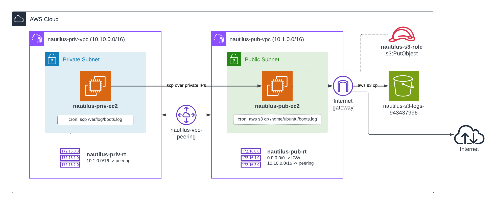

## 1. Logging Over VPC Peering

In many production setups, backend servers live in completely isolated private VPCs with no internet access. To archive audit logs centrally without exposing those private servers to the internet, I implemented a **two-hop log relay architecture**:

### Traffic Flow
1. **Private EC2 (`nautilus-priv-ec2`):** Generates `/var/log/boots.log` inside `nautilus-priv-vpc` (`10.10.0.0/16`). It cannot reach S3 directly because it has no Internet Gateway or NAT Gateway.
2. **VPC Peering (`nautilus-vpc-peering`):** Connects the private VPC (`10.10.0.0/16`) directly to the public VPC (`10.1.0.0/16`) over AWS's private network. Both route tables are updated so traffic travels privately between the two networks.
3. **Hop 1 (Private EC2 → Public EC2):** A root cron job on the private EC2 uses `scp` over the peering link to copy `/var/log/boots.log` to `/home/ubuntu/boots.log` on the public EC2 (`10.1.1.218`) every minute.
4. **Hop 2 (Public EC2 → Private S3):** A cron job on the public EC2 runs `aws s3 cp` every minute to push `/home/ubuntu/boots.log` to `s3://nautilus-s3-logs-943437996/nautilus-priv-vpc/boot/boots.log`.

### Security & Access Controls
* **Least Privilege IAM Role:** The public EC2 uses an IAM instance profile (`nautilus-s3-role`) that grants only `s3:PutObject` on the target log bucket. No static AWS access keys are stored on any server.
* **SSH Proxy / Bastion Access:** Because the private EC2 has no public IP, I could not SSH into it directly from `aws-client`. I used the public EC2 as a jump host via `ProxyCommand` to securely reach and configure the private instance.

## 2. Order of Steps

To construct and test the logging pipeline, I followed these steps in order:

1. **Inspect Existing Infrastructure:** Gather the VPC ID, CIDR, route table, AMI, instance type, key name, and private IP of `nautilus-priv-vpc` and `nautilus-priv-ec2`.
2. **Build the Public VPC Stack:** Create `nautilus-pub-vpc` (`10.1.0.0/16`), `nautilus-pub-subnet` (`10.1.1.0/24` in `us-east-1a`), `nautilus-pub-rt`, attach an Internet Gateway, and create `nautilus-pub-sg` allowing SSH.
3. **Create Private S3 Bucket:** Provision `nautilus-s3-logs-943437996` and enable Block Public Access.
4. **Create IAM Role and Instance Profile:** Create `nautilus-s3-role` with `s3:PutObject` permissions and bind it to an EC2 instance profile.
5. **Launch Public EC2:** Deploy `nautilus-pub-ec2` into the public subnet using the same key pair and attached IAM role.
6. **Configure VPC Peering & Routes:** Create and accept `nautilus-vpc-peering`, and add peering routes in both `nautilus-pub-rt` and `nautilus-priv-rt`.
7. **Configure Public EC2 Relay:** Install AWS CLI v2 and set up a cron job to push `/home/ubuntu/boots.log` to S3.
8. **Configure Private EC2 Source:** Use `ProxyCommand` to connect via the public EC2, copy the SSH key, and configure a root cron job to `scp` `/var/log/boots.log` to the public EC2.
9. **Verify End-to-End Delivery:** Confirm the file arrives on the public EC2 and appears in S3 under `nautilus-priv-vpc/boot/boots.log`.

## 3. Command Execution

### Step 1: Collect Existing Private Infrastructure Info
I gathered details of the existing private VPC and instance:

```bash
REGION=$(aws configure get region)

PRIV_VPC=$(aws ec2 describe-vpcs \
  --filters Name=tag:Name,Values=nautilus-priv-vpc \
  --query 'Vpcs[0].VpcId' --output text)

PRIV_CIDR=$(aws ec2 describe-vpcs \
  --vpc-ids $PRIV_VPC \
  --query 'Vpcs[0].CidrBlock' --output text)

PRIV_RT=$(aws ec2 describe-route-tables \
  --filters Name=tag:Name,Values=nautilus-priv-rt \
  --query 'RouteTables[0].RouteTableId' --output text)

PRIV_EC2=$(aws ec2 describe-instances \
  --filters Name=tag:Name,Values=nautilus-priv-ec2 Name=instance-state-name,Values=running \
  --query 'Reservations[0].Instances[0].InstanceId' --output text)

AMI=$(aws ec2 describe-instances --instance-ids $PRIV_EC2 --query 'Reservations[0].Instances[0].ImageId' --output text)
ITYPE=$(aws ec2 describe-instances --instance-ids $PRIV_EC2 --query 'Reservations[0].Instances[0].InstanceType' --output text)
KEYNAME=$(aws ec2 describe-instances --instance-ids $PRIV_EC2 --query 'Reservations[0].Instances[0].KeyName' --output text)
PRIV_IP=$(aws ec2 describe-instances --instance-ids $PRIV_EC2 --query 'Reservations[0].Instances[0].PrivateIpAddress' --output text)
```

Found:
* **Private VPC:** `vpc-045f0a5db2593dea5` (`10.10.0.0/16`) | Route Table: `rtb-00645335eaed46cb5`
* **Private EC2:** `i-01dc13f43dc5f1b14` | AMI: `ami-0fb0b230890ccd1e6` | Type: `t3.micro` | Key: `nautilus-key` | Private IP: `10.10.1.39`

### Step 2: Create the Public VPC, Subnet, IGW, Route Table, and Security Group
I created `nautilus-pub-vpc` with CIDR `10.1.0.0/16` and built out its public internet access:

```bash
PUB_CIDR=10.1.0.0/16

# Create VPC
PUB_VPC=$(aws ec2 create-vpc \
  --cidr-block $PUB_CIDR \
  --tag-specifications 'ResourceType=vpc,Tags=[{Key=Name,Value=nautilus-pub-vpc}]' \
  --query 'Vpc.VpcId' --output text)

# Create Subnet in us-east-1a and enable auto-assign public IP
PUB_SUBNET=$(aws ec2 create-subnet \
  --vpc-id $PUB_VPC \
  --cidr-block 10.1.1.0/24 \
  --availability-zone us-east-1a \
  --tag-specifications 'ResourceType=subnet,Tags=[{Key=Name,Value=nautilus-pub-subnet}]' \
  --query 'Subnet.SubnetId' --output text)

aws ec2 modify-subnet-attribute \
  --subnet-id $PUB_SUBNET \
  --map-public-ip-on-launch

# Create Route Table and associate with subnet
PUB_RT=$(aws ec2 create-route-table \
  --vpc-id $PUB_VPC \
  --tag-specifications 'ResourceType=route-table,Tags=[{Key=Name,Value=nautilus-pub-rt}]' \
  --query 'RouteTable.RouteTableId' --output text)

aws ec2 associate-route-table \
  --route-table-id $PUB_RT \
  --subnet-id $PUB_SUBNET

# Create and attach Internet Gateway, then add default route
IGW=$(aws ec2 create-internet-gateway \
  --tag-specifications 'ResourceType=internet-gateway,Tags=[{Key=Name,Value=nautilus-pub-igw}]' \
  --query 'InternetGateway.InternetGatewayId' --output text)

aws ec2 attach-internet-gateway \
  --internet-gateway-id $IGW \
  --vpc-id $PUB_VPC

aws ec2 create-route \
  --route-table-id $PUB_RT \
  --destination-cidr-block 0.0.0.0/0 \
  --gateway-id $IGW

# Create Security Group allowing SSH port 22
PUB_SG=$(aws ec2 create-security-group \
  --group-name nautilus-pub-sg \
  --description "SSH access" \
  --vpc-id $PUB_VPC \
  --query 'GroupId' --output text)

aws ec2 authorize-security-group-ingress \
  --group-id $PUB_SG \
  --protocol tcp \
  --port 22 \
  --cidr 0.0.0.0/0
```

### Step 3: Create the Private S3 Bucket
I created the target bucket and enabled Block Public Access:

```bash
aws s3api create-bucket \
  --bucket nautilus-s3-logs-943437996 \
  --region $REGION

aws s3api put-public-access-block \
  --bucket nautilus-s3-logs-943437996 \
  --public-access-block-configuration BlockPublicAcls=true,IgnorePublicAcls=true,BlockPublicPolicy=true,RestrictPublicBuckets=true
```

### Step 4: Create IAM Role, Policy, and Instance Profile
I created `nautilus-s3-role`, created a customer-managed policy granting `s3:PutObject`, attached it to the role, and created the matching EC2 instance profile:

```bash
# Create IAM role trusted by EC2
aws iam create-role \
  --role-name nautilus-s3-role \
  --assume-role-policy-document '{"Version":"2012-10-17","Statement":[{"Effect":"Allow","Principal":{"Service":"ec2.amazonaws.com"},"Action":"sts:AssumeRole"}]}'

# Create customer-managed S3 policy
POLICY_ARN=$(aws iam create-policy \
  --policy-name nautilus-s3-putobject \
  --policy-document '{"Version":"2012-10-17","Statement":[{"Effect":"Allow","Action":"s3:PutObject","Resource":"arn:aws:s3:::nautilus-s3-logs-943437996/*"}]}' \
  --query 'Policy.Arn' --output text)

# Attach policy to role
aws iam attach-role-policy \
  --role-name nautilus-s3-role \
  --policy-arn $POLICY_ARN

# Create and bind Instance Profile
aws iam create-instance-profile --instance-profile-name nautilus-s3-role
aws iam add-role-to-instance-profile \
  --instance-profile-name nautilus-s3-role \
  --role-name nautilus-s3-role

sleep 10
```

### Step 5: Launch the Public EC2 Instance
I launched `nautilus-pub-ec2` in the public subnet using the same AMI, instance type, and key pair as the private instance, attaching the IAM instance profile:

```bash
PUB_EC2=$(aws ec2 run-instances \
  --image-id $AMI \
  --instance-type $ITYPE \
  --key-name $KEYNAME \
  --subnet-id $PUB_SUBNET \
  --security-group-ids $PUB_SG \
  --iam-instance-profile Name=nautilus-s3-role \
  --tag-specifications 'ResourceType=instance,Tags=[{Key=Name,Value=nautilus-pub-ec2}]' \
  --query 'Instances[0].InstanceId' --output text)

aws ec2 wait instance-running --instance-ids $PUB_EC2

PUB_IP=$(aws ec2 describe-instances --instance-ids $PUB_EC2 --query 'Reservations[0].Instances[0].PublicIpAddress' --output text)
PUB_PRIV_IP=$(aws ec2 describe-instances --instance-ids $PUB_EC2 --query 'Reservations[0].Instances[0].PrivateIpAddress' --output text)
```

Public EC2 IPs: Public `54.146.236.25` | Private `10.1.1.218`

### Step 6: Configure VPC Peering and Two-Way Routes
I created and accepted `nautilus-vpc-peering`, then added peering routes to both route tables:

```bash
# Create and accept VPC Peering Connection
PCX=$(aws ec2 create-vpc-peering-connection \
  --vpc-id $PUB_VPC \
  --peer-vpc-id $PRIV_VPC \
  --tag-specifications 'ResourceType=vpc-peering-connection,Tags=[{Key=Name,Value=nautilus-vpc-peering}]' \
  --query 'VpcPeeringConnection.VpcPeeringConnectionId' --output text)

aws ec2 accept-vpc-peering-connection --vpc-peering-connection-id $PCX

# Route Private CIDR via Peering in Public Route Table
aws ec2 create-route \
  --route-table-id $PUB_RT \
  --destination-cidr-block $PRIV_CIDR \
  --vpc-peering-connection-id $PCX

# Route Public CIDR via Peering in Private Route Table
aws ec2 create-route \
  --route-table-id $PRIV_RT \
  --destination-cidr-block $PUB_CIDR \
  --vpc-peering-connection-id $PCX
```

Created Peering ID: `pcx-06c81147fb84da751`

### Step 7: Configure AWS CLI and Cron Job on Public EC2
I installed AWS CLI v2 on `nautilus-pub-ec2` and scheduled a cron job to push `/home/ubuntu/boots.log` to S3 every minute:

```bash
chmod 400 /root/.ssh/nautilus-key.pem

# Install AWS CLI v2 on public EC2
ssh -i /root/.ssh/nautilus-key.pem -o StrictHostKeyChecking=no ubuntu@$PUB_IP \
  "sudo apt-get update -y && sudo apt-get install -y unzip curl && curl -s https://awscli.amazonaws.com/awscli-exe-linux-x86_64.zip -o awscliv2.zip && unzip -q awscliv2.zip && sudo ./aws/install"

# Add cron job to upload to S3
ssh -i /root/.ssh/nautilus-key.pem -o StrictHostKeyChecking=no ubuntu@$PUB_IP \
  "(crontab -l 2>/dev/null; echo '* * * * * /usr/local/bin/aws s3 cp /home/ubuntu/boots.log s3://nautilus-s3-logs-943437996/nautilus-priv-vpc/boot/boots.log --region $REGION') | crontab -"
```

### Step 8: Configure Log Shipping Cron Job on Private EC2
I used SSH `ProxyCommand` through the public instance to reach `nautilus-priv-ec2`, copied the key file, and created a root cron job to `scp` `/var/log/boots.log` to the public instance's private IP (`10.1.1.218`):

```bash
PROXY="ssh -i /root/.ssh/nautilus-key.pem -o StrictHostKeyChecking=no -W %h:%p ubuntu@$PUB_IP"

# Copy SSH key to private instance and restrict permissions
scp -i /root/.ssh/nautilus-key.pem -o StrictHostKeyChecking=no -o ProxyCommand="$PROXY" \
  /root/.ssh/nautilus-key.pem ubuntu@$PRIV_IP:/home/ubuntu/nautilus-key.pem

ssh -i /root/.ssh/nautilus-key.pem -o StrictHostKeyChecking=no -o ProxyCommand="$PROXY" \
  ubuntu@$PRIV_IP "chmod 400 /home/ubuntu/nautilus-key.pem"

# Add root cron job to push /var/log/boots.log via SCP to public instance
ssh -i /root/.ssh/nautilus-key.pem -o StrictHostKeyChecking=no -o ProxyCommand="$PROXY" \
  ubuntu@$PRIV_IP "(sudo crontab -l 2>/dev/null; echo '* * * * * scp -i /home/ubuntu/nautilus-key.pem -o StrictHostKeyChecking=no /var/log/boots.log ubuntu@$PUB_PRIV_IP:/home/ubuntu/boots.log') | sudo crontab -"
```

## 4. Troubleshooting (Issues & Fixes)

### Issue 1: IAM `PutRolePolicy` Access Denied
When attempting to add an inline policy to `nautilus-s3-role` with `aws iam put-role-policy`, AWS rejected the request with `AccessDenied` because the lab IAM user is not authorized to perform `iam:PutRolePolicy`.
* **Fix:** I instead created a standalone customer-managed policy (`nautilus-s3-putobject`) using `aws iam create-policy` and attached it using `aws iam attach-role-policy`, which succeeded cleanly.

### Issue 2: `t3.micro` Not Supported in `us-east-1e`
When initially creating `nautilus-pub-subnet` without specifying an Availability Zone, AWS placed it in `us-east-1e`. Launching the `t3.micro` instance failed with: `Your requested instance type (t3.micro) is not supported in your requested Availability Zone (us-east-1e)`.
* **Fix:** I disassociated the route table, deleted the subnet in `us-east-1e`, and recreated `nautilus-pub-subnet` explicitly in `us-east-1a` where `t3.micro` is supported.

### Issue 3: Direct SSH to Private EC2 Timed Out
Trying to SSH directly from `aws-client` to `10.10.1.39` failed with `Connection timed out` because `10.10.1.39` is a private IP inside an isolated VPC.
* **Fix:** I configured an SSH `ProxyCommand` routing my SSH and `scp` traffic through `ubuntu@$PUB_IP` (the public instance), which had direct routing access to `10.10.1.39` over the active VPC Peering connection.

## 5. Verification

### CLI Verification
After waiting 1–2 minutes for both cron jobs to fire, I verified both hops:

```bash
# Confirm file arrived on public EC2
ssh -i /root/.ssh/nautilus-key.pem -o StrictHostKeyChecking=no ubuntu@$PUB_IP "ls -l /home/ubuntu/boots.log"
# Output: -rw-r--r-- 1 ubuntu ubuntu 25 Nov 19 21:15 /home/ubuntu/boots.log

# Confirm file was uploaded to the exact path in S3
aws s3 ls s3://nautilus-s3-logs-943437996/nautilus-priv-vpc/boot/
```

Output:
```text
2026-11-19 21:15:05         25 boots.log
```

The log file (`25` bytes) traveled successfully from the private instance to the public relay and into the private S3 bucket.

### Console UI Verification
I confirmed each component in the AWS Management Console:

1. **VPC > Your VPCs:** Verified `nautilus-pub-vpc` exists with CIDR `10.1.0.0/16`.

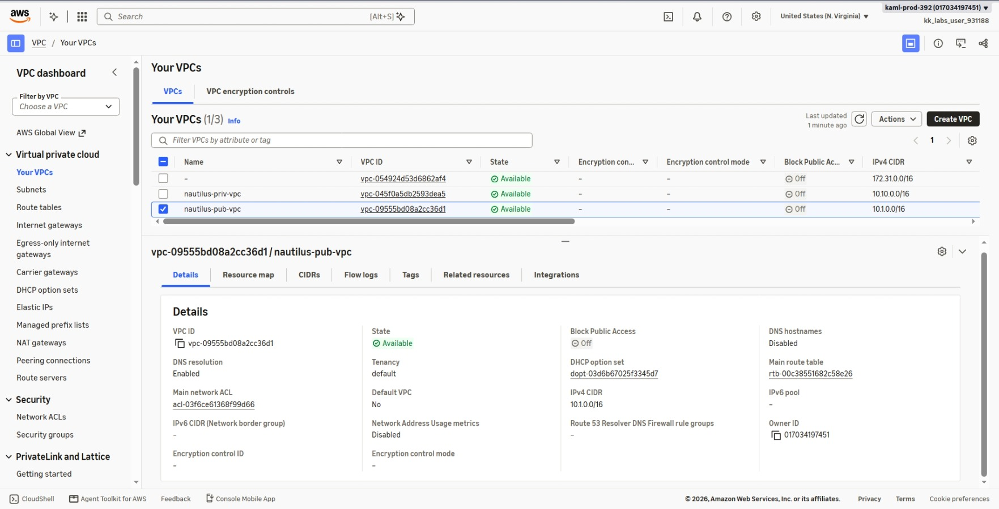

2. **VPC > Subnets:** Verified `nautilus-pub-subnet` belongs to `nautilus-pub-vpc` in `us-east-1a`.

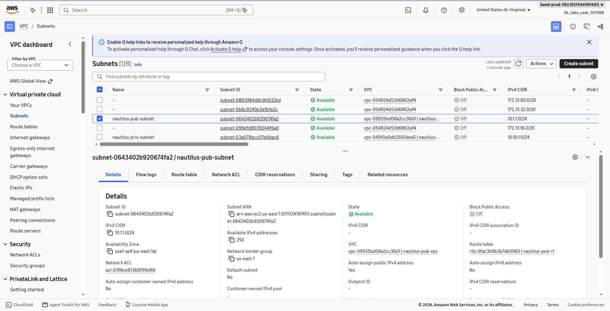

3. **VPC > Internet Gateways:** Verified `nautilus-pub-igw` shows **State** as **Attached** to `nautilus-pub-vpc`.

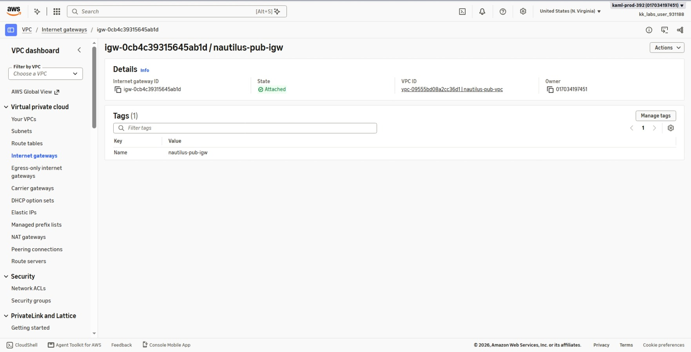

4. **VPC > Route Tables > `nautilus-pub-rt`:** Verified routes show `0.0.0.0/0` targeting the Internet Gateway and `10.10.0.0/16` targeting `pcx-06c81147fb84da751`, with `nautilus-pub-subnet` listed under Subnet associations.

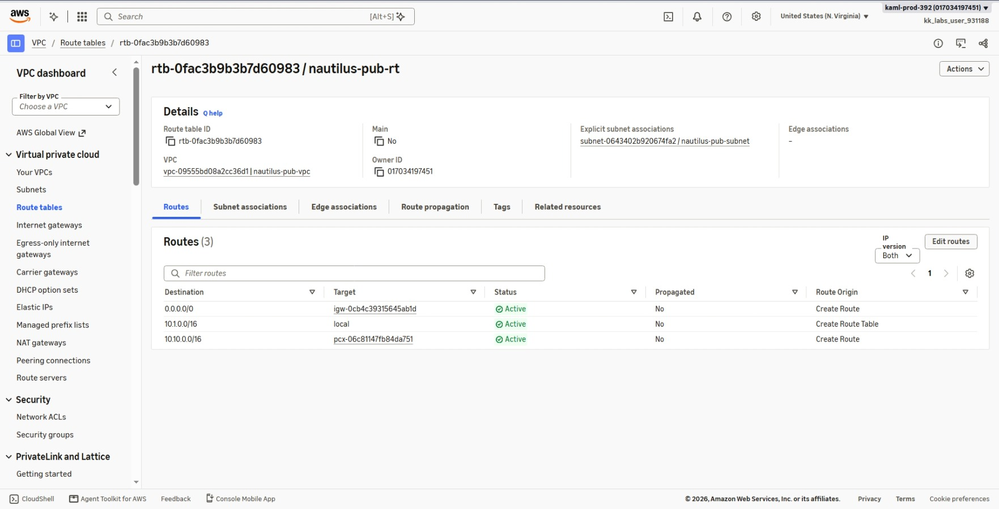

5. **VPC > Route Tables > `nautilus-priv-rt`:** Verified routes show `10.1.0.0/16` targeting `pcx-06c81147fb84da751`.

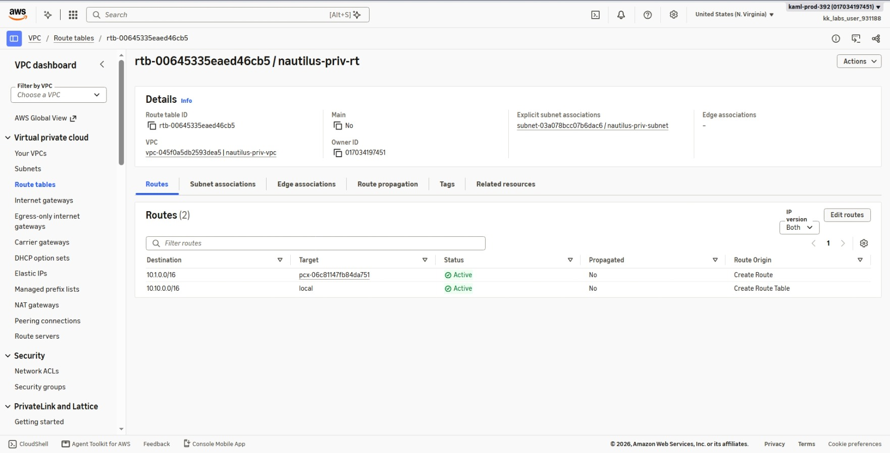

6. **VPC > Peering Connections:** Confirmed `nautilus-vpc-peering` displays status **Active**.

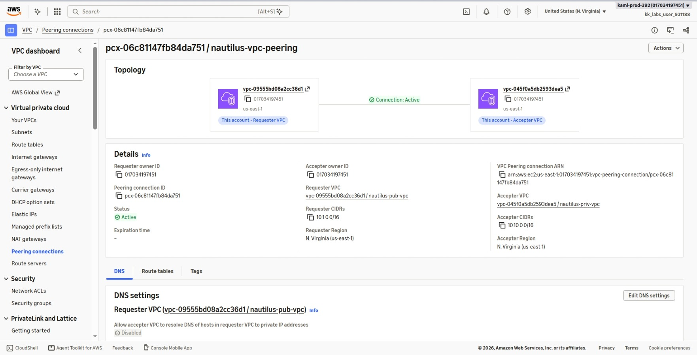

7. **EC2 > Instances:** Verified `nautilus-pub-ec2` is **Running** in `nautilus-pub-subnet` with a public IP and displays `nautilus-s3-role` under the **Security** tab.

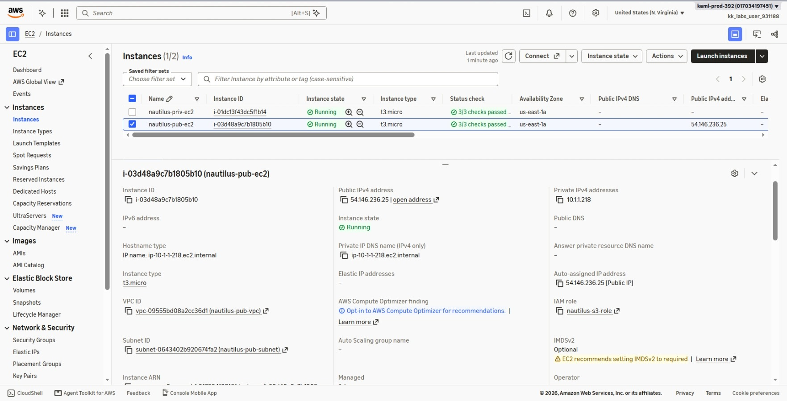

8. **IAM > Roles > `nautilus-s3-role`:** Verified the attached policy `nautilus-s3-putobject` grants strictly `s3:PutObject` on `arn:aws:s3:::nautilus-s3-logs-943437996/*`.

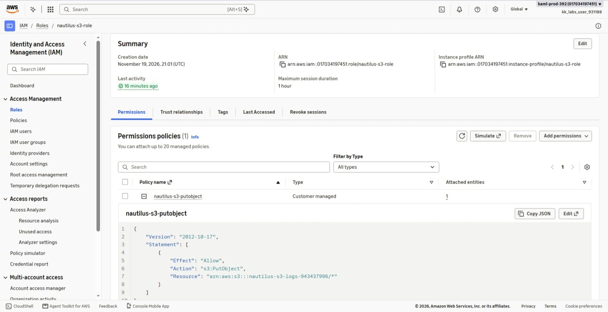

9. **Amazon S3 > `nautilus-s3-logs-943437996`:** Verified **Block all public access** is enabled and confirmed that `nautilus-priv-vpc/boot/boots.log` exists inside the bucket.

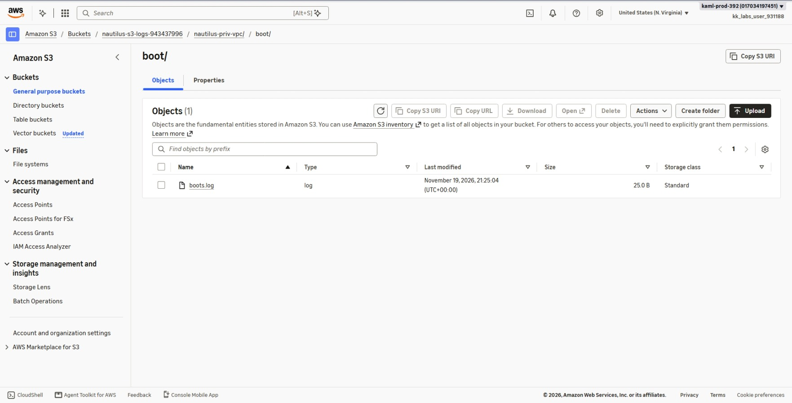

## Result
I verified that the centralized log shipping pipeline is fully operational. The private instance `nautilus-priv-ec2` ships `/var/log/boots.log` over `nautilus-vpc-peering` to `nautilus-pub-ec2`, which then pushes the file securely into the private S3 bucket under `nautilus-priv-vpc/boot/boots.log` using its attached IAM role.

## Screenshots
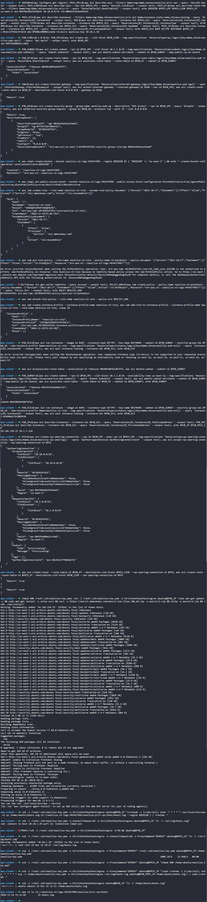