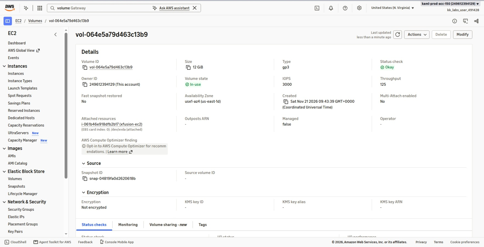
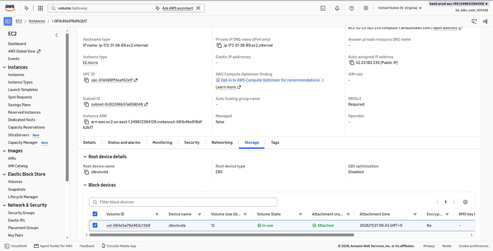
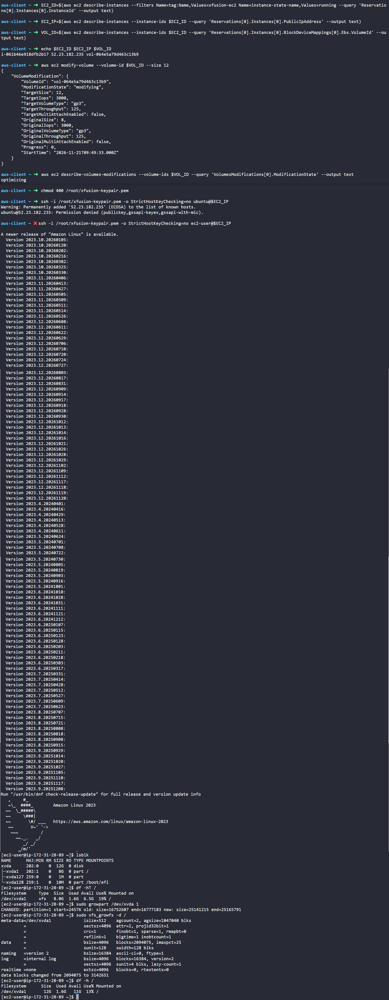

# Day 50: Expanding EC2 Instance Storage for Development Needs

## Objective
The objective is to expand the attached EBS root volume of a running Amazon EC2 instance named `xfusion-ec2` from 8 GiB to 12 GiB using the AWS CLI and Linux disk utilities. I modified the volume size in AWS without stopping the instance, extended the root partition using `growpart`, expanded the XFS filesystem using `xfs_growfs`, and verified the updated storage both on the server and in the AWS Management Console.

## 1. EBS Volume Expansion

Modern AWS EBS volumes support Elastic Volumes, which allows modifying storage capacity, volume type, and performance attributes while the volume is actively attached and serving data.

### The 3 Layers of Disk Expansion
Expanding disk space on a live Linux server requires updating three separate layers in order:

1. **AWS Storage Layer (The Virtual Disk):** I request AWS to increase the block storage volume from 8 GiB to 12 GiB (`modify-volume`). AWS resizes the underlying virtual drive immediately, transitioning to `modifying` and then `optimizing`.
2. **Partition Table Layer (The Slices):** Although the virtual hard drive (`xvda`) is now 12 GiB, the root partition (`xvda1`) inside Linux is still defined to end at 8 GiB. I use the `growpart` utility to rewrite the partition table and stretch partition 1 across the new free space.
3. **Filesystem Layer (The Formatting):** The partition is now larger, but the filesystem structure on top of it (XFS or ext4) does not know about the extra blocks yet. I use `xfs_growfs` (for XFS filesystems) or `resize2fs` (for ext4 filesystems) to extend the filesystem online without unmounting the disk or rebooting the server.

## 2. Order of Steps

To expand the storage without downtime, I followed these steps in order:

1. **Find Instance and Volume Details:** Retrieve the instance ID, public IP, and attached root volume ID of `xfusion-ec2`.
2. **Modify Volume in AWS:** Increase the volume size to 12 GiB using `aws ec2 modify-volume`.
3. **Verify Volume Modification State:** Confirm the state moves to `optimizing`.
4. **SSH into the EC2 Instance:** Set permissions on `/root/xfusion-keypair.pem` (`chmod 400`) and log in as `ec2-user`.
5. **Inspect Disk and Filesystem:** Run `lsblk` and `df -hT` to check the disk name, partition layout, and filesystem type (`xfs`).
6. **Extend Partition:** Run `growpart /dev/xvda 1` to expand partition 1.
7. **Expand Filesystem:** Run `xfs_growfs -d /` to resize the filesystem across the new partition boundaries.
8. **Verify Usable Space:** Confirm the root mount `/` reflects 12 GiB via `df -h` and the AWS Management Console.

## 3. Command Execution

### Step 1: Collect Instance and Volume IDs
I retrieved the EC2 instance ID, public IP address, and attached root EBS volume ID:

```bash
EC2_ID=$(aws ec2 describe-instances \
  --filters Name=tag:Name,Values=xfusion-ec2 Name=instance-state-name,Values=running \
  --query 'Reservations[0].Instances[0].InstanceId' \
  --output text)

EC2_IP=$(aws ec2 describe-instances \
  --instance-ids $EC2_ID \
  --query 'Reservations[0].Instances[0].PublicIpAddress' \
  --output text)

VOL_ID=$(aws ec2 describe-instances \
  --instance-ids $EC2_ID \
  --query 'Reservations[0].Instances[0].BlockDeviceMappings[0].Ebs.VolumeId' \
  --output text)

echo $EC2_ID $EC2_IP $VOL_ID
```

Values found:
* **Instance ID:** `i-061b46e918dfb2b17`
* **Public IP:** `52.23.182.235`
* **Volume ID:** `vol-064e5a79d463c13b9`

### Step 2: Expand the Volume in AWS
I modified the EBS volume size from 8 GiB to 12 GiB:

```bash
aws ec2 modify-volume \
  --volume-id $VOL_ID \
  --size 12
```

### Argument Breakdown:
* `modify-volume`: Requests an online change to an existing EBS volume.
* `--volume-id vol-064e5a79d463c13b9`: Targets the root volume of `xfusion-ec2`.
* `--size 12`: Sets the new target capacity in GiB.

I monitored the modification state until AWS started optimizing the disk:

```bash
aws ec2 describe-volumes-modifications \
  --volume-ids $VOL_ID \
  --query 'VolumesModifications[0].ModificationState' \
  --output text
```

Output: `optimizing`

### Step 3: Connect via SSH to the Server
I configured the key permissions and logged into the server:

```bash
chmod 400 /root/xfusion-keypair.pem

ssh -i /root/xfusion-keypair.pem \
  -o StrictHostKeyChecking=no \
  ec2-user@$EC2_IP
```

### Step 4: Check Disk and Filesystem Layout (Inside the Instance)
I ran `lsblk` and `df -hT` to check the current disk allocation:

```bash
# Check block devices
lsblk

# Check filesystem type and current mount size
df -hT /
```

Output:
```text
NAME      MAJ:MIN RM SIZE RO TYPE MOUNTPOINTS
xvda      202:0    0  12G  0 disk 
├─xvda1   202:1    0   8G  0 part /
├─xvda127 259:0    0   1M  0 part 
└─xvda128 259:1    0  10M  0 part /boot/efi

Filesystem     Type  Size  Used Avail Use% Mounted on
/dev/xvda1     xfs   8.0G  1.6G  6.5G  19% /
```

The output confirmed:
* The virtual disk (`xvda`) is 12 GiB.
* Partition 1 (`xvda1`) is still only 8 GiB.
* The filesystem is `xfs` and only shows 8.0 GiB available.

### Step 5: Extend the Partition
I extended partition 1 to consume the extra 4 GiB of free space on `xvda`:

```bash
sudo growpart /dev/xvda 1
```

Output:
```text
CHANGED: partition=1 start=24576 old: size=16752607 end=16777183 new: size=25141215 end=25165791
```

### Step 6: Expand the XFS Filesystem
Because the filesystem type is XFS, I used `xfs_growfs` to grow the filesystem while mounted:

```bash
sudo xfs_growfs -d /
```

Output confirmed that data blocks grew from `2094075` to `3142651`.

## 4. Troubleshooting Journal (OS Login & Filesystem Identification)

### Issue: Initial SSH Connection Denied
I initially attempted to connect as `ubuntu@$EC2_IP`, which returned `Permission denied (publickey)`.
* **Root Cause:** The instance was launched with Amazon Linux 2023, not Ubuntu.
* **Fix:** I switched the SSH username to `ec2-user`, which immediately connected with `xfusion-keypair.pem`.

### Filesystem Detection
Before resizing filesystems in Linux, it is critical to determine whether the partition is formatted with `ext4` or `xfs`:
* `ext4` uses `resize2fs`.
* `xfs` uses `xfs_growfs`.
Running `df -hT /` showed `Type: xfs`. Running `xfs_growfs -d /` applied the expansion cleanly without errors.

## 5. Dual Verification

### CLI Verification
Inside the instance, I ran `df -h /` to verify the new usable disk space:

```bash
df -h /
```

Output:
```text
Filesystem      Size  Used Avail Use% Mounted on
/dev/xvda1       12G  1.6G   11G  13% /
```

The root partition now shows a total size of **12G** with **11G** available, confirming the extra 4 GiB was absorbed without restarting the server.

### Console UI Verification
I confirmed the updated volume size in the AWS Management Console:

1. **EC2 > Elastic Block Store > Volumes:** Selected the volume (`vol-064e5a79d463c13b9`) and verified the **Size** column displays **12 GiB** and **Volume state** is **In-use**.



2. **EC2 > Instances > `xfusion-ec2` (Storage Tab):** Inspected the **Block devices** section for the root device and verified it displays **12 GiB**.



## Result
I verified that the attached EBS root volume for `xfusion-ec2` was expanded from 8 GiB to 12 GiB in `us-east-1`. Using `growpart` and `xfs_growfs`, I grew the root partition and XFS filesystem online. Both the Linux terminal output and the AWS Management Console confirm the instance now has 12 GiB of active storage.

This completes the final challenge of the 50-day AWS track in the 100 Days of Cloud challenge.

## Screenshots
